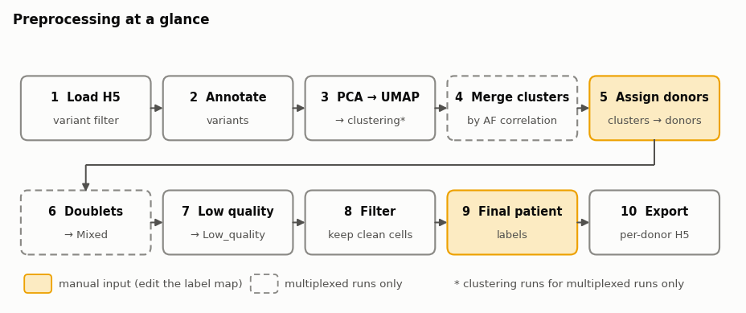
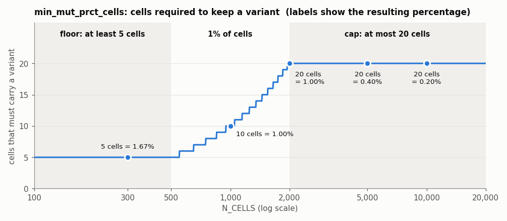
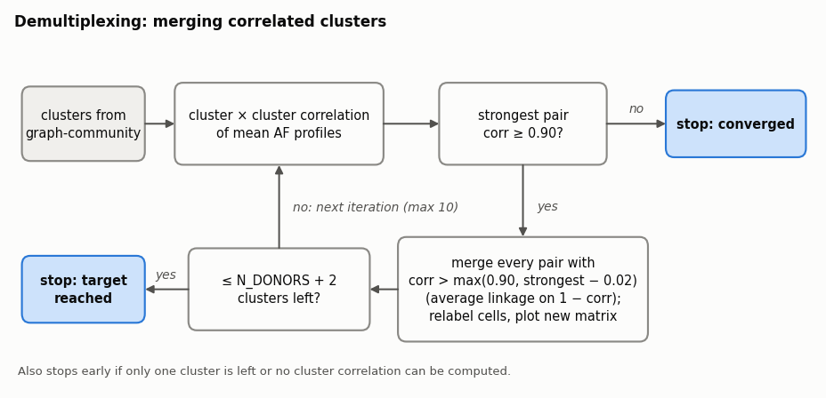
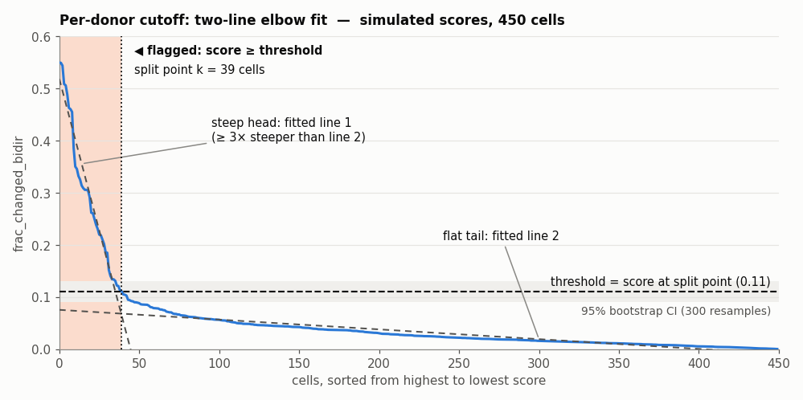
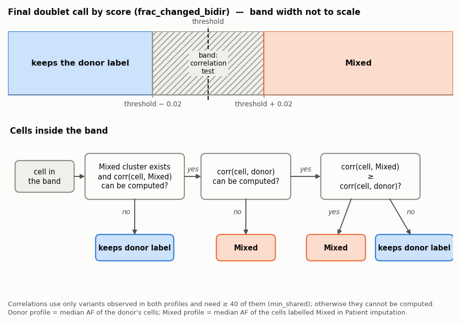
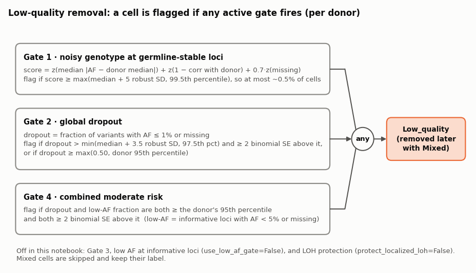

# Preprocessing: method notes

Shared documentation for the notebooks in `01_preprocessing/` (`01_Preprocessing_<experiment>.ipynb`).
It explains what each step does and why, with schematics. Parameter values are the ones set in the notebooks.

All notebooks follow the same template. Per experiment, `EXPERIMENT` and the two label maps differ; pMDS002 clusters with `k=30` instead of 15; MDS012, pMDS001 and pMDS002 look for single-donor H5 files directly in the experiment folder first and set `final_label_map` outside the multiplexed check.
`01_Preprocessing_External.ipynb` differs more: its settings are set in the notebook (no `experiment_config.yml`, no whitelist), it adds a chr4/chr14 translocation screen and reclaims Donor_A's `Mixed` cells after the doublet step, and it exports only the variants that passed the filter (see [Export](#6-export)).

**Contents**
1. [Overview](#1-overview)
2. [Loading data and the variant filter](#2-loading-data-and-the-variant-filter)
3. [Demultiplexing: merging correlated clusters](#3-demultiplexing-merging-correlated-clusters)
4. [Doublet removal](#4-doublet-removal)
5. [Low-quality cell removal](#5-low-quality-cell-removal)
6. [Export](#6-export)
7. [Regenerating the figures](#7-regenerating-the-figures)

---

## 1. Overview

Each notebook demultiplexes and QC-filters one Tapestri run, then exports one H5 file per donor.



| Step | Notebook section | Result |
|---|---|---|
| 1. Load H5 | Load data | `sample` with Mission Bio variant filtering |
| 2. Annotate | Variant annotation | `variant_annotations` |
| 3. PCA → UMAP → clustering | DNA QC | `sample_qc` with UMAP and, for multiplexed runs, cluster labels |
| 4. Merge clusters | Demultiplexing | clusters merged by AF correlation (multiplexed only) |
| 5. Assign donors | Patient imputation | **manual**: cluster labels → `Donor_*` or `Mixed` |
| 6. Doublets | Doublets removal | cross-donor doublets → `Mixed` (multiplexed only) |
| 7. Low quality | Low quality cell removal | degraded cells → `Low_quality` |
| 8. Filter | Propagate QC labels and filter | `filtered_sample` without `Mixed` / `Low_quality` |
| 9. Final labels | Final patient label mapping | **manual**: donor labels → patient identifiers |
| 10. Export | Export filtered samples | one H5 per donor with all raw variants |

---

## 2. Loading data and the variant filter

Variant filter thresholds use Mission Bio defaults (`min_dp=5`, `min_gq=20`, `vaf_ref=5`, `vaf_hom=95`, `vaf_het=30`, `min_prct_cells=50`), except `min_mut_prct_cells`, which scales with experiment size.

`min_mut_prct_cells` is the minimum percentage of cells that must carry a variant for it to be kept. It is set to **1% of cells, clamped to 5–20 cells**, then converted to a percentage of `N_CELLS`:

```python
min_mut_prct_cells = max(5, min(20, round(0.01 * N_CELLS))) * 100 / N_CELLS
```



| `N_CELLS` | 1% of cells | Cells required (5–20) | `min_mut_prct_cells` |
|---:|---:|---:|---:|
| 300 | 3 | **5** (floor) | 1.67% |
| 1,000 | 10 | 10 | 1.00% |
| 2,000 | 20 | 20 | 1.00% |
| 5,000 | 50 | **20** (cap) | 0.40% |
| 10,000 | 100 | **20** (cap) | 0.20% |

- **Floor of 5 cells:** in small runs, 1% would be only 1–4 cells. That is within the range of genotyping noise, allele dropout and doublets, so a variant has to be seen in at least 5 cells.
- **Cap of 20 cells:** in large runs, 1% would require 50–100+ cells and would discard small subclones. Capping at 20 cells keeps any clone of ≥ 20 cells detectable, regardless of run size.
- **In between (500–2,000 cells):** the plain 1% rule applies.

The whitelist variants from `experiment_config.yml` are passed to the loader as `whitelist`; any that are missing from the filtered assay are dropped from `whitelist` and listed in `missing_whitelist_variants.txt`.

---

## 3. Demultiplexing: merging correlated clusters

Graph-community clustering on the UMAP can split one donor into several clusters. Clusters whose mean AF profiles are highly correlated are merged iteratively (multiplexed runs only).



| Parameter | Value | Meaning |
|---|---|---|
| `MERGE_CORR_THRESHOLD` | 0.90 | clusters are never merged below this correlation |
| `MERGE_MARGIN` | 0.02 | each round merges at `max(0.90, strongest − 0.02)` |
| `MAX_ITERATIONS` | 10 | upper bound on merge rounds |
| `TARGET_MAX` | `N_DONORS + 2` | stop once this few clusters are left |

Each iteration:
1. Computes the cluster × cluster Pearson correlation of mean AF profiles. A pair needs at least 20% of variants (minimum 5) observed in both; missing correlations count as 0.
2. Stops if the strongest off-diagonal correlation is below 0.90.
3. Builds an average-linkage tree on distance = 1 − correlation and cuts it at `1 − max(0.90, strongest − 0.02)`.
4. Writes the merged labels back to `sample_qc` and saves the new correlation matrix as `cluster_correlation_iteration_XX.png`.

The remaining clusters are then mapped to donors by hand in *Patient imputation*; clusters that look like mixtures are labelled `Mixed`.

The loop prints a warning if a merge round leaves fewer than `N_DONORS` clusters. The AF heatmap after merging is saved as `AF_heatmap_post_merge.png`.

---

## 4. Doublet removal

A doublet is a droplet that captured two cells. When the two cells come from **different donors**, the cell's AF profile is a mix of both genotypes, so at many variants it no longer matches either donor. This step finds such cells inside each donor cluster and relabels them `Mixed`.
Same-donor doublets have a normal genotype and cannot be detected this way. The step is skipped for single-donor runs.

> **AF scale.** Mosaic stores AF in percent (0–100), but the doublet code applies the cutoffs below as if AF ran from 0 to 1. This section describes what happens on real, percent-scale data. (The low-quality step in §5 does detect the percent scale and rescales its cutoffs.)

### 1. Donor consensus and the variants used

- **Consensus profile**: for each donor, the median AF per variant across that donor's cells.
- **Informative variants**: the code keeps variants whose donor median AF is between 0.10 and 0.90. On percent data that is 0.1–0.9 %, which almost no variant has, so the fallback applies: with fewer than 30 such variants, **all variants are used**.
- **Discriminating variants** (when at least two donors have ≥ 10 cells): variants whose donor median differs by ≥ 0.20 from at least one other donor, i.e. 0.2 percentage points, so essentially every variant whose medians differ between donors (MDS001: 234 of 302). Because the informative set is all variants, loci where this donor is WT are included. If fewer than 5 qualify, all variants are used. The printout reports which mode each donor used.

### 2. Per-cell score

For each cell and each of the $n$ variants in the set, $d_v = AF_{\mathrm{cell},v} - AF_{\mathrm{consensus},v}$ (in %). With $\Delta = 0.30$, i.e. 0.3 percentage points:

$$
\mathrm{frac\_gain} = \frac{\#\{v : d_v \ge \Delta\}}{n},
\qquad
\mathrm{frac\_loss} = \frac{\#\{v : d_v \le -\Delta\}}{n}
$$

The score used for the cutoff is the **bidirectional** fraction:

$$
\mathrm{frac\_changed\_bidir} = 2 \cdot \min(\mathrm{frac\_gain},\ \mathrm{frac\_loss}) \in [0, 1]
$$

**Why both directions?** A doublet of donor A with donor B *gains* AF at variants where B carries more of the alternate allele than A, and *loses* AF where B carries less, so it usually shifts both ways. Taking the minimum means a cell needs gains **and** losses to score: a cell whose shifts all go one way scores 0, however large they are. The factor 2 puts a cell with equal gains and losses on the same scale as the plain fraction of changed variants.

Example, for a donor with 100 discriminating variants:

| Cell | Gains | Losses | Fraction changed | `frac_changed_bidir` | Interpretation |
|---|---:|---:|---:|---:|---|
| Singlet | 3 | 2 | 0.05 | **0.04** | close to the donor consensus |
| A + B doublet | 25 | 30 | 0.55 | **0.50** | shifted in both directions |
| One-sided shift | 35 | 0 | 0.35 | **0.00** | only gains, never flagged here |

**Caveats**
- **Almost any deviation counts.** Because $\Delta$ is 0.3 percentage points, ordinary read-sampling noise at heterozygous sites (e.g. 47 % against a median of 50 %) already counts as a gain or loss. The score therefore measures how often a cell deviates from its donor's median in both directions, and the per-donor elbow below decides how much of that is unusual.
- **Allele dropout looks similar.** Dropout at a heterozygous site removes either allele at random, pushing AF up (towards 100 %) or down (towards 0 %) about equally. Cells with a lot of dropout therefore also score high and can be flagged here. `Mixed` and `Low_quality` cells are both removed, so this changes the label, not which cells are kept.

### 3. Per-donor cutoff

1. Cells are sorted by score from high to low. Most cells form a long flat tail near 0; doublets form a short steep head.
2. Two straight lines are fitted to this curve, trying every split point between 1% and 45% of the cells (`min_frac`, `max_frac`). The split with the lowest fitting error where the head is at least 3× steeper than the tail (`slope_ratio_min`) wins, and the score at that split is the threshold. If no split reaches a 3× ratio, the best-fitting split is used.
3. Cells with score ≥ threshold are flagged.
4. The threshold is recomputed on 300 bootstrap resamples (`n_boot`, seed 42) to give a 95% CI. Cells within half the CI width of the threshold are labelled `Doublet_Borderline` / `Singlet_Borderline` in the returned calls; the others are `*_HighConf`.




Donors with fewer than 20 cells get no threshold and no cells flagged.
For each donor, the plot shows the sorted score curve with the threshold (dashed line), its CI (shaded) and the split point (dotted line), next to an AF heatmap of the cells ordered by score.

### Reassign borderline cells and final doublet calls




The final call uses a fixed band of ±0.02 (`band`) around each donor's threshold:

| Score | Final call |
|---|---|
| ≥ threshold + 0.02 | `Mixed` |
| < threshold − 0.02 | keeps the donor label |
| in between | decided by correlation (below) |

For cells in the band, the cell's AF profile is correlated with the donor consensus and with the median profile of the existing `Mixed` cluster (assigned in *Patient imputation*), using only variants observed in both and at least 40 of them (`min_shared`):
- the cell becomes `Mixed` if it correlates at least as well with `Mixed` as with its donor (`delta_corr = 0`);
- if there is no `Mixed` cluster, or the `Mixed` correlation can't be computed, the cell keeps its donor label;
- if only the donor correlation can't be computed, the cell becomes `Mixed`.

The CI-based borderline labels from the previous step are reported only; this step uses its own ±0.02 band.
New labels are written to the per-donor subsets (`sample_subsets`), not to `sample_qc`; the next cell copies them back. An AF heatmap of the final calls is shown for each donor.

---

## 5. Low-quality cell removal

`DNA_Utils.apply_low_quality_qc` flags cells whose genotype data is degraded (amplicon dropout, noisy AF) and relabels them `Low_quality`. It runs per donor; `Mixed` cells are skipped and keep their label. A cell is flagged if **any** active gate fires.



**Gate 1: noisy genotype at germline-stable loci.** Computed by `flag_amplicon_loss_cells` with its own fixed settings; the notebook's `k_mad` and `q` do not apply here.
- Stable loci: donor median AF in 10–90 % and among the 35% with the lowest spread across the donor's cells. If fewer than 25 qualify, the 50% lowest-spread loci overall are used.
- Three per-cell metrics against the donor median profile: median absolute AF deviation, 1 − Pearson correlation (≥ 20 shared loci), and the fraction of missing values. Each is robust-z scaled and summed with weights 1, 1 and 0.7.
- Flag if the score is ≥ max(median + 5 robust SD, 99.5th percentile). Because of the percentile term, this gate flags at most ~0.5% of a donor's cells. Donors with fewer than 20 cells are skipped.

**Gate 2: global dropout.** `k_mad=3.5`, `q=0.975`, `min_effect_size=2`, `abs_global_dropout=0.50`, `depth_adaptive=True`, `abs_floor_quantile=0.95`.
- Dropout = fraction of all variants with AF ≤ 1 % or missing. This also counts loci where the donor is genuinely WT, so it is only meaningful relative to other cells of the same donor.
- Relative rule: dropout above the lower of (median + 3.5 robust SD) and the 97.5th percentile, **and** at least 2 binomial standard errors above that threshold.
- Absolute rule: dropout ≥ max(0.50, the donor's 95th percentile). When more than 5% of a donor's cells exceed 0.50 (common in multiplexed runs, where many variants belong to other donors), this floor becomes the 95th percentile, so the top ~5% of cells are flagged by this rule alone.
- Donors with fewer than 20 cells use a threshold pooled across donors for the relative rule.

**Gate 4: combined moderate risk.** `combined_quantile=0.95`.
- Low-AF fraction = share of donor-informative loci (donor median AF ≥ 10 %) with AF < 5 % or missing.
- Flag if dropout and low-AF fraction are both ≥ the donor's 95th percentile, and both ≥ 2 binomial standard errors above it.

**Off in this notebook:** Gate 3, low AF at informative loci (`use_low_af_gate=False`), and protection of localized-LOH-like cells (`protect_localized_loh=False`).

**Outputs:** labels are written to `sample_qc` (with `lowq_germline_fail` and `lowq_germline_score` row attributes) and copied into `sample_subsets`. AF heatmaps are saved as `AF_lowq_global.png` and `AF_lowq_<donor>.png` in `results/demultiplexing/<EXPERIMENT>/`.

After the checkpoint, *Propagate QC labels and filter* copies the labels back into `sample_qc` and keeps only cells that are not `Mixed` or `Low_quality`.

---

## 6. Export

The raw H5 is reloaded **without variant filtering**, so each exported file keeps every raw variant (except in the External notebook, which exports from `filtered_sample` and so keeps only filtered variants). Cell-to-donor assignment comes from `filtered_sample`.
Assigned barcodes missing from the raw H5 are dropped with a warning, and saving is retried once after removing any partial file.

```text
processed_data/h5/<EXPERIMENT>/
├── multiplexed/                          input H5 (multiplexed runs)
├── demultiplexed/<donor>/                output, multiplexed runs
│   └── <donor>_protein_unfiltered.dna+protein.h5
└── <donor>/                              output, single-donor runs
    └── <donor>_protein_unfiltered.dna+protein.h5

results/
├── demultiplexing/<EXPERIMENT>/          figures and tables from this notebook
└── per_sample/<EXPERIMENT>/<donor>/      empty folders for the downstream notebooks
    ├── dna_cnv/
    │   ├── variants/{somatic,germline,informative,whitelist}_variants/
    │   ├── phylogeny/
    │   ├── clonotypes/{allele_frequencies,ploidy}/
    │   └── matrices/
    └── protein/{matrices,annotation}/
```

Single-donor runs read their input H5 from the first subfolder of `processed_data/h5/<EXPERIMENT>/` (MDS012, pMDS001 and pMDS002 first use `.h5` files placed directly in that folder, if any). All output folders are created if missing.

---

## 7. Regenerating the figures

The PNGs in `docs_figures/` are drawn by two scripts in the same folder (run with the `mosaic` conda environment, `~/miniconda3/envs/mosaic`):

```bash
python docs_figures/pipeline_figures.py docs_figures
python docs_figures/doublet_figures.py docs_figures "<path/to/pipelines>"
```

`doublet_figures.py` runs `DNA_Utils.piecewise_elbow_threshold` on simulated scores, so it needs the pipelines folder.
