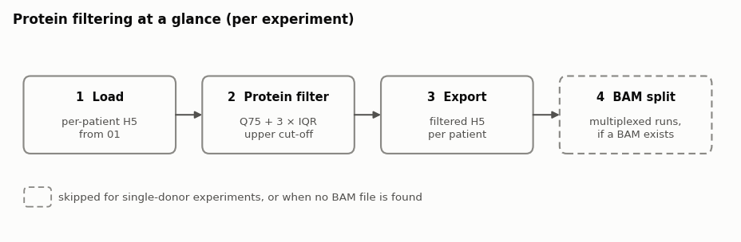
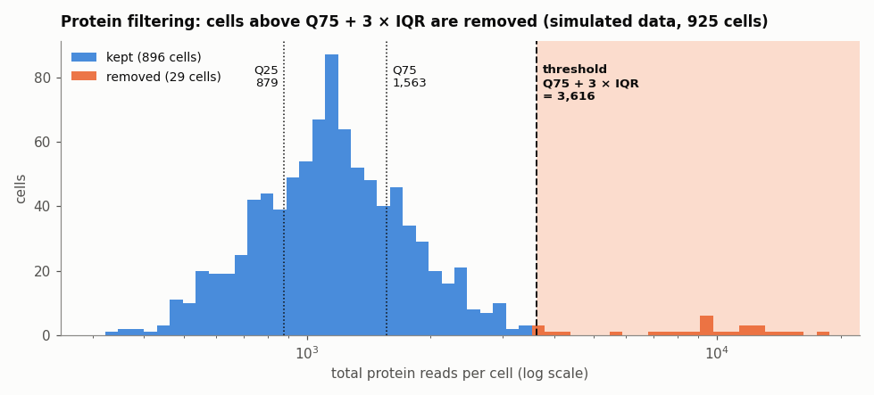
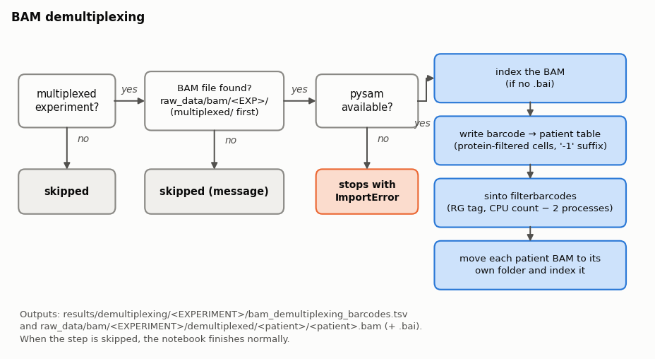

# Protein filtering: method notes

Shared documentation for the notebooks in `02_protein_filtering/` (`02_Protein_Filtering_<experiment>.ipynb`).
It explains what each step does, with schematics. Parameter values are the ones set in the notebooks.

All notebooks are identical apart from `EXPERIMENT`. They run after the 01 preprocessing notebooks and use their per-patient exports.

**Contents**
1. [Overview](#1-overview)
2. [Inputs](#2-inputs)
3. [Protein filtering](#3-protein-filtering)
4. [Export](#4-export)
5. [BAM demultiplexing](#5-bam-demultiplexing)
6. [Outputs](#6-outputs)
7. [Regenerating the figures](#7-regenerating-the-figures)

---

## 1. Overview

Each notebook takes the per-patient H5 files exported by the 01 notebook for one experiment, removes cells with abnormally high protein counts, saves the filtered files, and splits the experiment's BAM file by patient.



| Step | Notebook section | Result |
|---|---|---|
| 1. Load | Load per-patient H5 files | one Mosaic sample per patient, all cells and variants |
| 2. Protein filter | Protein filtering | cells with abnormally high total protein reads removed |
| 3. Export | Export protein-filtered H5 | `<patient>_protein_filtered.dna+protein.h5` per patient |
| 4. BAM split | BAM demultiplexing | one BAM per patient (multiplexed experiments with a BAM file only) |

The settings at the top of each notebook:

| Setting | Meaning |
|---|---|
| `EXPERIMENT` | experiment folder name under `metadata/` and `processed_data/h5/` |
| `SKIP_CHECK` | `True` skips the interactive confirmation after the violin plots |
| `SINTO_BIN` | path to the `sinto` program used for BAM demultiplexing |

Whether the experiment is multiplexed is read from `metadata/<EXPERIMENT>/experiment_config.yml`.

---

## 2. Inputs

The notebook reads every patient folder written by the 01 export:

| Experiment | Folder searched |
|---|---|
| Multiplexed | `processed_data/h5/<EXPERIMENT>/demultiplexed/<patient>/` |
| Single donor | `processed_data/h5/<EXPERIMENT>/<patient>/` |

In each folder it loads the first `.h5` file whose name contains `protein_unfiltered`, or any `.h5` file if none does. Folders without an H5 file are skipped. All variants and cells are loaded.

> **Note:** every subfolder found is treated as a patient. For single-donor experiments, make sure `processed_data/h5/<EXPERIMENT>/` contains only patient folders.

---

## 3. Protein filtering

Cells with far more protein reads than the rest of the patient's cells are removed. These are likely debris or cell aggregates. Each patient is filtered separately.

1. **Total protein reads per cell**: the sum of the protein read counts across all antibodies.
2. **Threshold**: Q75 + 3 × IQR of those totals, where Q25 and Q75 are the 25th and 75th percentiles and IQR = Q75 − Q25.
3. **Filter**: cells with totals above the threshold are removed. There is no lower cut-off.



Example, for a patient with Q25 = 900 and Q75 = 1,500 reads:

| | Value |
|---|---:|
| IQR = Q75 − Q25 | 600 |
| Threshold = Q75 + 3 × IQR | 3,300 |
| Cells kept | total reads ≤ 3,300 |

For each patient the notebook prints the cell counts and the threshold, and shows violin plots of total reads before and after filtering. Patients without a protein assay are kept unchanged.

⚠️ **Checkpoint:** inspect the violin plots before continuing (skipped when `SKIP_CHECK = True`).

---

## 4. Export

Each patient's filtered data is saved as `<patient>_protein_filtered.dna+protein.h5`, in the same folder as its unfiltered file. If saving fails, any partial file is removed and the save is tried once more.

---

## 5. BAM demultiplexing

For multiplexed experiments, the experiment's BAM file (all patients together) is split into one BAM file per patient, using the cells kept by the protein filter.



The step is **skipped**, with a message, for single-donor experiments and when no BAM file is found. The notebook then continues normally.

When a BAM file is found:
1. The first `.bam` file in `raw_data/bam/<EXPERIMENT>/multiplexed/` is used (or in `raw_data/bam/<EXPERIMENT>/` if that subfolder does not exist). It is indexed if no `.bai` file exists.
2. A barcode → patient table is written to `results/demultiplexing/<EXPERIMENT>/bam_demultiplexing_barcodes.tsv`, listing the protein-filtered cells. A `-1` suffix is added to barcodes that lack it, as `sinto` expects.
3. `sinto filterbarcodes` splits the BAM by the `RG` tag, using (number of CPUs − 2) processes, into `raw_data/bam/<EXPERIMENT>/demultiplexed/`.
4. Each patient's BAM is moved into its own folder, `demultiplexed/<patient>/<patient>.bam`, and indexed.

Requirements: `pysam` (the notebook stops with an error if it is missing and a BAM file is found) and the `sinto` program at `SINTO_BIN`.

---

## 6. Outputs

```text
processed_data/h5/<EXPERIMENT>/
└── demultiplexed/<patient>/                        (multiplexed; single donor: <EXPERIMENT>/<patient>/)
    ├── <patient>_protein_unfiltered.dna+protein.h5 input, from the 01 notebook
    └── <patient>_protein_filtered.dna+protein.h5   output of this notebook

results/demultiplexing/<EXPERIMENT>/
└── bam_demultiplexing_barcodes.tsv                 barcode → patient (BAM step only)

raw_data/bam/<EXPERIMENT>/demultiplexed/<patient>/
└── <patient>.bam, <patient>.bam.bai                per-patient BAM (BAM step only)
```

---

## 7. Regenerating the figures

The PNGs in `docs_figures/` are drawn by `docs_figures/protein_figures.py` (run with the `mosaic` conda environment, `~/miniconda3/envs/mosaic`):

```bash
python docs_figures/protein_figures.py
```

The threshold figure uses simulated data.
