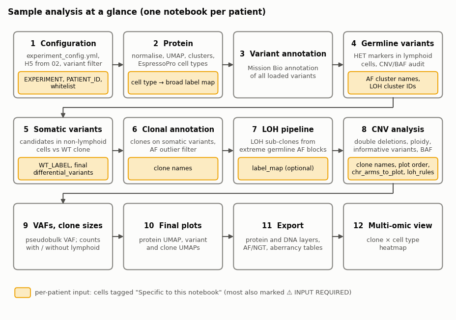
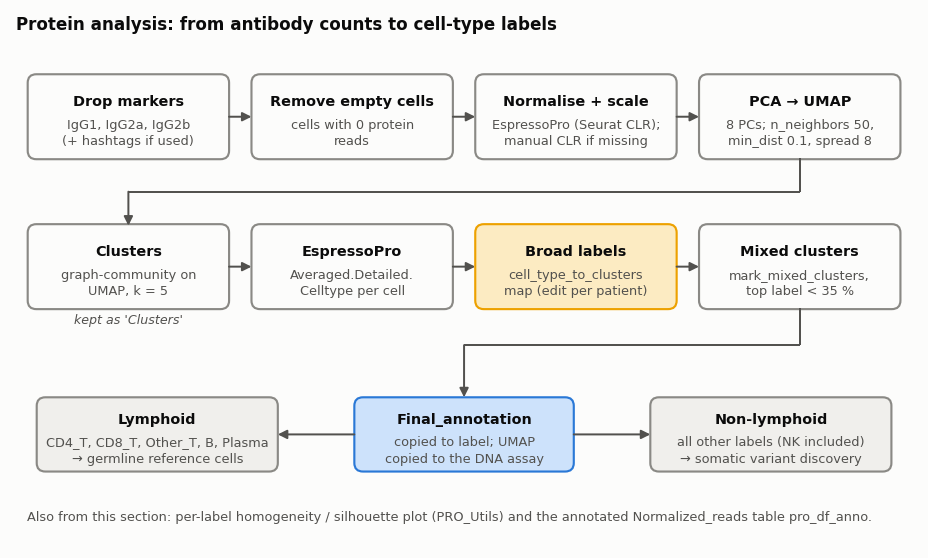
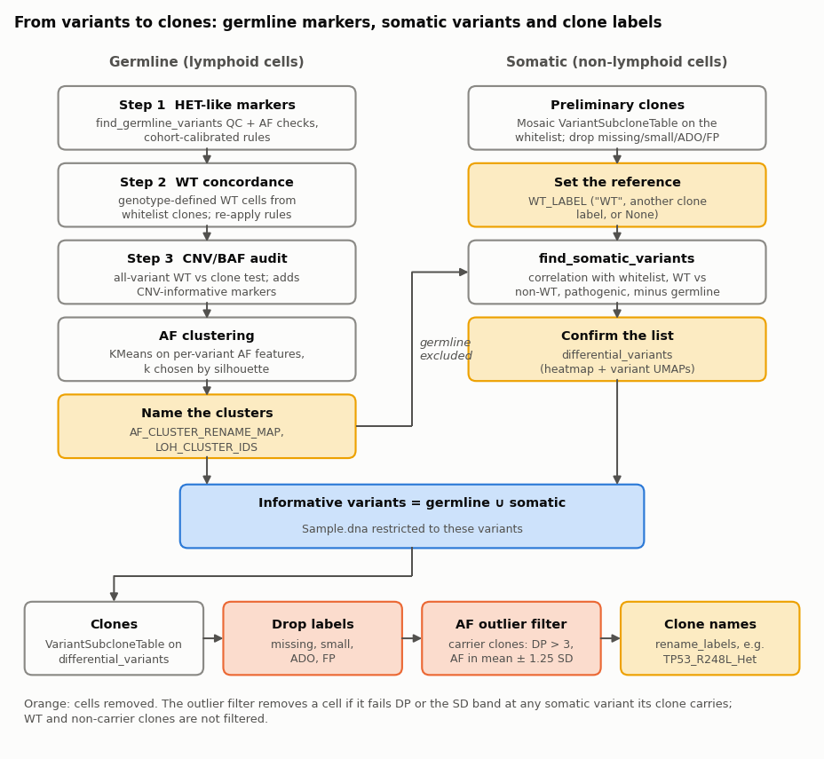
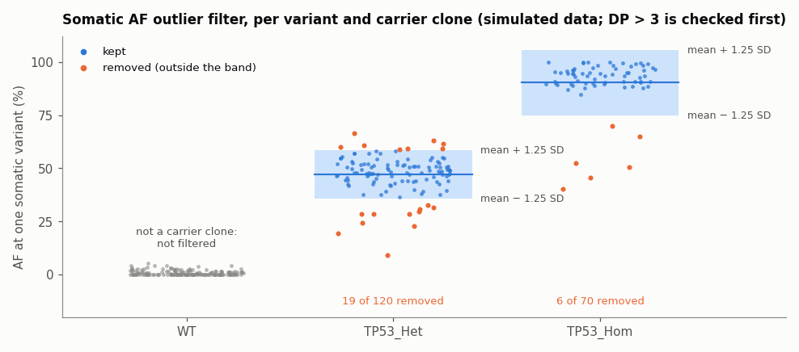
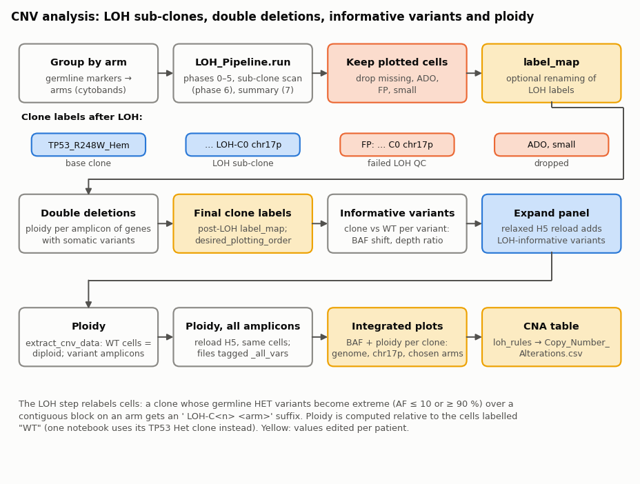

# Sample analysis: method notes

Shared documentation for the notebooks in `03_sample_analysis/` (`03_Sample_Analysis_<EXPERIMENT>_<patient>.ipynb`).
It explains what each section does, with schematics. Parameter values are the ones set in the notebooks.

Each notebook analyses one patient. It runs after the 01 preprocessing and 02 protein filtering notebooks and starts from the patient's protein-filtered H5 file. It annotates cell types from the protein data, selects germline and somatic variants, defines genotype clones, adds LOH and copy-number information, and exports per-clone tables and figures.

All notebooks share one structure. Cells whose values differ between patients (settings, label maps, variant lists, extra plots) have a markdown cell tagged *Specific to this notebook.* directly above them; the most important ones are also marked ⚠️ **INPUT REQUIRED**. Search for that tag to see what was set by hand for a patient.

**Contents**
1. [Overview](#1-overview)
2. [Configuration and inputs](#2-configuration-and-inputs)
3. [Protein analysis](#3-protein-analysis)
4. [Variant annotation](#4-variant-annotation)
5. [Germline variants](#5-germline-variants)
6. [Differential (somatic) variants](#6-differential-somatic-variants)
7. [Clonal annotation](#7-clonal-annotation)
8. [CNV analysis](#8-cnv-analysis)
9. [VAFs and clone sizes](#9-vafs-and-clone-sizes)
10. [Final plots](#10-final-plots)
11. [Export](#11-export)
12. [Multi-omic view](#12-multi-omic-view)
13. [Requirements](#13-requirements)
14. [Outputs](#14-outputs)
15. [Notebook variants and known quirks](#15-notebook-variants-and-known-quirks)
16. [Regenerating the figures](#16-regenerating-the-figures)

Pipeline functions are documented in the package READMEs under `scripts/pipelines/` (project root): [DNA_Utils](../../scripts/pipelines/DNA_Utils/README.md), [CNV_Utils](../../scripts/pipelines/CNV_Utils/README.md), [LOH_Pipeline](../../scripts/pipelines/LOH_Pipeline/README.md) and [PRO_Utils](../../scripts/pipelines/PRO_Utils/README.md). This page only says which function is called, with which values, and why.

---

## 1. Overview



| Step | Notebook section | Result |
|---|---|---|
| 1. Configure and load | Configuration; Resolve paths and load data | `Sample` (DNA, CNV, protein) with Mosaic variant filtering; `Sample_backup` |
| 2. Cell types | Protein analysis | `Final_annotation` per cell; protein UMAP copied to the DNA assay |
| 3. Annotate | Variant annotation | gene / protein / ClinVar columns on every loaded variant |
| 4. Germline | Germline variant identification | `filtered_germline_variants` (HET markers for LOH / CNV) |
| 5. Somatic | Differential (somatic) variant identification | `differential_variants` (**manual** final list) |
| 6. Clones | Clonal annotation | genotype clone per cell, AF outliers removed, **manual** clone names |
| 7. LOH | CNV analysis: LOH pipeline | clones split into LOH sub-clones (` LOH-C<n> <arm>`) |
| 8. CNV | CNV analysis: double deletions, visualisation, integrated plot | ploidy per clone, LOH-informative variants, BAF / ploidy figures, `Copy_Number_Alterations.csv` |
| 9. Sizes | VAFs and clone sizes | pseudobulk VAF and clone counts |
| 10. Figures | Final plots | protein, variant and clone UMAPs |
| 11. Export | Export | protein and DNA layers, AF / NGT tables, `All_aberrancies.csv` |
| 12. Multi-omic | Multi-omic view | clone × cell-type heatmap |

The manual inputs are summarised here and repeated in each section:

| Where | What to edit |
|---|---|
| Configuration | `EXPERIMENT`, `PATIENT_ID`; the patient's `whitelist` (somatic driver variants) |
| Cluster relabelling | `cell_type_to_clusters`: EspressoPro cell types → broad labels |
| Germline | `AF_CLUSTER_RENAME_MAP` and `LOH_CLUSTER_IDS` after inspecting the AF clusters |
| Somatic | `WT_LABEL`; the final `differential_variants` list |
| Clonal annotation | preliminary clone renaming (optional); `rename_labels` map with biological clone names |
| LOH pipeline | `label_map` for LOH labels (optional) |
| CNV | post-LOH `label_map`, `desired_plotting_order`, `chr_arms_to_plot`, `rename_map`, `loh_rules` |

---

## 2. Configuration and inputs

| Setting | Value / source | Meaning |
|---|---|---|
| `EXPERIMENT`, `PATIENT_ID` | set per notebook | experiment folder and patient folder name |
| `SKIP_CHECK` | `True` | not used further in the current notebooks |
| `IS_MULTIPLEXED` | `experiment_config.yml` (`multiplexed`) | where the H5 is searched |
| `GENOME_BUILD` | `experiment_config.yml` (`genome_build`, default `hg19`) | |
| `whitelist` | `experiment_config.yml`, then **overwritten** per patient | the patient's somatic driver variants |
| `germline_whitelist` | file named by `germline_whitelist` in the config (fallback `resources/common_mutations/Panel_6046_common_HET_variants.txt` or `Panel_8126_...`) | known common HET variants; one ID per line, `#` lines ignored |

The H5 file is the first `.h5` containing `protein_filtered` in `processed_data/h5/<EXPERIMENT>/demultiplexed/<patient>/` (multiplexed) or `processed_data/h5/<EXPERIMENT>/<patient>/` (single donor), falling back to the first `.h5` in that folder. `results/per_sample/<EXPERIMENT>/<patient>/protein/` and `.../dna_cnv/` are created if missing.

**Whitelist check** (most notebooks). The H5 is loaded once with the config whitelist, and for each whitelist variant the notebook reports the % of cells genotyped and the % of genotyped cells that are mutant (bar plot and table). The notebook stops with a `ValueError` if none of the whitelist variants is in the loaded data.

⚠️ **Manual input:** the cell after the whitelist check sets `whitelist = [...]` for the patient (e.g. `['chr17:7577538:C/A', 'chr17:7577506:C/A']`). It is used for loading, for preliminary clones and as the protected set in somatic calling.

**Loading.** `ms.load(H5_PATH, filter_variants=True, filter_cells=False, ...)` with `whitelist + germline_whitelist` always kept:

| Parameter | Value |
|---|---|
| `min_dp`, `min_gq` | 10, 20 |
| `vaf_ref`, `vaf_hom`, `vaf_het` | 5, 95, 30 |
| `min_prct_cells` | 50 |
| `min_mut_prct_cells` | `max(5, min(20, round(0.01 × N_CELLS))) × 100 / N_CELLS` (1% of cells, clamped to 5–20 cells; see the [01 notes](../01_preprocessing/README.md#2-loading-data-and-the-variant-filter)) |
| `iterations`, `n_cores` | 10, all CPUs − 1 |

`min_dp` is 10 here, against 5 in the 01 notebooks. A shallow copy is kept as `Sample_backup` and is used later for the all-variant CNV steps. Seeds: `PYTHONHASHSEED=42`, `random` / NumPy seeded with 42 (123 before each protein step).

---

## 3. Protein analysis



1. **Markers.** `IgG1`, `IgG2a` and `IgG2b` (isotype controls) are dropped; hashtag antibodies too in the hashtag notebooks (see [§15](#15-notebook-variants-and-known-quirks)). Cells with no protein reads are removed from the whole `Sample`.
2. **Normalisation.** EspressoPro CLR normalisation (`flavor="seurat"`, layer `Normalized_reads`) and z-scaling (`Scaled_reads`). Without EspressoPro, a manual CLR (`log1p(count / geometric mean of the cell)`) and per-marker z-score are used.
3. **Embedding.** PCA on `Scaled_reads` (8 components, randomized SVD), UMAP on the PCs (`n_neighbors=50`, `min_dist=0.1`, `spread=8`), graph-community clustering on the UMAP (`k=5`). The cluster labels are saved as `Clusters`.
4. **Cell types.** `ep.generate_predictions` and `ep.annotate_data` give `Averaged.Detailed.Celltype` per cell (EspressoPro downloads its models on first use; see [§13](#13-requirements)).
5. ⚠️ **Manual input: `cell_type_to_clusters`.** Maps detailed cell types to broad labels, e.g. `CD4_T: [CD4_T_Naive, CD4_T_Memory, Treg, CD4_CTL]`, `Progenitor: [GMP, MkP, MEP, EoBaMaP, Pre-Pro-B, Pro-B]`, `Other: [Small, Mixed]`. Unmapped types keep their name. The result is `Final_annotation` (also written to `label`).
6. **Mixed clusters.** `ep.mark_mixed_clusters(..., cluster_col="Clusters", min_frequency_threshold=0.35)` is meant to relabel clusters whose most frequent label is below 35% as `Mixed` (see the caveat in [§15](#15-notebook-variants-and-known-quirks)).
7. The protein UMAP is copied to `Sample.dna.row_attrs['umap']` for all later DNA overlays. A signature map, and a per-label silhouette plot ([`PRO_Utils.plot_protein_homogeneity_silhouette`](../../scripts/pipelines/PRO_Utils/README.md#homogeneity_silhouette)) are shown.

`pro_df_anno` (cells × `Normalized_reads` with `label`) and `pro_df_anno_raw` (raw `read_counts`) are kept for export. The broad labels decide two cell sets used later:

| Set | Labels | Used for |
|---|---|---|
| Lymphoid | `CD4_T`, `CD8_T`, `Other_T`, `B`, `Plasma` | germline reference ([§5](#5-germline-variants)); excluded from somatic calling and from the `_no_lymphoid` clone counts |
| Non-lymphoid | everything else (NK cells included) | somatic variant discovery ([§6](#6-differential-somatic-variants)) |

---

## 4. Variant annotation

All loaded variants are annotated with Mosaic `dna.get_annotations()` in chunks of 1,000 variants (Mission Bio annotation service, network access needed). The annotation table, `merged_annotation_filtered_detected_variants`, is added to the DNA column attributes and is used by the germline, somatic and plotting steps (gene, protein change, ClinVar, function, coding impact).

---

## 5. Germline variants

Germline heterozygous (HET) variants are the markers used to detect LOH and allelic imbalance. They are selected in lymphoid cells, which are assumed to carry no myeloid somatic events, in five calls to [DNA_Utils germline](../../scripts/pipelines/DNA_Utils/README.md#germline):

| Step | Function | Key settings |
|---|---|---|
| 1. HET-like markers | `run_empirical_all_variant_germline_export` | `keep_labels` = the five lymphoid labels; `known_het_variants=germline_whitelist`; `thresholds=get_empirical_cohort_germline_thresholds()`; `descriptive_min_dp=2`, `placement_min_dp=5` |
| 2. WT concordance | `add_wt_concordance_and_finalize_germline` | WT cells from whitelist clones (`max_ado_score=0.8`, `min_clone_cells=5`); `recipe="calibrated_practical_or_confirmed"` |
| 3. CNV/BAF audit | `run_step2_barcode_cnv_audit_pipeline` | all variants of `Sample_backup`, WT vs clone (defaults: p < 0.01, BAF deviation 0.3, depth ratio 0.7 / 1.3, IQR 0.3, ≥ 5 cells) |
| 4. AF clustering | `run_af_clustering_only` | `AF_CLUSTER_ONLY_DEFAULT_PARAMS` (KMeans on per-variant AF features, k by silhouette) |
| 5. Cluster naming | `rename_af_clusters_and_update_filtered_germline` | `preserve_baseline_germline_evidence=True`, `require_baseline_germline_evidence=True` |

In plain terms: step 1 scores every panel variant in lymphoid cells (HET / HOM / WT fractions, AF centred near 50%, not pathogenic or blacklisted, dbSNP / gnomAD common-variant support) and applies cohort-calibrated thresholds. Step 2 checks that the variant also looks HET in the genotype-defined WT cells. Step 3 tests every variant for a clone-specific BAF or depth shift against WT and adds markers that are informative for copy-number changes. Steps 4–5 cluster all variants by their AF profile across clones; a variant stays in the list only if it falls in a cluster named `germline_het` (or an LOH cluster) **and** has independent baseline germline evidence, is a simple SNV, and is not excluded.

⚠️ **Manual input:** after the clustering plots, set
- `AF_CLUSTER_RENAME_MAP`: raw cluster number → `germline_het`, `germline_hom`, `germline_wt` or another name, e.g. `{0: "germline_hom", 1: "germline_het", 2: "germline_wt", 3: "other"}`;
- `LOH_CLUSTER_IDS`: clusters whose AF diverges between clones (LOH candidates), e.g. `[]` if none.

The final list is plotted with `visualize_found_germline_variants` (pseudobulk VAF in lymphoid cells, genome-wide and per chromosome). It is saved once as `germline_variants_provisional_list.csv` (an existing file is not overwritten).

Files: `dna_cnv/variants/germline_variants/` (plots, provisional list) and, outside the per-sample tree, `resources/variants_patterns_tapestri/` (`<EXPERIMENT>_<patient>_variants_germline_data.csv` and three CNV/BAF audit CSVs; see [§13](#13-requirements)).

---

## 6. Differential (somatic) variants

Somatic candidates are searched in non-lymphoid cells only.

1. **Preliminary clones.** Mosaic `VariantSubcloneTable` on the whitelist variants, via [`DNA_Utils.clones_to_dataframe`](../../scripts/pipelines/DNA_Utils/README.md#clones) (`max_ado_score=0.8`, minimum clone size 5 cells expressed as a % of all cells). Cells labelled `missing`, `small`, `ADO` or `FP` are dropped from this subset.
2. ⚠️ **Manual input (optional):** `Sample_subset.dna.rename_labels({...})` to rename the preliminary clones (usually left empty).
3. ⚠️ **Manual input: `WT_LABEL`.** The reference clone for the WT vs non-WT test: `"WT"` (all notebooks), another clone label, or `None` to use all cells.
4. **Candidates.** [`DNA_Utils.find_somatic_variants`](../../scripts/pipelines/DNA_Utils/README.md#somatic) with `always_keep_pathogenic=True`, `pathogenic_bypass_germline_filter=True`: variants correlated with a whitelist variant, variants differing between WT and non-WT cells, and annotated pathogenic variants; the germline list, intronic and synonymous variants are removed (whitelist and pathogenic variants are protected).
5. **Review.** `visualize_found_differential_variants` draws a per-clone AF heatmap (`Differential_significant_variants.png`) and a UMAP grid of carrier cells (`Variant_UMAP_grid.html` in `dna_cnv/clonotypes/`). The candidates with their annotation are written, in discovery order, to `Putative_somatic_variants.csv`.
6. ⚠️ **Manual input: `differential_variants`.** The final somatic list, chosen from the candidates (e.g. `['chr17:7573987:G/A', 'chr17:7577538:C/A', ...]`).

The informative variants are then `filtered_germline_variants ∪ differential_variants`. Their heatmap is saved as `Informative_significant_variants.png`, `Sample.dna` is restricted to them, and the protein labels are re-synced by barcode ([`PRO_Utils.update_protein_labels_from_dataframe`](../../scripts/pipelines/PRO_Utils/README.md#update_labels)).



---

## 7. Clonal annotation

1. **Clones.** `VariantSubcloneTable` on the full `Sample` with `differential_variants` (`max_ado_score=0.8`, minimum 5 cells). `missing`, `ADO`, `FP` and `small` cells are dropped.
2. **AF outlier filter.** [`DNA_Utils.filter_somatic_variant_outliers`](../../scripts/pipelines/DNA_Utils/README.md#filter_outliers) with the clone table as `clone_variant_calls`, `dp_threshold=3`, `sd_k=1.25`. For each somatic variant, only the clones called Het / Hom for it are checked; in each, a cell must have DP > 3 and AF within mean ± 1.25 SD of its clone. A cell is removed if it fails at any variant its clone carries. The remaining cells are intersected with the protein barcodes.



3. Per-clone UMAPs (`Clone_UMAP_<clone>.png`) are saved in `dna_cnv/variants/somatic_variants/` to help naming.
4. ⚠️ **Manual input: clone names.** `Sample.dna.rename_labels({...})`, e.g. `{'3': 'TP53_D259Y_A347V', 'TP53:p.R248L_Het': 'TP53_R248L_Het'}`. Clones renamed to `ADO`, `FP`, `small` or `missing` are dropped. The labels are copied to `Clone` and an AF heatmap by clone is shown.

The names matter downstream: `WT` is the reference for ploidy and informativeness tests, and clone colours in the UMAPs follow the name (`WT`, TP53 `Het`, TP53 `Hem`/`Hom`, other).

---

## 8. CNV analysis



### ALT/REF reads and LOH pipeline

ALT and REF read counts per cell and variant are approximated from AF and DP (`ALT = round(AF/100 × DP)`, `REF = DP − ALT`). The germline markers are grouped by chromosome arm with `CNV_Utils.group_informative_variants_by_chr_arm`, using `resources/references/cytobands.tsv`.

[`LOH_Pipeline.run`](../../scripts/pipelines/LOH_Pipeline/README.md#loh_wrapper) then looks, in each clone and arm, for cells whose germline HET variants become extreme (AF ≤ 10 or ≥ 90) over a contiguous block, and turns them into LOH sub-clones (e.g. `TP53_R248W_Hem LOH-C0 chr17p`, or `... chr5q:q14.3-q33.1` for a localised block). Failed calls become `FP: ...` / `SUB: ...`, cells explained by allele dropout become `ADO`, and terminal labels under 5 cells become `small` ([label conventions](../../scripts/pipelines/LOH_Pipeline/README.md#label-conventions)).

| Setting | Value |
|---|---|
| `build_config` | package defaults, plus `cytobands`, `informative_variants`, `output_dir`, `plot_dropped_clusters=True`, `phase1_show_failed_clones=False` |
| main defaults | extreme AF ≤ 10 / ≥ 90; block ≥ 4 variants on ≥ 3 amplicons; arm extreme fraction ≥ 0.90; clone ≥ 5 cells; correlation ≥ 0.80 |
| `run` | `chr_arms=None` (all arms), `post_phase5_subclone_scan_labels="auto"`, `..._min_parent_cells=5`, `..._merge_back=True`, plotting on (`All_clones_AF`, separate clones) |

⚠️ The markdown asks to configure LOH parameters per sample, but most notebooks use the defaults; one notebook lowers the minimum cell counts to 4.

After the run, only plotted cells are kept, `missing` / `ADO` / `FP` / `small` cells are dropped and the new labels are written to `Clone` and `label`. ⚠️ **Manual input (optional):** `label_map` in that cell renames LOH labels before the drop (e.g. mapping an `FP: ...` label back to its base clone).

### Truncating double deletions

Checks whether a gene carrying a somatic variant has lost copies (e.g. a TP53 deletion on the other allele). `Sample_backup` (all variants) is normalised and ploidy is computed per amplicon relative to the `WT` cells ([`CNV_Utils.extract_cnv_data`](../../scripts/pipelines/CNV_Utils/README.md#cnv_extraction), `diploid_label="WT"`, all amplicons, files tagged `_all_vars`). [`prepare_ploidy_region_plot_inputs`](../../scripts/pipelines/CNV_Utils/README.md#explore_gene_cnv) maps each gene's amplicons to the exons / introns of one RefSeq transcript (`resources/genome/hg19/hg19.ncbiRefSeq.gtf`), and the notebook draws one clone × amplicon ploidy heatmap per gene (colour centred at 2, black below 0.01), with the somatic variants marked above their amplicon. Saved as `clone_amplicon_ploidy_heatmap_<gene>_selected_refseq_exon_intron_order.pdf/.png` in `clonotypes/allele_frequencies/`.

### Final clone labels

A helper cell prints a `label_map = {...}` template with the current labels.

⚠️ **Manual input:**
- `label_map` (post-LOH renaming), e.g. `{'TP53_D259Y_A347V': 'TP53_D259Y_A347V_Het', 'WT': 'WT'}`; labels mapped to `missing` / `ADO` / `FP` / `small` are dropped. The final clone sizes are printed.
- `desired_plotting_order`, e.g. `['WT', 'TP53_R248L_Het', 'TP53_R273H_Het', ...]`. Used by every later plot and table.

### Informative variants and panel expansion

1. AF heatmaps by clone for all informative variants (`Continuous_AF_Single_cell_clones_x_ALL_Informative_Variants`).
2. [`CNV_Utils.test_variant_informativeness`](../../scripts/pipelines/CNV_Utils/README.md#informativeness): for each arm, clone and variant, compares the clone with the `WT` cells (p < 0.01, BAF deviation 0.3, depth ratio < 0.7 deletion / > 1.3 amplification, AF IQR ≤ 0.35, ≥ 5 cells, variant → amplicon map, germline list as reference). Variants informative in any clone form `variable_af_germline`, the others `non_variable_af_germline`. Per-arm results: `wilcoxon_results_<arm>_enhanced.csv`.
3. [`CNV_Utils.expand_informative_variants`](../../scripts/pipelines/CNV_Utils/README.md#informativeness) reloads the H5 with a relaxed variant filter (`min_dp=5`, `min_prct_cells=30`) and keeps extra variants that are informative and pass quality gates: clone call rate ≥ 1st percentile of the current panel (`quality_percentile=1`), median DP ≥ min(p1, 10), mean GQ ≥ min(p1, 50), WT AF inside the p1–p99 range of WT AF over `variable_af_germline` (`require_wt_het=True`), outside the blacklist BED / CSV, not ClinVar pathogenic. `Sample` is replaced by the returned object (original panel + kept variants).
4. ALT/REF and arm groups are rebuilt on all current variants and `test_variant_informativeness` is run again with the germline list extended by the new variants. This second result is the one shown in the integrated plots.

### Ploidy and integrated plots

1. `extract_cnv_data` on `Sample` (ploidy relative to `WT` cells, amplicons of the panel variants) → `Cell_x_ploidy_data.csv`, `Clone_x_ploidy_data.csv`, `Variants_x_ploidy_data.csv`, `Ploidy_metadata.csv` in `clonotypes/ploidy/`.
2. The H5 is reloaded with the standard filter plus the new variants, restricted to the same cells and labels, and `extract_cnv_data` is run on all amplicons → the same four files with `_all_vars`. The clone-median ploidy per amplicon is reshaped to `chr<N>:<end>` columns; amplicons with a WT median of 0 are dropped.
3. [`CNV_Utils.plot_integrated_cnv_baf_with_significance`](../../scripts/pipelines/CNV_Utils/README.md#visualization) draws, per clone, BAF (informative variants highlighted, somatic variants as diamonds) above the ploidy line per cytoband block: genome-wide (`Clones_CNV_BAF_Significant_<clone>.png`), chr17p (`..._chr17p_<clone>.png`) and selected arms (`..._selected_<clone>.png`), all in `dna_cnv/clonotypes/`.

⚠️ **Manual input:**
- `chr_arms_to_plot` for the selected-arms figure (template: `['chr5q', 'chr7q', 'chr17p']`; set to the arms with events in this patient).
- `rename_map`: old → new clone names, used only to find saved images in [§10](#10-final-plots).
- `loh_rules`: `{arm: {clone_label: state}}`, e.g. `{"chr17p": {"TP53_R248W_Hem LOH-C0 chr17p": "cnLOH"}}`. `build_loh_table` writes one column per arm (default `WT`) to `dna_cnv/matrices/Copy_Number_Alterations.csv`. This table is the curated summary of copy-number events per cell and feeds `All_aberrancies.csv`.

---

## 9. VAFs and clone sizes

| Output | Function | File (`dna_cnv/`) |
|---|---|---|
| Pseudobulk VAF, variants × clones | [`DNA_Utils.get_VAF`](../../scripts/pipelines/DNA_Utils/README.md#clones) | `matrices/Pseudobulk_VAFs.csv` |
| Cells per clone | `DNA_Utils.get_clones_size` | `matrices/Clone_absolute_counts.csv`, `clonotypes/Clones_absolute_number.png` |
| % per clone | `get_clones_size(return_percentage=True)` | `matrices/Clone_relative_counts.csv`, `clonotypes/Clones_relative_number.png` |
| Same, without lymphoid cells | `exclude_celltypes=[CD8_T, CD4_T, Other_T, B, Plasma]` | `..._no_lymphoid.csv` / `.png` |

Clones are ordered by `desired_plotting_order`.

---

## 10. Final plots

- Protein UMAP by cell type ([`PRO_Utils.plot_protein_umap`](../../scripts/pipelines/PRO_Utils/README.md#plot_umap)) → `protein/annotation/Protein_UMAP_celltypes.png/.pdf`.
- One UMAP per somatic variant, carriers in black ([`DNA_Utils.plot_somatic_variants`](../../scripts/pipelines/DNA_Utils/README.md#plot_clones)) → `dna_cnv/clonotypes/Variant_UMAP_*.png/.pdf`.
- One UMAP per final clone (`plot_individual_clone_umaps`) → `dna_cnv/clonotypes/Clone_UMAP_<clone>.png/.pdf`.
- For each clone, the selected-arms CNV/BAF figure and the clone UMAP are shown side by side (found by file name, also under the old names in `rename_map`; displayed, not saved).

---

## 11. Export

| File | Content |
|---|---|
| `protein/matrices/protein_read_counts/Filtered/<layer>.csv` | every protein layer (`read_counts`, `Normalized_reads`, `Scaled_reads`, ...) for the final cells, with `label` |
| `.../Filtered/read_counts_all_cells.csv` | `pro_df_anno`: **`Normalized_reads`** of all cells from the protein section, with cell type |
| `.../Filtered/raw_read_counts_all_cells.csv` | raw `read_counts` of the same cells |
| `dna_cnv/matrices/dna_variants/Filtered/<layer>.csv` | every DNA layer (AF, DP, GQ, NGT, ...) for the final cells and variants, with clone `label` |
| `dna_cnv/matrices/Significant_captured_variants_annotation.csv` | annotation of the final variant set (re-queried) |
| `dna_cnv/matrices/AF_` / `NGT_variable_germline_het_mutations.csv` | LOH-informative germline variants (skipped if none) |
| `dna_cnv/matrices/AF_` / `NGT_non_variable_germline_het_mutations.csv` | other germline variants |
| `dna_cnv/matrices/AF_` / `NGT_somatic_mutations.csv` | `differential_variants` |
| `dna_cnv/matrices/All_aberrancies.csv` | somatic AF table joined with the `Copy_Number_Alterations` columns |

The layer files go to the assay's Mosaic name (`protein_read_counts`, `dna_variants`).

---

## 12. Multi-omic view

The DNA clone labels are cross-tabulated with the protein `Final_annotation` on the cells present in both assays, normalised per clone (each row sums to 1), ordered by `desired_plotting_order`, and drawn as a heatmap → `protein/annotation/Clones_Celltype_percentage.png`.

---

## 13. Requirements

**Files read** (all paths relative to the project root; the pipeline packages find the project root from their own location, `<project>/scripts/pipelines/`, or from the `TAPESTRI_PROJECT_ROOT` environment variable):

| File | Used by |
|---|---|
| `metadata/<EXPERIMENT>/experiment_config.yml` | configuration |
| `processed_data/h5/<EXPERIMENT>/[demultiplexed/]<patient>/*protein_filtered*.h5` | all steps (from 02) |
| `resources/common_mutations/Panel_6046_common_HET_variants.txt` or `Panel_8126_common_HET_variants.txt` (or the file named in the config) | germline whitelist |
| `resources/references/cytobands.tsv` | arm grouping, LOH, plots (also read inside the germline CNV audit) |
| `resources/genome/hg19/hg19.ncbiRefSeq.gtf` | exon / intron labels for the double-deletion heatmaps (build hard-coded to `hg19` in that cell) |
| `resources/common_mutations/dbsnp_v155_hg19_common_vars.txt`, `gnomad_genomes_r2.1.1_hg19_common_vars.txt` | common-variant support in germline step 1 (`find_germline_variants` defaults) |
| `resources/blacklists/hg19-blacklist.v2.bed`, `hg19_blacklist_MergedList_Anshul Kundaje_Stanford.csv` | blacklist in germline step 1 (`find_germline_variants` defaults) and in `expand_informative_variants` |

**Files written outside `results/per_sample/`:**
- `resources/variants_patterns_tapestri/`: the per-patient germline table and CNV/BAF audit CSVs. This folder is shared by the cohort and is used to calibrate the germline thresholds.

**Network access:**
- Mosaic `get_annotations()` (variant annotation, called again in Export and inside `expand_informative_variants`): Mission Bio annotation service.
- EspressoPro models: already installed in the Mosaic container, so nothing is downloaded. (Outside the container, EspressoPro downloads them from Hugging Face on the first `generate_predictions` call.)

**Packages:** `missionbio.mosaic`, the four pipeline packages (`scripts/pipelines/`), `itables`, `plotly` with `kaleido` (PNG/PDF export of UMAPs), `seaborn`, `PIL`, `pyyaml`. EspressoPro is optional: without it, normalisation falls back to a manual CLR and cell-type prediction is skipped, but the later steps need the broad labels, so they would have to be set by hand.

---

## 14. Outputs

```text
results/per_sample/<EXPERIMENT>/<patient>/
├── protein/
│   ├── annotation/       Protein_UMAP_celltypes, Clones_Celltype_percentage
│   └── matrices/protein_read_counts/Filtered/
│                         <layer>.csv, read_counts_all_cells.csv, raw_read_counts_all_cells.csv
│                         (+ HTO_*.csv in the hashtag notebooks)
└── dna_cnv/
    ├── variants/
    │   ├── germline_variants/   germline plots, germline_variants_provisional_list.csv
    │   ├── whitelist_variants/  whitelist_pct_genotyped_pct_mutant.pdf / _table.csv (whitelist check)
    │   └── somatic_variants/    Differential_ / Informative_significant_variants, Putative_somatic_variants.csv,
    │                            outlier-filter plots and audits, Clone_UMAP_* (before naming)
    ├── clonotypes/              Variant_UMAP_*, Clone_UMAP_*, Clones_CNV_BAF_Significant[_chr17p|_selected]_<clone>,
    │   │                        clone-size plots
    │   ├── allele_frequencies/  LOH plots (All_clones_AF*), AF heatmaps, wilcoxon_results_<arm>_enhanced.csv,
    │   │                        informativeness_relaxed/, per-gene ploidy heatmaps
    │   └── ploidy/              Cell_ / Clone_ / Variants_x_ploidy_data, Ploidy_metadata, Amplicons_to_variant
    │                            (each also with _all_vars)
    └── matrices/                dna_variants/Filtered/<layer>.csv, Copy_Number_Alterations.csv, Pseudobulk_VAFs.csv,
                                 clone counts, AF_ / NGT_ tables, All_aberrancies.csv,
                                 Significant_captured_variants_annotation.csv
```

The folders are created by the 01 export or by the notebook. Most figures are saved as PNG and PDF.

---

## 15. Notebook variants and known quirks

**How notebooks differ.**
- All notebooks follow the workflow above; the differences are listed below.
- `MDS011_Donor_A`, `MDS011_Donor_B` and `pMDS001_Donor_A` have an **HTO** section: [`PRO_Utils.call_hto_present_absent`](../../scripts/pipelines/PRO_Utils/README.md#hto_calling) on `Hashtag-1` (`uncertain_band=None`, hard positive / negative split), written to `HTO_positive_barcodes.csv`, `HTO_negative_barcodes.csv` and `HTO_calls_all_cells.csv`. The calls are recorded only; cells are not filtered on them. The hashtag antibodies are then dropped from the marker list.
- `MDS003_Donor_B` has no WT clone and uses `TP53_R110H_Het` as the reference (`diploid_label`, `wt_label`).
- Other per-patient additions are extra plots (e.g. more `chr_arms_to_plot` figures) and a different `quality_percentile` (5) in `MDS002_Donor_A`.
- The template (`scripts/templates/03_Sample_Analysis_Template.ipynb`) predates the current workflow (it has the older germline and outlier-filter calls), so new notebooks should be started from a current notebook or the template updated first.

**Behaviour to be aware of** (the code is unchanged):
- `mark_mixed_clusters`: in the EspressoPro version checked, `cluster_col` is ignored for Mosaic samples and the current labels are used as clusters. Because the labels were just set to the broad cell types, every "cluster" is pure and no cell becomes `Mixed`.
- The ploidy heatmaps of the double-deletion step are written to `clonotypes/allele_frequencies/` (the last `OUTPUT_DIR`), not `ploidy/`, and their clone order is arbitrary because `desired_plotting_order` is not set yet.
- `variable_af_germline` / `non_variable_af_germline` come from the first informativeness run, before the panel expansion; the exported `AF_` / `NGT_` germline tables do not include the added variants.
- `read_counts_all_cells.csv` contains normalised values, not read counts (the raw counts are in `raw_read_counts_all_cells.csv`).
- `require_clone_imbalance=False` has no effect on the statistical fallback of `test_variant_informativeness` ([CNV_Utils known quirks](../../scripts/pipelines/CNV_Utils/README.md#known-quirks)).
- `germline_variants_provisional_list.csv` is never overwritten; delete it to refresh it after changing the germline list.
- The empty-table message in the `All_aberrancies` cell mentions germline variants but refers to `df_LOH`.

---

## 16. Regenerating the figures

The PNGs in `docs_figures/` are drawn by `docs_figures/sample_figures.py` (run with the `mosaic` conda environment, `~/miniconda3/envs/mosaic`):

```bash
python docs_figures/sample_figures.py
```

The outlier-filter figure uses simulated data; the others are schematics.
