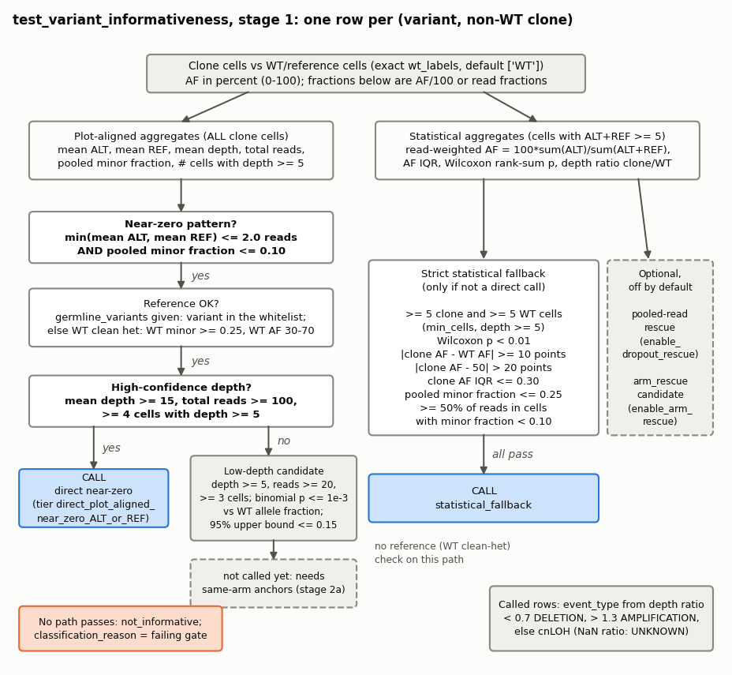
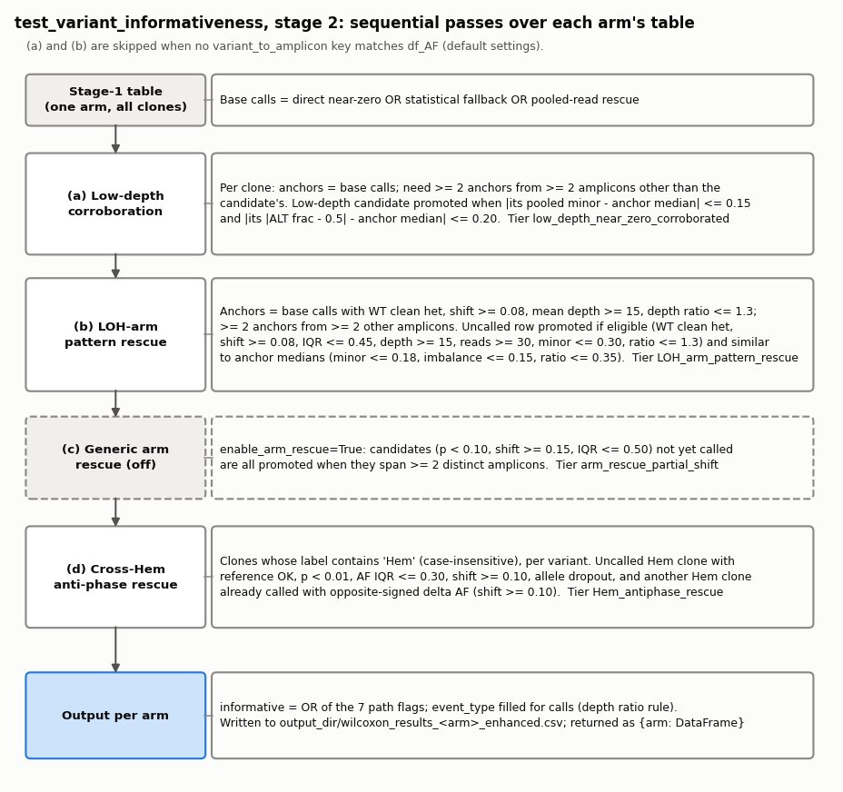
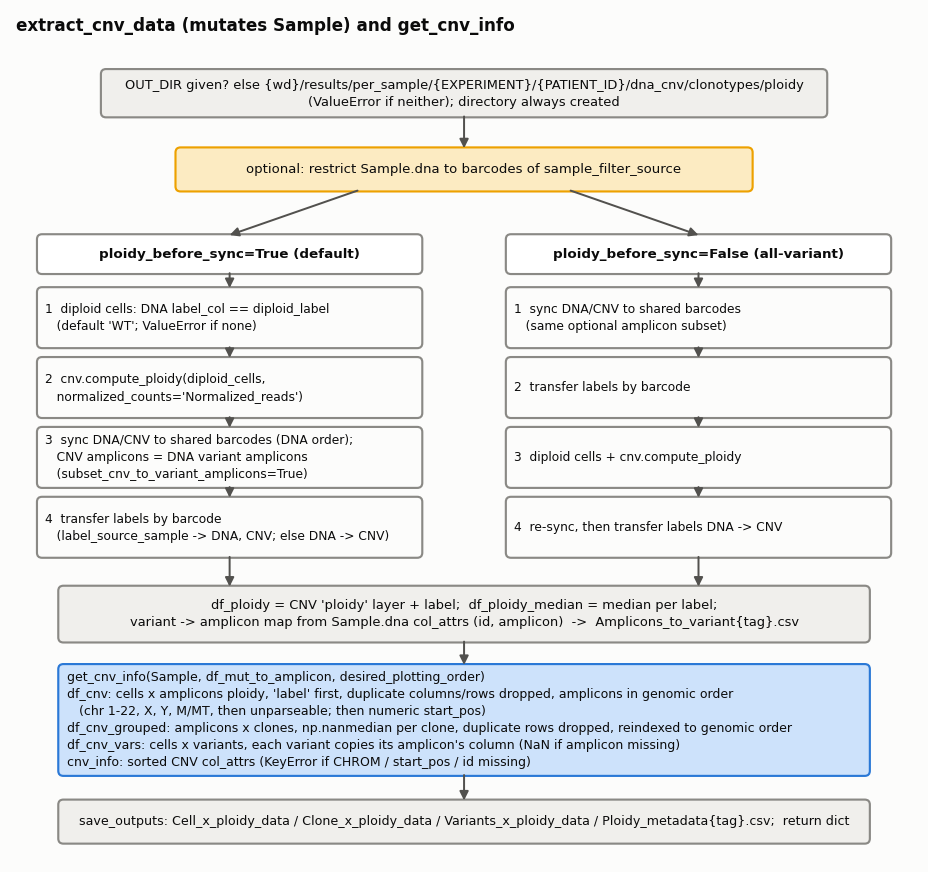
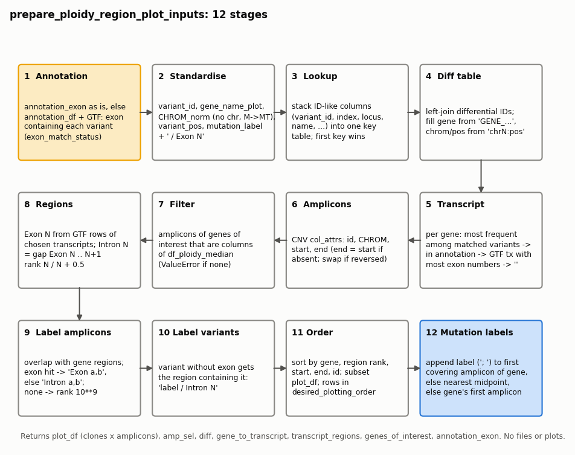
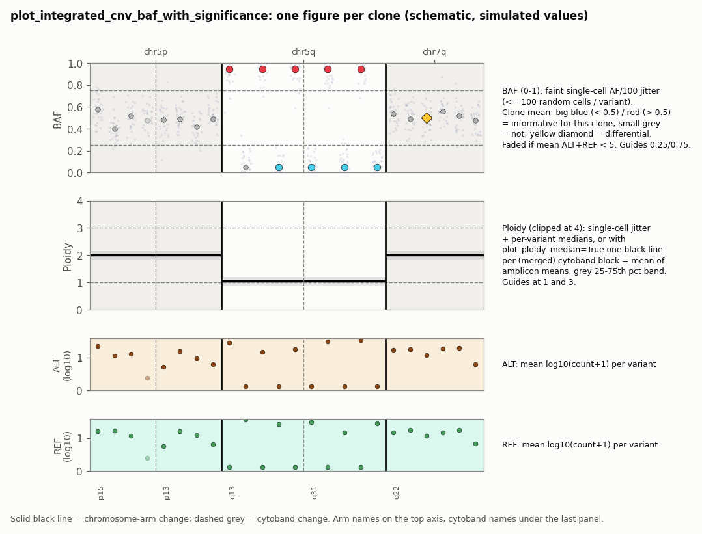

# CNV_Utils

Copy-number and allelic-imbalance analysis for single-cell DNA (Tapestri / mosaic `Sample` objects). The package
groups germline heterozygous variants by chromosome arm, tests which of them show a clone-specific allelic shift
against the WT/reference cells (loss of heterozygosity, LOH), extracts per-amplicon ploidy per cell and per clone,
prepares per-gene exon/intron ploidy plots, and draws clone-level BAF/ploidy figures. It is used in the per-sample
analysis notebooks (`03_Sample_Analysis_*.ipynb`) after clones have been labelled in `Sample.dna.row_attrs['label']`.

AF values follow the mosaic convention: the `AF` layer is in percent (0-100). Functions that work with fractions
(BAF, minor-allele fraction, IQR, shift versus WT) divide by 100 internally; this is stated per function below.

## Modules

| Module | Purpose | Main functions |
|---|---|---|
| `variant_grouping` | Assign `chrN:pos:REF/ALT` variant IDs to chromosomes and chromosome arms | `group_informative_variants_by_chr_arm` |
| `informativeness` | Decide which germline variants are informative LOH markers per clone; expand the panel from a relaxed H5 reload | `test_variant_informativeness`, `expand_informative_variants` |
| `cnv_extraction` | Ploidy per cell / clone / variant from the CNV assay | `extract_cnv_data`, `get_cnv_info` |
| `explore_gene_cnv` | Exon/intron-ordered ploidy matrix for the genes carrying differential variants; RefSeq GTF loader | `prepare_ploidy_region_plot_inputs`, `load_refseq_gtf_exons` |
| `visualization` | Cell x variant AF heatmaps by clone; integrated BAF / ploidy / ALT / REF figure per clone | `visualise_variants_by_clone`, `plot_integrated_cnv_baf_with_significance` |

All of the above are exported from `CNV_Utils/__init__.py`.

## Typical use

Informative germline variants (as in the notebooks; `df_ALT`/`df_REF` are rebuilt from AF and DP):

```python
import CNV_Utils

df_AF = Sample.dna.get_attribute('AF', constraint='row+col')
cols = list(df_AF.columns.values)
df_AF['label'] = Sample.dna.row_attrs['label']
df_AF = df_AF.loc[:, ['label'] + cols]
AF = df_AF[cols]
DP = Sample.dna.get_attribute('DP', constraint='row+col')[cols]
df_ALT = (AF / 100 * DP).round().astype(int)
df_REF = (DP - df_ALT).clip(lower=0).astype(int)

grouped_by_chr, grouped_by_chr_arm = CNV_Utils.group_informative_variants_by_chr_arm(
    filtered_germline_in_samples=filtered_germline_variants, cytobands=cytobands, verbose=True
)

wilcoxon_results_var = CNV_Utils.test_variant_informativeness(
    df_AF=df_AF, df_ALT=df_ALT, df_REF=df_REF,
    grouped_by_chr_arm=grouped_by_chr_arm,
    output_dir=f"{wd}/results/per_sample/{EXPERIMENT}/{PATIENT_ID}/dna_cnv/clonotypes/allele_frequencies",
    p_threshold=0.01, max_af_iqr=0.35, min_cells=5,
    variant_to_amplicon=variant_to_amplicon,
    germline_variants=list(filtered_germline_variants),
)
informative = [v for res in wilcoxon_results_var.values() for v in res.loc[res['informative'], 'variant']]
```

Expand the panel from the raw H5 and replace `Sample` explicitly:

```python
res = CNV_Utils.expand_informative_variants(
    H5_PATH, Sample, cytobands, output_dir=af_dir, desired_plotting_order=desired_plotting_order,
    whitelist=whitelist, germline_whitelist=germline_whitelist,
    sample_raw_size=sample_raw_size, num_cores=num_cores,
    previous_informative_variants=variable_af_germline, wt_label="WT",
    blacklist_paths=[".../hg19-blacklist.v2.bed"],
)
Sample = res["Sample_object"]
```

Ploidy tables (all-variant sample, labels taken from the filtered `Sample`):

```python
out_all = CNV_Utils.extract_cnv_data(
    Sample=Sample_all_vars, desired_plotting_order=desired_plotting_order,
    wd=wd, EXPERIMENT=EXPERIMENT, PATIENT_ID=PATIENT_ID, diploid_label="WT",
    sample_filter_source=Sample, label_source_sample=Sample,
    subset_cnv_to_variant_amplicons=False, ploidy_before_sync=False,
    output_tag="_all_vars", save_outputs=True,
)
df_ploidy_median = out_all["df_ploidy_median"]
```

Per-gene exon/intron ploidy inputs:

```python
gtf_exons_refseq = CNV_Utils.load_refseq_gtf_exons(gtf_path)
ploidy_inputs = CNV_Utils.prepare_ploidy_region_plot_inputs(
    sample_all_vars=Sample_all_vars, df_ploidy_median=df_ploidy_median,
    annotation_df=merged_annotation_filtered_detected_variants,
    differential_variants=differential_variants,
    desired_plotting_order=desired_plotting_order, gtf_exons_refseq=gtf_exons_refseq,
)
plot_df, amp_sel = ploidy_inputs["plot_df"], ploidy_inputs["amp_sel"]
```

Figures:

```python
CNV_Utils.visualise_variants_by_clone(
    df=df_AF, variants_to_plot=informative, cytobands=cytobands, output_dir=af_dir,
    output_prefix="Continuous_AF_Single_cell_clones_x_ALL_Informative_Variants",
    desired_clone_plotting_order=desired_plotting_order, plot_separate_clones=True,
)

CNV_Utils.plot_integrated_cnv_baf_with_significance(
    df_AF=df_AF, df_cnv_vars=df_cnv_all_reshaped, df_ALT=df_ALT, df_REF=df_REF, cytobands=cytobands,
    wilcoxon_results_var=wilcoxon_results_var, df_mut_to_amplicon=df_mut_to_amplicon,
    differential_variants=differential_variants, desired_plotting_order=desired_plotting_order,
    output_path=f"{clones_dir}/Clones_CNV_BAF_Significant.png",
    plot_separate_clones=True, plot_ploidy_median=True,
)
```

## variant_grouping

<details>
<summary><b><code>group_informative_variants_by_chr_arm</code></b> — Splits variant IDs (<code>chrN:pos:REF/ALT</code>) by chromosome (text before the first <code>:</code>) and then by chromosome arm.</summary>

`group_informative_variants_by_chr_arm(filtered_germline_in_samples, cytobands, verbose=True)`

Source: [variant_grouping.py:16](variant_grouping.py#L16 "group_informative_variants_by_chr_arm")

Splits variant IDs (`chrN:pos:REF/ALT`) by chromosome (text before the first `:`) and then by chromosome arm. The
`cytobands` table needs `chromosome` (without the `chr` prefix), `arm`, `start` and `end`; each arm spans
`[min(start), max(end)]` over its bands, and a variant goes to the first arm whose span contains its position
(inclusive). Returns `(grouped_by_chr, grouped_by_chr_arm)`: a `defaultdict(list)` keyed `chr1`, ... and a dict keyed
`chr1p`, `chr1q`, .... Variants on chromosomes without cytobands, with an unparseable position or outside every arm
span are dropped (only counted in the printout). The arm dict is the per-arm input of `test_variant_informativeness`.
No files; prints a step-by-step summary when `verbose`.

</details>

## informativeness

<details>
<summary><b><code>test_variant_informativeness</code></b> — This is a library function, not a pytest test, despite the <code>test_</code> prefix.</summary>

`test_variant_informativeness(df_AF, df_ALT, df_REF, grouped_by_chr_arm, output_dir, p_threshold=0.01, ..., wt_labels=None, variant_to_amplicon=None, germline_variants=None, verbose=True)`

Source: [informativeness.py:62](informativeness.py#L62 "test_variant_informativeness")

This is a library function, not a pytest test, despite the `test_` prefix.

For every chromosome arm and every non-WT clone it compares each variant in the clone with the WT/reference cells and
decides whether the variant is an informative LOH marker for that clone.

- **Inputs:** `df_AF` cells x variants AF in percent plus a `label` column; `df_ALT`, `df_REF` read counts (reindexed
  to `df_AF`'s cells); `grouped_by_chr_arm` `{arm: [variant, ...]}`; optional `variant_to_amplicon` (dict or DataFrame
  with variant/id/mutation and amplicon/amplicon_id/amp columns; IDs are canonicalised) and `germline_variants`
  whitelist. `wt_labels` are exact labels (default `['WT']`, no prefix matching).
- **AF scale:** all thresholds on AF are applied after dividing by 100 (`baf_deviation_threshold=0.2` means
  `|AF/100 - 0.5| > 0.2`, `min_baf_shift_vs_wt=0.10` means 10 AF points), except the WT clean-het band, which is
  written in percent (30 to 70).
- **Output:** `{arm: DataFrame}` with one row per (variant, clone): read-weighted clone and WT AF
  (`100 * sum(ALT) / sum(ALT+REF)`), `delta_af`, Wilcoxon rank-sum statistic and p, depth ratio clone/WT, minor-allele
  fractions, exact-binomial evidence, one `informative_*` flag per decision path, `informative` (OR of all paths),
  `informativeness_tier`, `classification_reason` (first failing gate for uncalled rows) and `event_type`.
- **Side effects:** writes `output_dir/wilcoxon_results_<arm>_enhanced.csv` per arm and prints parameters, per-arm
  counts and a summary.
- **Raises:** `KeyError` if `df_AF` has no `label`; `ValueError` if no cell carries a WT label or
  `dropout_rescue_max_clone_cells < 1`.

Stage 1 computes every row on its own:



1. Two sets of aggregates per (variant, clone). *Plot-aligned* ones use all clone cells (as drawn in the ALT/REF panels:
   mean ALT, mean REF, mean depth, total reads, pooled minor fraction, number of cells with depth >= 5).
   *Statistical* ones use cells with ALT+REF >= `min_cell_depth_for_dropout` (5).
2. **Direct near-zero call:** min(mean ALT, mean REF) <= 2.0 reads and pooled minor fraction <= 0.10, the reference
   check passes (variant in `germline_variants` if given, else WT clean het: WT pooled minor fraction >= 0.25 and
   30 <= WT AF <= 70), and high-confidence depth (mean depth >= 15, total reads >= 100, >= 4 cells with depth >= 5).
3. **Low-depth candidate:** the same near-zero pattern and reference check but only basic depth (>= 5 mean depth,
   >= 20 reads, >= 3 cells), plus a one-sided exact binomial p <= 1e-3 for the depleted-allele count under the WT allele
   fraction and a 95% upper bound on the depleted-allele fraction <= 0.15. Not called yet (see stage 2a).
4. **Strict statistical fallback** (only rows that are not direct calls): >= 5 clone and >= 5 WT cells with depth >= 5
   (`min_cells`), Wilcoxon p < 0.01, shift vs WT >= 10 AF points, clone imbalance `|AF/100 - 0.5| > 0.2`, clone AF IQR
   <= 0.30, and allele dropout (pooled minor fraction <= 0.25 and >= 50% of clone reads in cells with minor fraction
   < 0.10). No WT clean-het check on this path.
5. Optional paths, off by default: pooled-read rescue (`enable_dropout_rescue`) and the generic arm-rescue candidates
   (`enable_arm_rescue`).
6. `event_type` for called rows from the clone/WT mean-depth ratio: < 0.7 `DELETION`, > 1.3 `AMPLIFICATION`, otherwise
   `cnLOH`; NaN ratio gives `UNKNOWN`. Uncalled rows have `event_type == ""`.

Stage 2 runs sequential passes over each arm's table:



1. **(a) Low-depth corroboration:** per clone, anchors are the stage-1 calls (direct, fallback, pooled-read rescue).
   A low-depth candidate is promoted when >= 2 anchors from >= 2 amplicons other than its own exist and its pooled minor
   fraction and `|ALT fraction - 0.5|` are within 0.15 and 0.20 of the anchor medians.
2. **(b) LOH-arm pattern rescue:** anchors additionally need WT clean het, shift >= 0.08, mean depth >= 15 and depth
   ratio <= 1.3. An uncalled row is promoted when it is eligible (WT clean het, enough statistical cells, shift >= 0.08,
   IQR <= 0.45, mean depth >= 15, reads >= 30, minor fraction <= 0.30, depth ratio <= 1.3) and similar to the anchor
   medians (minor-fraction distance <= 0.18, imbalance distance <= 0.15, depth-ratio distance <= 0.35).
3. **(c) Generic arm rescue** (off by default).
4. **(d) Cross-Hem anti-phase rescue:** among clones whose label contains `Hem` (case-insensitive), an uncalled clone
   with reference OK, p < 0.01, AF IQR <= 0.30, shift >= 0.10 and allele dropout is promoted when another Hem clone is
   already called for the same variant with an opposite-signed `delta_af` (and shift >= 0.10).
5. `informative` = OR of the seven path flags; missing `event_type` values of called rows are filled; the CSV is
   written.

Passes (a) and (b) are skipped (with a message) when no `variant_to_amplicon` key matches a `df_AF` variant, because
independent amplicons are required by default.

</details>

<details>
<summary><b><code>expand_informative_variants</code></b> — Grows the informative germline panel by reloading the raw H5 with relaxed variant filtering and keeping additional</summary>

`expand_informative_variants(H5_PATH, Sample, cytobands, output_dir, desired_plotting_order, *, whitelist, germline_whitelist, sample_raw_size, num_cores, p_threshold=0.01, baf_deviation_threshold=0.3, max_af_iqr=0.3, min_cells=5, quality_percentile=10, adaptive_qc_percentile=1, adaptive_median_dp_cap=10.0, adaptive_mean_gq_cap=50.0, require_wt_het=True, wt_het_band=None, wt_label="WT", blacklist_paths=None, exclude_pathogenic=True, annotate_final_variants=True, plot=True, verbose=True)`

Source: [informativeness.py:1540](informativeness.py#L1540 "expand_informative_variants")

Grows the informative germline panel by reloading the raw H5 with relaxed variant filtering and keeping additional
variants that pass informativeness and quality gates. The input `Sample` is not modified; reassign
`Sample = res["Sample_object"]` in the notebook.

1. `ms.load` the H5 with the relaxed filter (default `min_dp=5, min_gq=20, vaf_ref=5, vaf_hom=95, vaf_het=30,
   min_prct_cells=30`, `min_mut_prct_cells` = 1% of raw cells clamped to 5-20 cells, expressed as a percent); `whitelist`
   and `germline_whitelist` are passed in.
2. Keep only the cells of `Sample` and copy their labels; require WT/reference cells (`wt_label`, exact).
3. Build AF/ALT/REF matrices (`ALT = round(AF/100 * DP)`, `REF = DP - ALT`), group by arm, run
   `test_variant_informativeness` (with this function's p/BAF/depth/IQR/min_cells settings, the WT labels and the H5's
   variant -> amplicon map) and keep the lowest-p informative call per variant.
4. Per-variant QC: clone call rate (NGT != 3 in the called clone), genotyping rate, median / mean DP, mean GQ.
   Variants already in the panel are "baseline", the rest "additional".
5. Additional variants must pass: clone call rate >= `quality_percentile` of baseline; median DP >= min(p1 of
   baseline, 10); mean GQ >= min(p1 of baseline, 50); optional hard floors (`min_clone_call_rate`, `min_median_dp`);
   WT-HET (WT mean AF inside `wt_het_band`, else the p1-p99 range of WT AF over `previous_informative_variants`, else
   30-70%); no overlap with BED/CSV blacklist intervals (BED is 0-based half-open); not ClinVar pathogenic (contains
   "pathogenic" and not "benign").
6. `Sample_object` = raw DNA for the original panel plus kept additions (order kept), with labels and compatible row
   attributes (including 2-D embeddings such as umap/pca) transferred by barcode.
7. Optional chunked variant annotation (1000 per chunk) added as DNA column attributes.
8. Optional plot via `visualise_variants_by_clone` (previous panel as background, new variants highlighted).

Returns a dict with `Sample_object` (alias `Sample`), `Sample_all`, `wilcoxon_results`, `qc`, `additional` (gate
columns `wt_af`, `is_blacklisted`, `is_pathogenic`, `kept`), `new_kept`, `final_variant_ids`, `missing_variant_ids`,
`thresholds`, `variant_annotations`, `transferred_row_attributes`, `skipped_row_attributes`. The relaxed
informativeness CSVs go to `output_dir/informativeness_relaxed`.

</details>

<details>
<summary><b>Private helpers</b> (3 entries)</summary>

| Helper | Purpose |
|---|---|
| [`_normalize_wt_labels`](informativeness.py#L41 "_normalize_wt_labels") | WT labels as a list (`None` -> `['WT']`, str -> `[str]`) |
| [`_build_wt_mask`](informativeness.py#L50 "_build_wt_mask") | Boolean mask of cells whose stripped label exactly matches a WT label |
| [`_is_wt_label`](informativeness.py#L56 "_is_wt_label") | True if one label exactly matches a WT label |

</details>

## cnv_extraction

<details>
<summary><b><code>extract_cnv_data</code></b> — End-to-end ploidy wrapper.</summary>

`extract_cnv_data(Sample, desired_plotting_order=None, wd=None, EXPERIMENT=None, PATIENT_ID=None, OUT_DIR=None, output_tag="", sample_filter_source=None, label_source_sample=None, label_col="label", compute_ploidy=True, ploidy_before_sync=True, diploid_label="WT", normalized_counts="Normalized_reads", subset_cnv_to_variant_amplicons=True, save_outputs=True, verbose=True)`

Source: [cnv_extraction.py:367](cnv_extraction.py#L367 "extract_cnv_data")

End-to-end ploidy wrapper. It **mutates `Sample` in place**: `Sample.dna`/`Sample.cnv` are replaced by barcode-synced
(and optionally amplicon-subset) assays, the CNV assay gains a `ploidy` layer and `row_attrs[label_col]` is
overwritten by label transfer.



1. Resolve `OUT_DIR` (default `{wd}/results/per_sample/{EXPERIMENT}/{PATIENT_ID}/dna_cnv/clonotypes/ploidy`; it is
   created even when `save_outputs=False`). `desired_plotting_order=None` becomes `sorted(set(Sample.dna.row_attrs['Clone']))`.
2. Optionally restrict `Sample.dna` to the barcodes of `sample_filter_source`.
3. Default lane (`ploidy_before_sync=True`): pick DNA cells with `label_col == diploid_label` (str or list;
   `ValueError` if none), run `Sample.cnv.compute_ploidy(diploid_cells=..., normalized_counts=...)`, sync DNA/CNV to
   shared barcodes in DNA order (CNV restricted to the DNA variant amplicons if `subset_cnv_to_variant_amplicons`),
   then transfer labels (from `label_source_sample` into DNA and CNV, else DNA -> CNV).
4. All-variant lane (`ploidy_before_sync=False`): sync, transfer labels, compute ploidy, re-sync, transfer DNA -> CNV.
5. `df_ploidy` (CNV ploidy + label) and `df_ploidy_median` (median per label); variant -> amplicon map from the DNA
   column attributes, saved as `Amplicons_to_variant{tag}.csv`.
6. `get_cnv_info` builds the four tables, saved as `Cell_x_ploidy_data`, `Clone_x_ploidy_data`,
   `Variants_x_ploidy_data`, `Ploidy_metadata` (each `{tag}.csv`) when `save_outputs`.

Returns a dict: `OUT_DIR`, `shared_barcodes`, `variant_amplicons`, `wt_cells`, `df_ploidy`, `df_ploidy_median`,
`df_mut_to_amplicon_dataframe`, `df_mut_to_amplicon`, `variant_to_amp_dict`, `df_cnv`, `df_cnv_grouped`,
`df_cnv_vars`, `cnv_info`, `outputs` (`{filename: DataFrame}`).

</details>

<details>
<summary><b><code>get_cnv_info</code></b> — Reads the <code>ploidy</code> layer of <code>Sample.cnv</code> (requires <code>row_attrs[&#x27;label&#x27;]</code> and col_attrs <code>CHROM</code>, <code>start_pos</code>, <code>id</code>;</summary>

`get_cnv_info(Sample, df_mut_to_amplicon=None, desired_plotting_order=None, verbose=True)`

Source: [cnv_extraction.py:61](cnv_extraction.py#L61 "get_cnv_info")

Reads the `ploidy` layer of `Sample.cnv` (requires `row_attrs['label']` and col_attrs `CHROM`, `start_pos`, `id`;
`KeyError` otherwise). Returns `(df_cnv, df_cnv_grouped, df_cnv_vars, cnv_info_sorted)`:

- `df_cnv`: cells x amplicons with `label` first; duplicate columns and rows dropped; amplicons in genomic order
  (chromosome 1-22, X, Y, M/MT, then unparseable; then numeric `start_pos`).
- `df_cnv_grouped`: amplicons x clones, `np.nanmedian` ploidy per clone (clones in `desired_plotting_order` that exist,
  else sorted labels); duplicate rows dropped, duplicate probe IDs median-collapsed, rows reindexed to genomic order.
- `df_cnv_vars` (only with `df_mut_to_amplicon = {'variant': [...], 'amplicon': [...]}`): cells x variants, each
  variant copying its amplicon's ploidy column (NaN if the amplicon is missing); non-mapped columns (e.g. `label`)
  are kept as metadata. `None` otherwise.
- `cnv_info_sorted`: the de-duplicated CNV column attributes in genomic order.

</details>

<details>
<summary><b>Private helpers</b> (7 entries)</summary>

| Helper | Purpose |
|---|---|
| [`_make_vprint`](cnv_extraction.py#L27 "_make_vprint") | `print` + flush that is silent unless `verbose` |
| [`_chrom_to_int`](cnv_extraction.py#L38 "_chrom_to_int") | Chromosome name -> sortable integer (X 23, Y 24, M/MT 25, unknown 999) |
| [`_chrom_sort_key`](cnv_extraction.py#L54 "_chrom_sort_key") | `sort_values` key applying `_chrom_to_int` to the `CHROM` column |
| [`_sync_dna_cnv_by_barcode`](cnv_extraction.py#L304 "_sync_dna_cnv_by_barcode") | Subset DNA/CNV in place to shared barcodes (DNA order), optional CNV amplicon subset |
| [`_transfer_labels_by_barcode`](cnv_extraction.py#L324 "_transfer_labels_by_barcode") | Copy labels from one assay to another by barcode (NaN where unmatched) |
| [`_get_labeled_attribute`](cnv_extraction.py#L338 "_get_labeled_attribute") | Assay layer as a DataFrame with `label` as first column |
| [`_compute_ploidy_from_diploid_cells`](cnv_extraction.py#L346 "_compute_ploidy_from_diploid_cells") | Select diploid reference cells and run `Sample.cnv.compute_ploidy` |

</details>

## explore_gene_cnv

<details>
<summary><b><code>prepare_ploidy_region_plot_inputs</code></b> — Maps differential variants onto CNV amplicons and onto the exons/introns of one selected transcript per gene, to feed</summary>

`prepare_ploidy_region_plot_inputs(sample_all_vars, df_ploidy_median, differential_variants, annotation_df=None, annotation_exon=None, desired_plotting_order=None, gtf_exons_refseq=None, verbose=True)`

Source: [explore_gene_cnv.py:1496](explore_gene_cnv.py#L1496 "prepare_ploidy_region_plot_inputs")

Maps differential variants onto CNV amplicons and onto the exons/introns of one selected transcript per gene, to feed
a per-gene ploidy plot. Pass either `annotation_exon` (already exon-annotated, used as is) or `annotation_df` together
with `gtf_exons_refseq` (exon annotation computed internally). Without a GTF table amplicons stay unlabelled.



1. Annotation: copy `annotation_exon`, or for each variant with gene/chromosome/position find GTF exons of the same gene
   and chromosome containing it (own transcript preferred; ties by transcript, exon number, start, end) and record
   `exon_match_status` (`matched_exon`, `no_exon_overlap`, `missing_position`, ...).
2. Standardise: `variant_id`, `gene_name_plot`, `CHROM_norm` (no `chr`, M -> MT), `variant_pos`, `mutation_label`,
   `mutation_label_exon` = "label / Exon N".
3. Lookup: stack the ID-like columns (`variant_id`, index, `condensed_format`, `mutation_id`, `locus`, `variant`,
   `Variant`, `name`, `Name`) into one key table; the first occurrence of a key wins.
4. Diff table: left-join the differential IDs; fill missing gene from `GENE_...` IDs and chrom/pos from `chrN:pos` IDs.
5. Transcript per gene: most frequent among matched variants -> most frequent in the whole annotation -> GTF transcript
   with most distinct exon numbers -> `""`.
6. Amplicon metadata from `sample_all_vars.cnv.col_attrs` (gene from `gene_name` or `cnv.get_gene_names()`; end from
   `end_pos`/`end`/`stop_pos`, else start; start/end swapped if reversed).
7. Keep amplicons of the genes of interest that are columns of `df_ploidy_median` (`ValueError` if none).
8. Transcript regions: Exon N from the GTF rows of the chosen transcripts; Intron N = gap between Exon N and N+1;
   rank N for exons and N + 0.5 for introns.
9. Amplicon labels: any exon overlap -> "Exon a,b", else "Intron a,b"; rank = minimum region rank; unlabelled -> 10**9.
10. Variant labels: variants without an exon get the containing region; intronic ones become "label / Intron N".
11. Order amplicons by gene, region rank, start, end, id; subset `df_ploidy_median` to `plot_df`; rows in
    `desired_plotting_order` when any match.
12. Each variant's label is appended (`"; "`-separated) to `amp_sel['mutation_labels']` of the first covering amplicon
    of its gene (same chromosome preferred), else the nearest amplicon midpoint, else (no position) the gene's first
    amplicon.

Returns a dict: `plot_df` (clones x selected amplicons), `amp_sel`, `diff`, `gene_to_transcript`,
`transcript_regions`, `genes_of_interest`, `annotation_exon`. No files or plots; timestamped logs when `verbose`.
Raises `ValueError` if no annotation is given, no gene can be inferred, or no amplicon of those genes is in the matrix.

</details>

<details>
<summary><b><code>load_refseq_gtf_exons</code></b> — Reads a tab-separated GTF/GFF (lines starting with <code>#</code> skipped) and keeps <code>exon</code> features.</summary>

`load_refseq_gtf_exons(gtf_path)`

Source: [explore_gene_cnv.py:1690](explore_gene_cnv.py#L1690 "load_refseq_gtf_exons")

Reads a tab-separated GTF/GFF (lines starting with `#` skipped) and keeps `exon` features. Gene is taken from
`gene_name`/`gene`/`gene_id`/`Name`, transcript from `transcript_id`/`transcriptId`/`transcript`, plus `exon_id` and
`exon_number`, in `key "value"` (GTF) or `key=value` (GFF) form. Chromosomes are normalised (strip `chr`, M -> MT).
Rows missing chromosome, gene, transcript or coordinates are dropped; missing exon numbers are inferred per
gene/transcript/chromosome/strand by coordinate order (descending on the `-` strand). Returns a DataFrame with
`gene_name_gtf`, `CHROM_norm`, `exon_start`, `exon_end`, `exon_number`, `transcript_id_gtf`,
`transcript_id_gtf_noversion`, `exon_id`, `strand`.

</details>

<details>
<summary><b>Private helpers</b> (22 entries)</summary>

| Helper | Purpose |
|---|---|
| [`_clean_label`](explore_gene_cnv.py#L132 "_clean_label") | `str(x).strip()`, or `""` for NaN / 'nan' / 'none' / 'na' |
| [`_normalise_chrom`](explore_gene_cnv.py#L142 "_normalise_chrom") | Strip `chr` (any case), map M -> MT |
| [`_strip_tx_version`](explore_gene_cnv.py#L155 "_strip_tx_version") | Drop a trailing `.N` transcript version |
| [`_as_variant_vector`](explore_gene_cnv.py#L165 "_as_variant_vector") | Series/Index/array/list/set/scalar -> list of str (NaN dropped) |
| [`_first_existing_col`](explore_gene_cnv.py#L178 "_first_existing_col") | First candidate column present in a DataFrame |
| [`_parse_gene_from_variant_name`](explore_gene_cnv.py#L193 "_parse_gene_from_variant_name") | Gene from a `GENE_...` ID |
| [`_parse_chrom_pos_from_variant_name`](explore_gene_cnv.py#L206 "_parse_chrom_pos_from_variant_name") | `(chrom, pos)` from a `[chr]N:pos...` ID |
| [`_pick_variant_id_col`](explore_gene_cnv.py#L217 "_pick_variant_id_col") | First known variant-ID column present |
| [`_sort_num_labels`](explore_gene_cnv.py#L230 "_sort_num_labels") | Clean, de-duplicate and numerically sort labels |
| [`_region_rank_from_label`](explore_gene_cnv.py#L244 "_region_rank_from_label") | 'Exon N' -> N, 'Intron N' -> N + 0.5, else last |
| [`_exon_rank_value`](explore_gene_cnv.py#L262 "_exon_rank_value") | Backward-compatible rank helper |
| [`_format_region_label`](explore_gene_cnv.py#L293 "_format_region_label") | `("exon", ["2", "3"])` -> "Exon 2,3" |
| [`_fill_variant_id`](explore_gene_cnv.py#L315 "_fill_variant_id"), `_add_chrom_norm`, `_add_variant_pos` | Add standard ID / chromosome / position columns (stage 2) |
| [`_standardise_gtf_exons`](explore_gene_cnv.py#L365 "_standardise_gtf_exons") | Standardise GTF exon table columns |
| [`_compute_annotation_exon_from_gtf`](explore_gene_cnv.py#L464 "_compute_annotation_exon_from_gtf") | Per-variant exon assignment (stage 1) |
| [`_transcript_ids_in`](explore_gene_cnv.py#L620 "_transcript_ids_in") | Non-empty transcript IDs in a table |
| [`_choose_gene_transcripts_from_diff`](explore_gene_cnv.py#L645 "_choose_gene_transcripts_from_diff") | Transcript-selection ladder (stage 5) |
| [`_build_transcript_regions_from_gtf`](explore_gene_cnv.py#L703 "_build_transcript_regions_from_gtf") | Exon and intron intervals (stage 8) |
| [`_select_best_region_hits`](explore_gene_cnv.py#L832 "_select_best_region_hits") | Prefer exon hits over intron hits |
| [`_empty_region_assignment`](explore_gene_cnv.py#L851 "_empty_region_assignment"), `_lookup_transcript_regions`, `_assign_region_to_amplicon` | Amplicon region labelling (stage 9) |
| [`_load_annotation_exon`](explore_gene_cnv.py#L950 "_load_annotation_exon"), `_standardise_annotation_table`, `_build_variant_lookup`, `_build_differential_table`, `_build_amplicon_metadata`, `_restrict_amplicons_to_genes_of_interest`, `_build_selected_transcript_regions`, `_label_differential_variant_regions`, `_order_amplicons_and_build_plot_df`, `_assign_mutation_labels_to_amplicons` | Stages 1-2, 3, 4, 6, 7, 8, 10, 11, 12 of `prepare_ploidy_region_plot_inputs` |
| [`_gtf_attr`](explore_gene_cnv.py#L1674 "_gtf_attr") | First matching GTF/GFF attribute value |

</details>

## visualization

Both functions save PNG + PDF files and call `plt.show()` for each figure.

<details>
<summary><b><code>visualise_variants_by_clone</code></b> — One seaborn heatmap (cells x selected variants, AF in percent) per clone label.</summary>

`visualise_variants_by_clone(df, variants_to_plot, cytobands, output_dir, output_prefix="Single_cell_clones_Variable_AF_Germline_by_chr_arm", label_col="label", max_subplots_per_figure=25, dpi=150, save_figures=True, plot_categorical=False, split_by_cytobands=False, desired_clone_plotting_order=None, plot_separate_clones=False, verbose=True)`

Source: [visualization.py:169](visualization.py#L169 "visualise_variants_by_clone")

One seaborn heatmap (cells x selected variants, AF in percent) per clone label. Within a clone, cells are ordered by
average-linkage hierarchical clustering (left unordered if clustering fails). Variants are sorted by chromosome (X = 23),
arm and position using arm spans from `cytobands` (columns `chromosome`, `arm`, `start`, `end`, `cytoband`); a dashed
vertical line and a rotated label mark every arm change (or cytoband change with `split_by_cytobands`). Colours:
continuous `RdYlBu_r` 0-100, or with `plot_categorical` <= 10 dark blue, 10-90 white, >= 90 dark red. Clones in
`desired_clone_plotting_order` come first, the rest sorted. Output: one stacked figure
`<prefix>_by_chr_arm.png/.pdf` (or `_by_cytoband`), split into `_partN` figures above `max_subplots_per_figure`
clones, or one figure per clone `<prefix><suffix>_<clone>.png/.pdf` with `plot_separate_clones`.

</details>

<details>
<summary><b><code>plot_integrated_cnv_baf_with_significance</code></b> — Writes one figure per clone in <code>desired_plotting_order</code> (labels absent from <code>df_AF</code> skipped) with stacked panels on a</summary>

`plot_integrated_cnv_baf_with_significance(df_AF, df_cnv_vars, df_ALT, df_REF, cytobands, wilcoxon_results_var, df_mut_to_amplicon, differential_variants, desired_plotting_order, output_path, chr_arms_to_plot=None, max_jitter_cells=100, plot_separate_clones=False, plot_ploidy_median=False, plot_alt_ref=True, df_cnv_all=None, ploidy_line_stat="mean", ploidy_ci_method="percentile", ploidy_ci_percentiles=(25, 75), ...)`

Source: [visualization.py:1077](visualization.py#L1077 "plot_integrated_cnv_baf_with_significance")

Writes one figure per clone in `desired_plotting_order` (labels absent from `df_AF` skipped) with stacked panels on a
shared variant axis. Only the per-clone mode exists: pass `plot_separate_clones=True` (the default `False` raises
`NotImplementedError`, after data preparation).



1. Variants are the `chr*` columns of `df_AF` (optionally restricted to `chr_arms_to_plot`), assigned to arms and
   cytobands from `cytobands` (columns `chromosome arm`, `start`, `end`, `cytoband`, `cytoband type`; `KeyError` if
   missing) and sorted by chromosome, arm, position. Solid black lines mark arm changes, dashed grey lines cytoband
   changes; arm names on a top axis, cytoband names under the last panel (labels closer than 1.5 positions skipped).
2. **BAF** (AF/100): up to 100 random cells per variant as faint jitter; clone-mean dot per variant. Variants with
   `informative=True` for this clone in `wilcoxon_results_var` are big circles (blue < 0.5, red > 0.5, purple = 0.5),
   others small grey circles; `differential_variants` are yellow diamonds. Markers fade (alpha 0.4) when mean ALT+REF
   < 5. Guides at 0.25 / 0.75, right axis AA / AB / BB.
3. **Ploidy** (clipped at 4): single-cell jitter and per-variant medians; with `plot_ploidy_median=True` (points hidden
   by default) one black line per cytoband block instead: each amplicon of the band (from `df_cnv_all`, default
   `df_cnv_vars`) gets its mean over the clone's cells, a block is "extreme" if any displayed variant in it is
   informative for the clone, adjacent same-state blocks on one chromosome are merged, and the line is the mean (or
   median) of the amplicon means with a grey 25-75th percentile band (or mean +/- SD, or mean +/- 1.96 SEM). Guides at
   1 and 3.
4. **ALT** and **REF** (if `plot_alt_ref`): mean log10(count + 1) per variant, faded at low depth.
5. Saved as `<name>_<clone><ext>` next to `output_path`, plus a `.pdf` copy.

Returns `None`; returns early with a message when no variants or labels are found. `df_mut_to_amplicon` and
`height_spacer` are accepted but unused.

</details>

<details>
<summary><b>Private helpers</b> (16 entries)</summary>

| Helper | Purpose |
|---|---|
| [`_make_vprint`](visualization.py#L54 "_make_vprint") | Silent-unless-verbose print |
| [`_subsample_cells`](visualization.py#L64 "_subsample_cells") | Random subsample of jitter values (global NumPy RNG) |
| [`_categorize_af`](visualization.py#L81 "_categorize_af") | AF % -> 0 (<= 10), 1 (10-90), 2 (>= 90) |
| [`_build_arm_lookup`](visualization.py#L90 "_build_arm_lookup"), `_assign_variants_to_arms`, `_heatmap_sort_key` | Arm/cytoband assignment and sort key for the heatmaps |
| [`_save_png_and_pdf`](visualization.py#L163 "_save_png_and_pdf") | Save PNG and the `.png -> .pdf` copy |
| [`_extract_chr_arm_pos`](visualization.py#L497 "_extract_chr_arm_pos"), `_chr_from_arm` | Sort key and chromosome from an arm name |
| [`_summarise_values`](visualization.py#L522 "_summarise_values"), `_summarise_interval` | Line statistic and CI (percentile / SD / SEM) for ploidy lines |
| [`_safe_label_for_filename`](visualization.py#L562 "_safe_label_for_filename") | Replace spaces, `/`, `\`, `:` with `_` |
| [`_baf_to_rgb`](visualization.py#L573 "_baf_to_rgb") | BAF -> colour along the white-lilac-purple-pink-white ramp |
| [`_cytoband_blocks`](visualization.py#L582 "_cytoband_blocks"), `_arm_blocks` | Runs of consecutive variants sharing cytoband / arm |
| [`_add_top_chr_arm_labels`](visualization.py#L613 "_add_top_chr_arm_labels"), `_add_bottom_cytoband_labels` | Arm and cytoband axis labels |
| [`_style_panel_spines`](visualization.py#L679 "_style_panel_spines"), `_draw_alt_arm_background`, `_draw_ci_band_and_caps` | Panel styling, arm shading, CI band |
| [`_build_cytoband_lookups`](visualization.py#L764 "_build_cytoband_lookups"), `_variant_to_chr_arm`, `_band_and_type` | Cytoband validation and lookups |
| [`_build_informative_lookup`](visualization.py#L851 "_build_informative_lookup") | `{(label, variant): True}` from `wilcoxon_results_var` |
| [`_ploidy_cytoband_segments`](visualization.py#L877 "_ploidy_cytoband_segments"), `_merge_ploidy_segments` | Per-cytoband ploidy segments and their merging |
| [`_plot_log_count_panel`](visualization.py#L995 "_plot_log_count_panel") | ALT / REF log-count panel |

</details>

## Known quirks

Documented, not fixed:

- `informativeness.py:test_variant_informativeness` — the Hem anti-phase pass treats low-depth-corroborated rows as "not yet informative", so they can also become Hem anti-phase candidates (similar to the LOH-arm rescue overwrite below).
- `informativeness.py:test_variant_informativeness` — the statistical fallback always requires clone imbalance;
  `require_clone_imbalance=False` / `require_shift_vs_wt` only change the diagnostic `has_imbalance` column (the
  notebooks pass `require_clone_imbalance=False`, which therefore does not relax the fallback).
- `informativeness.py:test_variant_informativeness` — `min_dropout_cell_fraction` and `max_minor_allele_fraction` are
  accepted but unused.
- `informativeness.py:test_variant_informativeness` — Hem anti-phase candidates must also pass p < `p_threshold`, so a
  looser `hem_antiphase_p_threshold` has no effect.
- `informativeness.py:test_variant_informativeness` — the LOH-arm rescue can re-process low-depth-corroborated rows and
  overwrite their tier/reason.
- `informativeness.py:test_variant_informativeness` — column `significant_threshold_0.01` is hard-coded to 0.01
  regardless of `p_threshold`.
- `informativeness.py:expand_informative_variants` — default `baf_deviation_threshold=0.3` versus 0.2 in
  `test_variant_informativeness`; several options (e.g. `germline_variants`) are not passed through.
- `cnv_extraction.py:get_cnv_info` — `drop_duplicates()` merges distinct cells with identical label + ploidy profile,
  and drops amplicons whose clone medians equal another amplicon's (they come back as all-NaN rows after reindex).
- `cnv_extraction.py:extract_cnv_data` — `OUT_DIR` is created even when `save_outputs=False`; the default
  `desired_plotting_order` needs a DNA `Clone` row attribute.
- `variant_grouping.py:group_informative_variants_by_chr_arm` — the arm lookup is keyed by raw
  `cytobands["chromosome"]` but queried with strings, so an integer chromosome column maps nothing;
  `replace("chr", "")` removes every "chr" substring; variants in gaps between arm spans are dropped (only counted).
- `visualization.py:visualise_variants_by_clone` — `save_figures=False` is ignored in combined mode; the PDF path is
  built with `.replace('.png', '.pdf')` (a non-.png path saves the same file twice); non-string clone labels fail in
  separate mode; the separate-mode message mentions a clone-name title that is never drawn; `font_title` is unused.
- `visualization.py` (both plots) — chromosome-arm parsing `int(chr_arm[3:-1])` fails for chrY/chrMT, which then sort
  before chr1 (X is special-cased as 23).
- `visualization.py:plot_integrated_cnv_baf_with_significance` — default `plot_separate_clones=False` raises
  `NotImplementedError` only after all data preparation; `df_mut_to_amplicon` and `height_spacer` are unused.
- `explore_gene_cnv.py` (GTF standardisation) — gene/transcript columns are cast to str before `dropna`, so missing
  values become "nan"/"" and are never dropped.
- `explore_gene_cnv.py` — only statuses that are exactly `""` are filled; NaN statuses in a supplied column stay NaN.
- `explore_gene_cnv.py` — `chrom_rank` and `exon_rank` are computed but unused; amplicons are sorted by gene name, not
  chromosome.
- `explore_gene_cnv.py` — pandas FutureWarnings: float/str values written into an int64 `region_rank` column.

## Tests

From the pipelines folder:

```bash
~/miniconda3/envs/mosaic/bin/python -m pytest -c tests/pytest.ini tests/test_cnv*
```

(`test_cnv_extraction.py`, `test_cnv_gtf.py`, `test_cnv_informativeness.py`, `test_cnv_variant_grouping.py`,
`test_cnv_visualization_smoke.py`, `test_cnv_wt_labels.py`; fakes for the `Sample` object are in
`tests/_cnv_pro_fakes.py`.)

## Regenerating figures

From the pipelines folder:

```bash
~/miniconda3/envs/mosaic/bin/python docs/make_CNV_Utils_figures.py
```

This rewrites `CNV_Utils/docs/informativeness_row_paths.png`, `informativeness_arm_passes.png`,
`extract_cnv_flow.png`, `ploidy_region_pipeline.png` and `integrated_plot_layout.png`. The first four are flowcharts
with the function defaults; the last is a schematic drawn with simulated values (it does not call the plotting
function).
