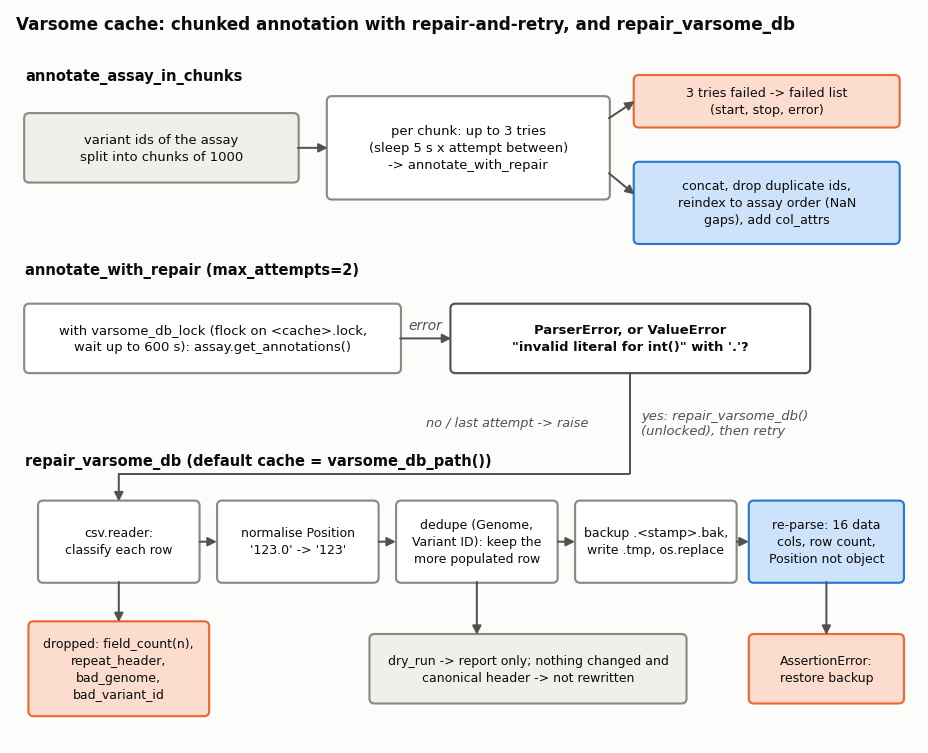
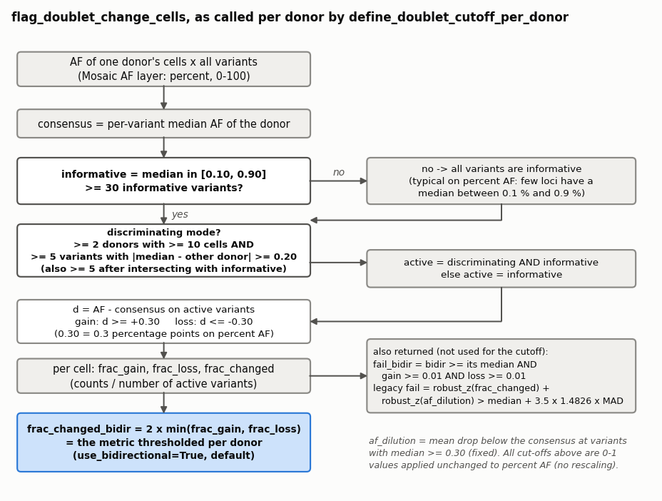
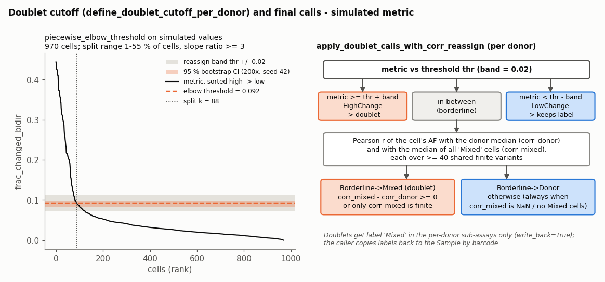
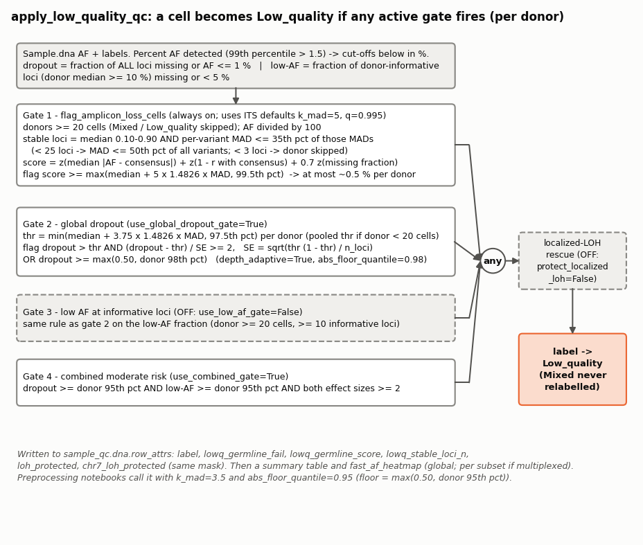
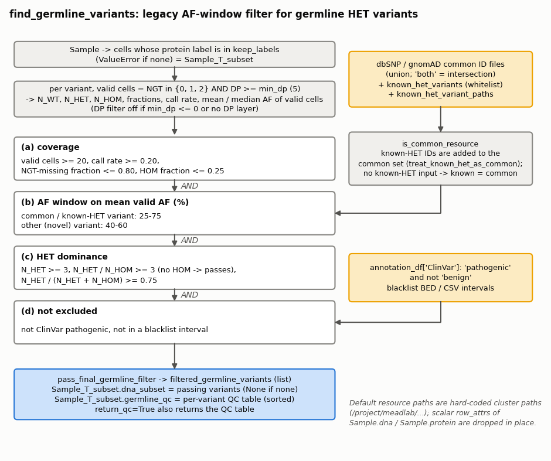
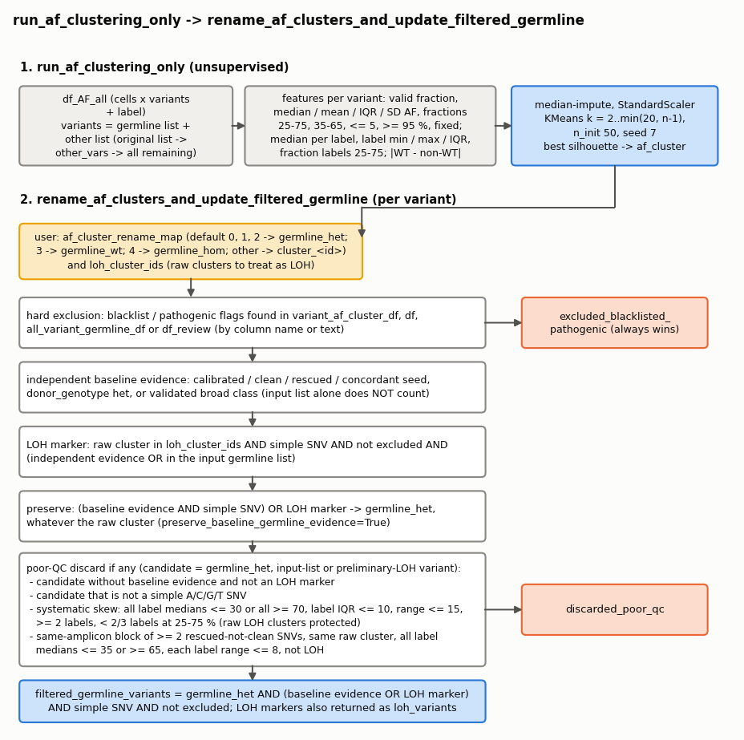
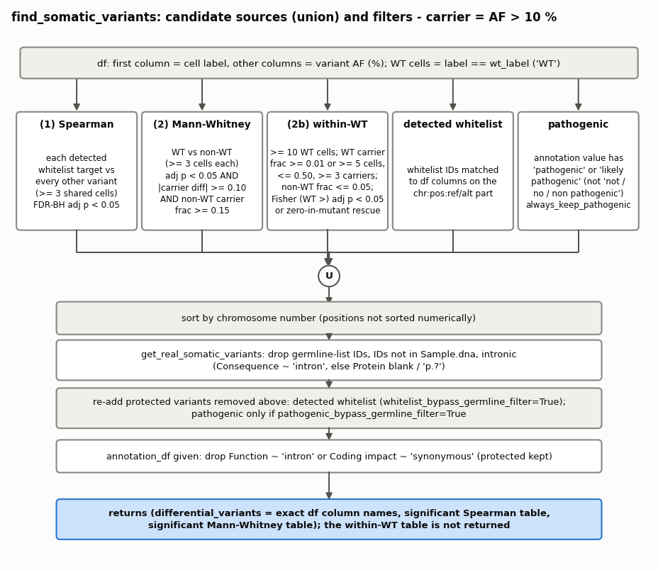
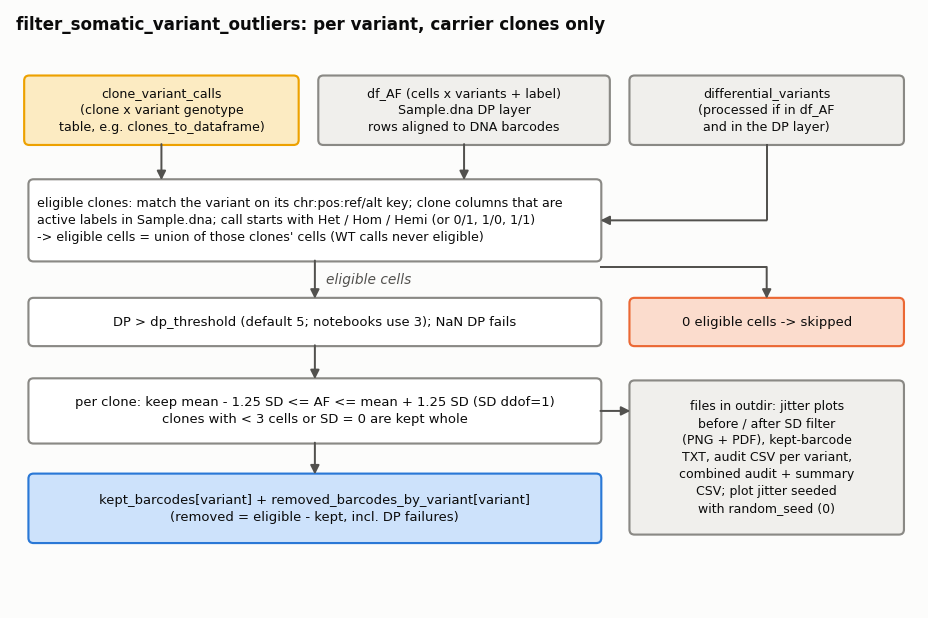

# DNA_Utils

Single-cell DNA genotype processing for Tapestri samples loaded with Mission Bio Mosaic. The package covers the DNA
side of the analysis: cell QC during preprocessing (inter-donor doublets, low-quality / amplicon-loss cells, AF
heatmaps), germline HET marker discovery and its CNV/BAF audit, somatic variant selection, clone tables and clone /
variant UMAPs, per-variant outlier cleaning, and maintenance of the shared Varsome annotation cache. The QC functions
are called from `01_preprocessing/01_Preprocessing_*.ipynb`; the germline, somatic and clone functions from the
per-sample notebooks `03_sample_analysis/03_Sample_Analysis_*.ipynb`.

Conventions used throughout: NGT codes are 0 = WT, 1 = HET, 2 = HOM-ALT, 3 = no call; variant IDs look like
`chr17:7577538:C/T`; **the Mosaic `AF` layer is in percent (0-100)**. Some functions detect the AF scale and rescale
their cut-offs, others do not; each function below says which.

## Modules

| Module | Purpose | Main functions |
|---|---|---|
| `utils` | Variant-ID parsing, assay hygiene, Varsome cache lock / repair, chunked annotation, matrix export | `extract_chr_num`, `repair_varsome_db`, `annotate_assay_in_chunks`, `export_cell_subset_matrices` |
| `qc_filters` | Cell QC: doublet scoring and calls, low-quality cells, fast AF heatmap | `define_doublet_cutoff_per_donor`, `apply_doublet_calls_with_corr_reassign`, `apply_low_quality_qc`, `fast_af_heatmap` |
| `germline` | Germline HET discovery, AF-shape validation, all-variant profile, WT concordance, CNV/BAF marker audit, AF clustering | `run_empirical_all_variant_germline_export`, `add_wt_concordance_and_finalize_germline`, `run_step2_barcode_cnv_audit_pipeline`, `run_af_clustering_only`, `rename_af_clusters_and_update_filtered_germline` |
| `somatic` | Somatic variant selection and heatmap / UMAP plots | `find_somatic_variants`, `visualize_found_differential_variants` |
| `filter_outliers` | Per-variant AF outlier removal inside carrier clones | `filter_somatic_variant_outliers` |
| `clones` | Clone tables, per-clone VAF, clone sizes | `clones_to_dataframe`, `get_VAF`, `get_clones_size` |
| `plot_clones` | One highlight UMAP per clone or per variant | `plot_individual_clone_umaps`, `plot_somatic_variants` |

Everything in `__all__` (see `__init__.py`) is importable as `DNA_Utils.<name>`. A few public module-level functions are
not re-exported (`qc_filters.palette_from_plotly_scatter`, `somatic.plot_somatic_variant_umap_grid`, the germline
`GERMLINE_PATTERN_DIR` / `EMPIRICAL_COHORT_GERMLINE_THRESHOLDS` constants); import them from their module.

## Typical use

Preprocessing QC (multiplexed run; values from `01_Preprocessing_MDS001.ipynb`):

```python
summary_df, donor_calls = DNA_Utils.define_doublet_cutoff_per_donor(
    sample_qc, label_key="label", exclude_labels=EXCLUDED_LABELS,
    min_frac=0.01, max_frac=0.45, slope_ratio_min=3.0, n_boot=300, ci=0.95,
    plot=True, plot_tiny_heatmap=True, heatmap_max_cells=200,
)
reassign_results, final_doublet_calls, sample_subsets = DNA_Utils.apply_doublet_calls_with_corr_reassign(
    sample_qc=sample_qc, donor_calls=donor_calls, donors=summary_df["donor"].tolist(),
    band=0.02, min_shared=40, delta_corr=0.00, label_key="label", write_back=True,
)
summary_df_lowq, fail_lowq, scores_lowq, sample_subsets = DNA_Utils.apply_low_quality_qc(
    sample_qc=sample_qc, DNA_Utils=DNA_Utils, sample_subsets=sample_subsets, IS_MULTIPLEXED=True,
    k_mad=3.5, q=0.975, abs_floor_quantile=0.95, use_low_af_gate=False, heatmap_save_dir=demux_dir,
)
fig = DNA_Utils.fast_af_heatmap(sample_qc, title="AF (post clean-up)")
```

Germline markers and CNV/BAF audit (`03_Sample_Analysis_*.ipynb`):

```python
thresholds = DNA_Utils.get_empirical_cohort_germline_thresholds()
step1 = DNA_Utils.run_empirical_all_variant_germline_export(
    Sample, experiment=EXPERIMENT, patient_id=PATIENT_ID,
    annotation_df=annotations, known_het_variants=germline_whitelist,
    DNA_Utils=DNA_Utils, thresholds=thresholds, out_dir=pattern_dir,
)
step2 = DNA_Utils.add_wt_concordance_and_finalize_germline(
    Sample, step1["all_variant_germline_df"], whitelist, DNA_Utils=DNA_Utils, thresholds=thresholds,
    total_barcodes=len(Sample.dna.row_attrs["barcode"]),
)
step3 = DNA_Utils.run_step2_barcode_cnv_audit_pipeline(
    step2=step2, Sample=Sample, all_variant_germline_df=step2["all_variant_germline_df"],
    CNV_Utils=CNV_Utils, DNA_Utils=DNA_Utils, experiment=EXPERIMENT, patient_id=PATIENT_ID, wd=wd,
)
cluster_out = DNA_Utils.run_af_clustering_only(
    df_AF_all=step3["df_AF_all"], filtered_germline_variants=step3["filtered_germline_variants"],
    patient_id=PATIENT_ID, params=DNA_Utils.AF_CLUSTER_ONLY_DEFAULT_PARAMS,
)
rename_out = DNA_Utils.rename_af_clusters_and_update_filtered_germline(
    variant_af_cluster_df=cluster_out["variant_af_cluster_df"], af_mat=cluster_out["af_mat"],
    df_AF_all=step3["df_AF_all"], filtered_germline_variants=step3["filtered_germline_variants"],
    af_cluster_rename_map={0: "germline_hom", 1: "germline_het", 2: "germline_het", 3: "germline_het",
                           4: "germline_wt", 5: "noisy"},
    loh_cluster_ids=[1, 3], all_variant_germline_df=step3["all_variant_germline_df"], patient_id=PATIENT_ID,
)
filtered_germline_variants = rename_out["filtered_germline_variants"]
```

Somatic variants, clones and plots:

```python
df_clones = DNA_Utils.clones_to_dataframe(wfv, variants=whitelist, max_ado_score=0.8,
                                          min_clone_size=5 / len(Sample.dna.row_attrs["barcode"]) * 100)
differential_variants, corr_hits, wilcox_hits = DNA_Utils.find_somatic_variants(
    df_AF, whitelist, filtered_germline_variants, Sample_subset,
    annotation_df=annotations, wt_label="WT", always_keep_pathogenic=True, pathogenic_bypass_germline_filter=True,
)
kept_barcodes, all_audits, removed = DNA_Utils.filter_somatic_variant_outliers(
    Sample=Sample, df_AF=df_AF, differential_variants=differential_variants,
    clone_variant_calls=df_clones, outdir=outdir, dp_threshold=3, sd_k=1.25,
)
df_vaf = DNA_Utils.get_VAF(Sample, label_col="label", clone_order=order, output_path=f"{outdir}/Pseudobulk_VAFs.csv")
clone_counts = DNA_Utils.get_clones_size(Sample, label_col="label", desired_order=order)
figs = DNA_Utils.plot_individual_clone_umaps(Sample, clone_column="label", outdir=outdir)
```

Variant matrices for a cell set, with Varsome annotation (per-sample notebooks, export cell):

```python
res = DNA_Utils.export_cell_subset_matrices(
    Sample_unfiltered.dna, cell_table, out_dir, annotate=True, annot_chunk_size=1000,
    use_cache_lock=True, repair_on_parse_error=True, formats=("parquet",),
)
# res["annot_failed"] lists (start, stop, error) of annotation chunks that failed
```

---

## utils

Chromosome / ID helpers, assay hygiene and the Varsome cache tools. The cache (`annotations_database.csv`) lives inside
the installed `missionbio.annotation` package and is appended to by every process in the environment without locking.
Two failure modes result: torn lines from concurrent appends (`ParserError: Expected 18 fields ...`) and mixed
`Position` formatting (`'148386525.0'` vs `'148386525'`) that later makes `int()` fail. The cache can be re-pulled from
the API, so dropping rows costs API calls, not information.

<details>
<summary><b><code>extract_chr_num</code></b> — Sortable chromosome number from an ID: <code>chrX</code> 23, <code>chrY</code> 24, <code>chrM</code>/<code>chrMT</code> 25, otherwise <code>int(token[3:])</code>, or 999 if</summary>

`extract_chr_num(variant)`

Source: [utils.py:64](utils.py#L64 "extract_chr_num")

Sortable chromosome number from an ID: `chrX` 23, `chrY` 24, `chrM`/`chrMT` 25, otherwise `int(token[3:])`, or 999 if
that is not an integer (used as a sort key, e.g. `sorted(v, key=DNA_Utils.extract_chr_num)`).

</details>

<details>
<summary><b><code>extract_chr / extract_position</code></b> — Text before the first <code>:</code> (e.g.</summary>

`extract_chr(col) / extract_position(variant)`

Source: [utils.py:94](utils.py#L94 "extract_chr") · [utils.py:110](utils.py#L110 "extract_position")

Text before the first `:` (e.g. `'chr17'`), and the integer second `:` field (-1 if missing or non-integer).

</details>

<details>
<summary><b><code>chrom_key</code></b> — Maps a Series of chromosome labels to sortable ints: strips lowercase <code>chr</code>, upper-cases, 1-22, X 23, Y 24, MT/M 25;</summary>

`chrom_key(s)`

Source: [utils.py:133](utils.py#L133 "chrom_key")

Maps a Series of chromosome labels to sortable ints: strips lowercase `chr`, upper-cases, 1-22, X 23, Y 24, MT/M 25;
other contigs get 1,000,000 + their order of first appearance.

</details>

<details>
<summary><b><code>sanitize_row_attrs / drop_scalar_row_attrs</code></b> — Delete, in place, <code>row_attrs</code> that break Mosaic slicing: 0-D entries and 1-D entries of the wrong length (<code>sanitize</code>),</summary>

`sanitize_row_attrs(assay) / drop_scalar_row_attrs(assay)`

Source: [utils.py:168](utils.py#L168 "sanitize_row_attrs") · [utils.py:187](utils.py#L187 "drop_scalar_row_attrs")

Delete, in place, `row_attrs` that break Mosaic slicing: 0-D entries and 1-D entries of the wrong length (`sanitize`),
or only 0-D entries (`drop_scalar`; no-op for `None`).

</details>

<details>
<summary><b><code>VARSOME_DB_COLUMNS / VARSOME_N_FIELDS / VARSOME_VALID_GENOMES</code></b> — The exact 18-column cache header, its length (18), and the accepted genome tags (<code>hg19, hg38, hg37, GRCh37, GRCh38</code>).</summary>

`VARSOME_DB_COLUMNS, VARSOME_N_FIELDS, VARSOME_VALID_GENOMES`

Source: [utils.py:206](utils.py#L206 "VARSOME_DB_COLUMNS") · [utils.py:228](utils.py#L228 "VARSOME_N_FIELDS") · [utils.py:235](utils.py#L235 "VARSOME_VALID_GENOMES")

The exact 18-column cache header, its length (18), and the accepted genome tags (`hg19, hg38, hg37, GRCh37, GRCh38`).
Importing the module raises `csv.field_size_limit` to 2^31 - 1.

</details>

<details>
<summary><b><code>varsome_db_path</code></b> — Returns the cache path from <code>missionbio.annotation.varsome.Varsome().db_path</code> (<code>AttributeError</code> if absent).</summary>

`varsome_db_path()`

Source: [utils.py:244](utils.py#L244 "varsome_db_path")

Returns the cache path from `missionbio.annotation.varsome.Varsome().db_path` (`AttributeError` if absent).

</details>

<details>
<summary><b><code>varsome_db_lock</code></b> — Context manager: exclusive <code>fcntl.flock</code> on <code>&lt;cache&gt;.lock</code>, polling every 0.5 s for up to 600 s, then <code>TimeoutError</code>.</summary>

`varsome_db_lock(path=None, *, timeout=600.0, poll=0.5, verbose=False)`

Source: [utils.py:275](utils.py#L275 "varsome_db_lock")

Context manager: exclusive `fcntl.flock` on `<cache>.lock`, polling every 0.5 s for up to 600 s, then `TimeoutError`.
Yields the cache path. It only protects the cache when every annotating process uses it.

</details>

<details>
<summary><b><code>repair_varsome_db</code></b> — header, has a valid genome tag and a variant ID containing <code>:</code> and <code>/</code>.</summary>

`repair_varsome_db(path=None, *, backup=True, dry_run=False, dedupe=True, normalize_positions=True, verbose=True)`

Source: [utils.py:432](utils.py#L432 "repair_varsome_db")



1. Reads the cache with `csv.reader` and classifies each data row: kept only if it has 18 fields, is not a repeated
   header, has a valid genome tag and a variant ID containing `:` and `/`. Drop reasons are counted
   (`field_count(n)`, `repeat_header`, `bad_genome(...)`, `bad_variant_id(...)`). Rows with blank later fields are kept.
2. `normalize_positions`: `Position` is rewritten as a bare integer string (`'123.0'` -> `'123'`; `nan` / `none` ->
   blank). Unparseable or truly fractional values are left alone.
3. `dedupe`: one row per (Genome, Variant ID); the first row is kept unless a later one has strictly more non-blank fields.
4. `dry_run=True` returns the counts without writing. If nothing changed and the header is canonical, the file is not
   rewritten.
5. Otherwise: copy to `<name>.<YYYYmmdd_HHMMSS>.bak`, write `<name>.tmp` (canonical header, `QUOTE_MINIMAL`, `\n`) and
   `os.replace` it over the cache.
6. Verifies by re-reading with `pd.read_csv(index_col=[0, 1])`: 16 data columns, the expected row count and (when
   normalising) a non-object `Position` dtype; otherwise `AssertionError` naming the backup.

Returns `{path, backup, n_before, n_kept, n_dropped, n_deduped, n_positions_fixed, reasons}`;
`FileNotFoundError` if the cache does not exist.

</details>

<details>
<summary><b><code>annotate_with_repair</code></b> — Calls <code>assay.get_annotations()</code> (inside <code>varsome_db_lock</code> when <code>lock</code>).</summary>

`annotate_with_repair(assay, *, max_attempts=2, lock=True, repair_on_parse_error=True, verbose=True)`

Source: [utils.py:628](utils.py#L628 "annotate_with_repair")

Calls `assay.get_annotations()` (inside `varsome_db_lock` when `lock`). On a `ParserError`, or a `ValueError` whose
message contains `invalid literal for int()` and a `.`, it runs `repair_varsome_db()` on the default cache (outside the
lock) and retries, up to `max_attempts` calls in total. Other errors, and the cache error on the last attempt, propagate.

</details>

<details>
<summary><b><code>annotate_assay_in_chunks</code></b> — Splits the variants into chunks of 1000 and annotates each with <code>annotate_with_repair</code>, up to 3 tries per chunk with a</summary>

`annotate_assay_in_chunks(assay, *, chunk_size=1000, max_retries=3, backoff_sec=5.0, add_col_attrs=True, id_key="id", use_cache_lock=True, repair_on_parse_error=True, verbose=True)`

Source: [utils.py:696](utils.py#L696 "annotate_assay_in_chunks")

Splits the variants into chunks of 1000 and annotates each with `annotate_with_repair`, up to 3 tries per chunk with a
`5 s x attempt` sleep between tries. A chunk that fails all tries is recorded as `(start, stop, repr(error))` instead
of raising. If a chunk result has the right length but different ids, its index is re-keyed to the chunk ids by
position. Results are concatenated, duplicate ids dropped (first kept), reindexed to the assay's variant order (NaN for
unannotated variants) and, with `add_col_attrs`, every annotation column is written back as a `col_attr`. Returns
`(merged, failed)`; `RuntimeError` if every chunk failed.

</details>

<details>
<summary><b><code>subset_assay_to_cells</code></b> — Takes an iterable of barcodes (or anything with <code>.index</code>), string-matches it to the assay, sanitises the input assay&#x27;s</summary>

`subset_assay_to_cells(assay, barcodes, *, preserve_assay_order=True, require_any=True, verbose=True)`

Source: [utils.py:824](utils.py#L824 "subset_assay_to_cells")

Takes an iterable of barcodes (or anything with `.index`), string-matches it to the assay, sanitises the input assay's
`row_attrs` and returns `copy.copy(assay)[barcodes, :]`. Prints matched / missing counts; `ValueError` if nothing
overlaps and `require_any`.

</details>

<details>
<summary><b><code>variant_metadata_frame</code></b> — One row per variant: every 1-D variant-length <code>col_attr</code>, parsed <code>chrom</code> / <code>position</code>, optional external annotations</summary>

`variant_metadata_frame(assay, *, annotations=None, id_key="id", include_subset_stats=True, include_af_dp_stats=False, ngt_layer="NGT", sort_genomic=False, verbose=True)`

Source: [utils.py:903](utils.py#L903 "variant_metadata_frame")

One row per variant: every 1-D variant-length `col_attr`, parsed `chrom` / `position`, optional external annotations
(clashing names get `_annot`), and NGT summaries over the assay's cells (`n_WT/HET/HOM/missing`, `genotype_rate`,
`mutated_cell_frac` = (HET+HOM)/genotyped, `vaf_by_cell_count` = 100 (HET + 2 HOM) / (2 genotyped)); optionally mean AF /
DP over genotyped cells, and a genomic sort.

</details>

<details>
<summary><b><code>export_assay_layers</code></b> — Writes one cells x variants file per layer (<code>&lt;layer&gt;&lt;suffix&gt;.&lt;fmt&gt;</code>) with a leading <code>label</code> column (from</summary>

`export_assay_layers(assay, out_dir, *, layers=None, suffix="", label_key="label", parquet=False, formats=None, downcast=True, size_warn_gb=2.0, verbose=True)`

Source: [utils.py:1068](utils.py#L1068 "export_assay_layers")

Writes one cells x variants file per layer (`<layer><suffix>.<fmt>`) with a leading `label` column (from
`get_labels()`, else `'NA'`). Downcasts NGT to int8 and float layers to float32; warns above an estimated 2 GB CSV.
Returns `{layer: path}` (or `{layer: {fmt: path}}` for several formats).

</details>

<details>
<summary><b><code>export_cell_subset_matrices</code></b> — Orchestrator: optionally annotates the full assay with <code>annotate_assay_in_chunks</code>, subsets it to <code>barcodes</code>, exports the</summary>

`export_cell_subset_matrices(assay, barcodes, out_dir, *, annotate=False, annot_chunk_size=1000, layers=("NGT", "AF"), suffix="_all_variants", metadata_formats=("csv",), ...)`

Source: [utils.py:1191](utils.py#L1191 "export_cell_subset_matrices")

Orchestrator: optionally annotates the full assay with `annotate_assay_in_chunks`, subsets it to `barcodes`, exports the
layers and writes `variant_metadata<suffix>.<fmt>` from `variant_metadata_frame`. Returns
`{assay, annotations, annot_failed, metadata, paths}`.

Private helpers:

| Helper | Purpose |
|---|---|
| `_varsome_classify_row` | `'ok'` or the drop reason for one cache row |
| `_varsome_n_populated` | Count of non-blank fields (dedupe tie-break) |
| `_varsome_normalize_position` | Rewrite `Position` to a bare integer string in place |
| `_is_varsome_cache_dtype_error` | True only for the `invalid literal for int()` + `.` `ValueError` |

</details>

---

## qc_filters

Cell-level QC on per-cell AF matrices, either a DataFrame `[label] + variant columns` or a Mosaic Sample / dna assay.

<details>
<summary><b><code>flag_doublet_change_cells</code></b> — Scores the cells of one donor for doublet-like AF profiles. <b>No AF rescaling is done</b>: every cut-off is used on the</summary>

`flag_doublet_change_cells(df, label_col="label", af_change_cut=0.30, min_variant_af=0.10, max_variant_af=0.90, z_k=3.5, min_informative=30, return_scores=True, min_gain_frac=0.01, min_loss_frac=0.01, cross_donor_refs=None, donor_name=None, disc_af_diff=0.20, min_disc_variants=5)`

Source: [qc_filters.py:90](qc_filters.py#L90 "flag_doublet_change_cells")

Scores the cells of one donor for doublet-like AF profiles. **No AF rescaling is done**: every cut-off is used on the
scale of the input. `define_doublet_cutoff_per_donor` passes Mosaic AF (percent), so the 0-1 style defaults act as
percentage points.



1. Consensus = the donor's per-variant median AF.
2. Informative variants: median in [`min_variant_af`, `max_variant_af`] = [0.10, 0.90]. On percent AF this is a median
   between 0.1 % and 0.9 %, so usually fewer than `min_informative` = 30 variants qualify and **all variants are used**,
   including loci where the donor is WT.
3. Discriminating mode (only when `cross_donor_refs` has more than one donor and contains `donor_name`): variants whose
   median differs from any other donor's median by >= `disc_af_diff` = 0.20 (0.2 percentage points on percent AF). If at
   least 5 such variants exist, and at least 5 remain after intersecting with the informative set, the active set is
   that intersection; otherwise the informative set.
4. Per cell, d = AF - consensus on the active variants; gain = d >= +0.30, loss = d <= -0.30 (0.3 percentage points on
   percent AF, so almost any deviation counts). `frac_gain`, `frac_loss`, `frac_changed` are counts / number of active
   variants.
5. `frac_changed_bidir = 2 x min(frac_gain, frac_loss)` is the metric used by the per-donor cutoff.
6. Also returned: `fail_bidir` (bidir >= its median AND gain >= 0.01 AND loss >= 0.01) and the legacy `fail`:
   `af_dilution` = mean drop below the consensus at variants with median >= 0.30, `score = robust_z(frac_changed) +
   robust_z(af_dilution)`, `fail = score > median + 3.5 x 1.4826 x MAD(score)`.

Returns `fail` or `(fail, qc)` with `qc` = `frac_changed, frac_gain, frac_loss, frac_changed_bidir, af_dilution,
change_score, threshold, fail_bidir, n_disc_variants` (number of active variants) and `used_discriminating`.

</details>

<details>
<summary><b><code>piecewise_elbow_threshold</code></b> — Sorts the finite values high -&gt; low and, for every split k in <code>[max(5, int(min_frac n)), min(n - 5, int(max_frac n))]</code>,</summary>

`piecewise_elbow_threshold(values, min_frac=0.02, max_frac=0.40, slope_ratio_min=3.0)`

Source: [qc_filters.py:270](qc_filters.py#L270 "piecewise_elbow_threshold")

Sorts the finite values high -> low and, for every split k in `[max(5, int(min_frac n)), min(n - 5, int(max_frac n))]`,
fits one line to the first k points and one to the rest. Among splits where both slopes are negative and
`|m1| / |m2| >= slope_ratio_min`, the lowest total squared error wins; if none qualifies, the lowest-SSE split overall.
Returns `(y_sorted[k], k, info)`, or `(nan, -1, {})` with fewer than 20 finite values or an empty split range.

</details>

<details>
<summary><b><code>define_doublet_cutoff_per_donor</code></b> — Per-donor doublet threshold on a Mosaic Sample.</summary>

`define_doublet_cutoff_per_donor(sample_qc, label_key="label", exclude_labels=("Mixed", "Low_quality"), min_frac=0.01, max_frac=0.55, slope_ratio_min=3.0, n_boot=200, ci=0.95, near_ci_mult=1.0, plot=True, figsize=(5.0, 2.6), plot_tiny_heatmap=False, heatmap_max_cells=250, use_bidirectional=True, min_gain_frac=0.01, min_loss_frac=0.01, disc_af_diff=0.20, min_disc_variants=5)`

Source: [qc_filters.py:431](qc_filters.py#L431 "define_doublet_cutoff_per_donor")

Per-donor doublet threshold on a Mosaic Sample.



1. Donors = sorted labels minus `exclude_labels`. Consensus (median AF) profiles are built for donors with >= 10 cells.
   With >= 2 such donors it prints the number of discriminating variants over all donor pairs (|median difference|
   >= 0.20, i.e. 0.2 percentage points) and, per donor, how many have consensus AF < 0.05 ("silent"; on percent AF
   essentially AF = 0).
2. Each donor's AF matrix (percent, not rescaled) is scored with `flag_doublet_change_cells` (its default cut-offs, see
   above), in discriminating mode when >= 2 consensus profiles exist. It prints which variant mode was used.
3. Metric = `frac_changed_bidir` (or `frac_changed` with `use_bidirectional=False`), finite cells only. Donors with < 20
   finite values get a NaN threshold and every cell `Singlet_HighConf`.
4. Threshold = `piecewise_elbow_threshold(metric, min_frac=0.01, max_frac=0.55, slope_ratio_min=3)`. Bootstrap: 200
   resamples (RNG seed 42), 95 % quantile CI if >= 10 finite bootstrap thresholds, else CI = threshold.
5. `fail = metric >= threshold`; `borderline = |metric - thr| <= 1.0 x max(CI half-width, 1e-6)`. Class labels:
   `Doublet_HighConf`, `Doublet_Borderline`, `Singlet_Borderline`, `Singlet_HighConf`.
6. With `plot`, one elbow plot per donor (sorted metric, dashed threshold, CI band, dotted k), optionally with a metric
   strip and a small AF heatmap (`plot_tiny_heatmap`, at most `heatmap_max_cells` rows).

Returns `(summary_df, donor_calls)`: one summary row per donor (`threshold, ci_low, ci_high, n_flagged, pct_flagged,
n_borderline, metric, n_disc_variants, used_discriminating`) and a dict per donor with cell ids, metric values,
threshold, CI, `fail`, `borderline`, `class_label` and bootstrap thresholds. Because of the percent-AF issue in step 2,
the metric mostly counts small two-sided AF deviations from the donor median; cells with heavy allele dropout also
score high (see Known quirks).

</details>

<details>
<summary><b><code>apply_doublet_calls_with_corr_reassign</code></b> — Final doublet calls from <code>donor_calls</code> (right panel of the figure above).</summary>

`apply_doublet_calls_with_corr_reassign(sample_qc, donor_calls, donors=None, label_key="label", band=0.02, min_shared=40, delta_corr=0.00, mixed_label="Mixed", write_back=True)`

Source: [qc_filters.py:714](qc_filters.py#L714 "apply_doublet_calls_with_corr_reassign")

Final doublet calls from `donor_calls` (right panel of the figure above). Per donor: metric >= thr + 0.02 ->
`HighChange` (doublet); metric < thr - 0.02 -> `LowChange` (kept); cells in between are correlated (Pearson, >= 40
shared finite variants) with the donor's median profile and with the median profile of all `Mixed` cells. They become
doublets (`Borderline->Mixed`) when `corr_mixed - corr_donor >= 0` or only `corr_mixed` is finite, and stay
(`Borderline->Donor`) otherwise, always so when there are no Mixed cells. The fixed `band` is used; the CI-based
borderline classes of `define_doublet_cutoff_per_donor` are not. Returns `(reassign_results, final_doublet_calls,
sample_subsets)`: per-donor tables (metric, group, `fail_final`, correlations), boolean calls and per-donor
sub-assays. With `write_back`, the **sub-assays** get `label_original`, `label` (doublets -> `Mixed`) and
`doublet_group`; `sample_qc` itself is not modified.

</details>

<details>
<summary><b><code>flag_amplicon_loss_cells</code></b> — Flags noisy / amplicon-loss cells by their deviation from the donor consensus at germline-stable loci.</summary>

`flag_amplicon_loss_cells(df, label_col="label", informative_range=(0.10, 0.90), stability_quantile=0.35, min_stable_loci=25, fallback_quantile=0.50, min_shared_corr=20, score_weights=(1.0, 1.0, 0.7), k_mad=5.0, q=0.995, min_cells=20, return_scores=True)`

Source: [qc_filters.py:896](qc_filters.py#L896 "flag_amplicon_loss_cells")

Flags noisy / amplicon-loss cells by their deviation from the donor consensus at germline-stable loci. Scale-aware: if
the AF 99th percentile is > 1.5 the AF is divided by 100, so the ranges below are on a 0-1 scale.
Per donor with >= 20 cells (`Mixed` and `Low_quality` skipped): consensus = per-variant median; stable loci =
informative variants (median 0.10-0.90) whose per-variant MAD is <= the 35th percentile of those MADs; with fewer than 25
stable loci, all variants with MAD <= the 50th percentile are used; with fewer than 3 the donor is skipped. Per cell on
the stable loci: `noise_mad` (median |AF - consensus|), `one_minus_corr` (1 - Pearson r with the consensus, >= 20 shared
loci, NaN -> donor median), `nan_frac`. Score = `1.0 z(noise_mad) + 1.0 z(one_minus_corr) + 0.7 z(nan_frac)` (robust z),
flag `score >= max(median + 5 x 1.4826 x MAD, 99.5th percentile)` (or `median + 5 SD` when < 20 finite scores). With
`q = 0.995` at most about 0.5 % of a donor's cells can be flagged. Returns `fail` and a score table
(`noise_mad, one_minus_corr, nan_frac, composite_score, threshold, n_stable_loci`).

</details>

<details>
<summary><b><code>flag_spurious_gain_cells</code></b> — Flags cells with AF spikes at variants their label group should be silent at.</summary>

`flag_spurious_gain_cells(df, label_col="label", silent_max=0.02, k_mad=5.0, high_floor=0.15, frac_spike_threshold=0.30, min_silent=10, return_scores=True)`

Source: [qc_filters.py:1087](qc_filters.py#L1087 "flag_spurious_gain_cells")

Flags cells with AF spikes at variants their label group should be silent at. AF is divided by 100 when its maximum is
> 1.8. A variant is silent for a group when the group median AF < 0.02; a spike is AF above
`clip(median + 5 x 1.4826 x MAD, 0.15, 1.0)`; a cell fails when >= 30 % of its silent variants spike and it has >= 10
silent variants. Returns flags and `frac_spike_vs_silent, silent_count, flag_fail`. Not used by the notebooks.

</details>

<details>
<summary><b><code>apply_low_quality_qc</code></b> — Relabels low-quality cells of a Sample to <code>Low_quality</code> with OR-ed gates.</summary>

`apply_low_quality_qc(sample_qc, DNA_Utils, sample_subsets=None, IS_MULTIPLEXED=False, label_key="label", mixed_label="Mixed", lowq_label="Low_quality", k_mad=3.75, q=0.975, min_donor_cells=20, abs_global_dropout=0.50, abs_low_af_info=0.50, depth_adaptive=True, abs_floor_quantile=0.98, use_global_dropout_gate=True, use_low_af_gate=False, use_combined_gate=True, combined_quantile=0.95, min_effect_size=2, protect_localized_loh=False, loh_shift=0.35, ..., show_global_heatmap=True, show_subset_heatmaps=True, heatmap_save_dir=None)`

Source: [qc_filters.py:2121](qc_filters.py#L2121 "apply_low_quality_qc")

Relabels low-quality cells of a Sample to `Low_quality` with OR-ed gates. It detects percent AF (99th percentile
> 1.5) and uses 1 % / 10 % / 5 % instead of 0.01 / 0.10 / 0.05 for its own AF cuts.



1. Per-cell metrics: `dropout` = fraction of all loci that are missing or AF <= 1 % (true WT loci count too);
   `low-AF fraction` = fraction of donor-informative loci (donor median >= 10 %) that are missing or < 5 %.
2. Gate 1 (always): `DNA_Utils.flag_amplicon_loss_cells(df, label_col=label_key)` with **its own** defaults
   (`k_mad=5`, `q=0.995`), not the caller's `k_mad` / `q`.
3. Gate 2 (`use_global_dropout_gate`, on): per donor, `thr = min(median + 3.75 x 1.4826 x MAD, 97.5th pct)` of
   dropout (donors < 20 cells use the threshold of all non-Mixed / non-Low_quality cells pooled). Flag if
   `dropout > thr` AND `(dropout - thr) / SE >= 2` with `SE = sqrt(thr (1 - thr) / n_loci)`, OR
   `dropout >= max(0.50, donor 98th pct)` (`depth_adaptive`; without it the floor is 0.50).
4. Gate 3 (`use_low_af_gate`, off): the same rule on the low-AF fraction (donor >= 20 cells and >= 10 informative loci).
5. Gate 4 (`use_combined_gate`, on): dropout >= donor 95th pct AND low-AF fraction >= donor 95th pct AND both effect
   sizes >= 2 (donor >= 20 cells, >= 10 informative loci).
6. Optional localized-LOH rescue (`protect_localized_loh`, off): per donor, loci with median 20-80 %; hits =
   `|AF - median| >= loh_shift` (0.35, not rescaled, so 0.35 percentage points); a cell with >= 10 hits, >= 75 % of them on
   one chromosome and <= 2 chromosomes with >= 4 hits is removed from the flags.
7. Flagged cells (except `Mixed`) get `lowq_label`. Row attrs written to `sample_qc.dna`: `label`, `lowq_germline_fail`,
   `lowq_germline_score`, `lowq_stable_loci_n`, `loh_protected`, `chr7_loh_protected` (same mask). Prints per-gate
   additions, a summary and label counts; draws `fast_af_heatmap` globally (`AF_lowq_global.png` in
   `heatmap_save_dir`) and, when multiplexed, per subset after copying labels into the subsets by barcode.

Returns `(summary_df, fail, scores, sample_subsets)`. The preprocessing notebooks pass `k_mad=3.5` and
`abs_floor_quantile=0.95`, so there the gate-2 floor is `max(0.50, donor 95th pct)`.

</details>

<details>
<summary><b><code>fast_af_heatmap</code></b> — Rasterised matplotlib heatmap of an assay layer (default AF) with rows grouped by <code>label_key</code>.</summary>

`fast_af_heatmap(sample_or_assay, label_key="label", attribute="AF", features=None, group_order=None, max_cells_per_group=2000, max_total_cells=20000, cluster_variants=True, cluster_groups=True, cluster_cells_within_group=True, sort_within_group_by=None, cmap=None, clip_percentiles=(1, 99), palette="auto", title=None, save_path=None, show=True, return_order=False, ...)`

Source: [qc_filters.py:1669](qc_filters.py#L1669 "fast_af_heatmap")

Rasterised matplotlib heatmap of an assay layer (default AF) with rows grouped by `label_key`. Columns are clustered
(correlation, average linkage, on <= 2000 evenly spaced cells; constant columns last) unless `features` is given;
groups are naturally sorted (or `group_order`) and optionally ordered by clustering their median profiles; each group is
thinned to `min(max_cells_per_group, max(50, max_total_cells // n_groups))` rows and clustered or sorted by
`sort_within_group_by`. Colour limits are the 1st / 99th percentiles, widened to include the centre (50 for percent AF,
0.5 otherwise) of a two-slope norm. A left label strip uses the Mosaic scatterplot palette when it can be extracted
(else the Mission Bio colours). Figure size scales with cells and variants (8-18 x 8-55 in). Saves to `save_path`,
shows, and returns the figure (or `(fig, rendered_cell_index, column_order)` with `return_order`).

</details>

<details>
<summary><b><code>palette_from_plotly_scatter</code></b> — <code>{trace name: marker colour}</code> from a Plotly scatterplot (e.g.</summary>

`palette_from_plotly_scatter(fig, label_values=None)`

Source: [qc_filters.py:1390](qc_filters.py#L1390 "palette_from_plotly_scatter")

`{trace name: marker colour}` from a Plotly scatterplot (e.g. `sample.dna.scatterplot(colorby="label")`), to pass as
`fast_af_heatmap(..., palette=...)`. Falls back to the Mission Bio colour cycle over `label_values`, else `{}`.

Private helpers:

| Helper | Purpose |
|---|---|
| `_robust_z` | Modified z-score `0.6745 (x - median) / (MAD + 1e-12)` (doublet and amplicon-loss scores) |
| `_af_dataframe` | AF layer of an assay as a DataFrame |
| `_corr_complete_obs` | Pearson r over shared finite positions (NaN below `min_shared` or if constant) |
| `_two_line_fit` | Two straight-line fits and their SSE for one split |
| `_plot_doublet_elbow`, `_draw_elbow_panel`, `_tiny_heatmap_matrix` | Elbow plot and the optional tiny heatmap |
| `_cluster_columns`, `_cluster_row_index`, `_cluster_group_order`, `_prep_for_clustering` | SciPy average-linkage orders (fallback: input order) |
| `_group_palette`, `_coerce_palette`, `_auto_scatterplot_palette`, `_missionbio_colors`, `_natkey` | Label colours and natural sort |
| `_resolve_cmap`, `_default_af_heatmap_cmap`, `_af_colour_limits`, `_auto_heatmap_figsize`, `_grouped_row_order`, `_draw_label_strip` | Heatmap colour scale, size, row order and label strip |
| `_donor_label_list`, `_mad_or_quantile_threshold`, `_binomial_se`, `_low_af_fraction` | Low-quality gate helpers |
| `_extract_chrom`, `_localized_loh_mask` | Localized-LOH rescue rule |

</details>

---

## germline

Germline HET marker discovery and auditing. The module is organised in seven sections (see its docstring). The
notebook flow is: `run_empirical_all_variant_germline_export` (step 1) -> `add_wt_concordance_and_finalize_germline`
(step 2) -> `run_step2_barcode_cnv_audit_pipeline` (matrices + CNV/BAF audit + final markers) ->
`run_af_clustering_only` -> `rename_af_clusters_and_update_filtered_germline`. AF is in percent throughout this module.

### 1. Legacy discovery and plotting

<details>
<summary><b><code>get_real_somatic_variants</code></b> — Flattens and strips the variant IDs, removes those in the germline list, keeps IDs present in</summary>

`get_real_somatic_variants(differential_variants, filtered_germline_in_samples, sample, use_consequence_if_available=True)`

Source: [germline.py:57](germline.py#L57 "get_real_somatic_variants")

Flattens and strips the variant IDs, removes those in the germline list, keeps IDs present in
`sample.dna.col_attrs["id"]` and drops intronic ones: `Consequence` contains "intron" when that column exists, otherwise
`Protein` contains `p.?` or is blank. Returns a string array in input order; `KeyError` without an `id` column. Used by
`find_somatic_variants`.

</details>

<details>
<summary><b><code>visualize_found_germline_variants</code></b> — Picks variants (explicit IDs, a class / seed-column filter on an all-variant table, or every assay variant), computes</summary>

`visualize_found_germline_variants(Sample_T_subset, wd, MBio_batch, Patient_ID, variant_ids=None, variant_df=None, variant_class_col="germline_broad_class", variant_classes=None, seed_col=None, output_label=None, cytobands_path=None, save_plots=True, show_plots=True, min_variants_per_chr=2)`

Source: [germline.py:136](germline.py#L136 "visualize_found_germline_variants")

Picks variants (explicit IDs, a class / seed-column filter on an all-variant table, or every assay variant), computes
pseudobulk VAF (mean AF over cells) and draws a log-scale VAF histogram, a genome-wide stem plot
(`chrov.plot_with_chroms`), per-chromosome stem plots (chromosomes with >= 2 variants) and a faceted VAF-vs-position
scatter. Saves PNG + PDF under `{wd}/results/per_sample/{batch}/{patient}/dna_cnv/variants/germline_variants`; returns
the per-variant table with VAF.

</details>

<details>
<summary><b><code>find_germline_variants</code></b> — The original AF-window germline filter.</summary>

`find_germline_variants(Sample, keep_labels, annotation_df=None, af_min_common=25, af_max_common=75, af_min_novel=40, af_max_novel=60, max_hom_frac=0.25, max_ngt_frac=0.80, min_dp=5, min_valid_cells=20, min_call_rate_after_ngt_dp=0.20, min_het_to_hom_alt_ratio=3.0, min_het_frac_among_alt_valid=0.75, min_het_valid_cells=3, exclude_pathogenic=True, common_variant_paths=None, known_het_variants=None, blacklist_paths=None, common_requires="either", return_qc=False, verbose=True, ...)`

Source: [germline.py:636](germline.py#L636 "find_germline_variants")

The original AF-window germline filter. Its QC table is also the master table of the all-variant profile.



1. Subset to cells whose protein label is in `keep_labels` (`ValueError` if none). Scalar `row_attrs` of `Sample.dna`
   and `Sample.protein` are dropped in place.
2. Per variant, valid cells = NGT in {0, 1, 2} and DP >= 5 (DP filter off when `min_dp <= 0` or no DP layer). Counts,
   fractions, call rate and mean / median AF are computed on valid cells.
3. Flags: ClinVar text containing "pathogenic" but not "benign" -> `is_pathogenic_excluded`; inside a blacklist BED /
   CSV interval -> `is_blacklisted`; in the dbSNP / gnomAD ID files (union, or intersection with
   `common_requires="both"`) -> `is_common_resource`. Known-HET IDs (`known_het_variants` and/or
   `known_het_variant_paths`) are added to the common set; with no known-HET input the common set is used as the known
   set.
4. Pass = (a) >= 20 valid cells, call rate >= 0.20, NGT-missing <= 0.80, HOM fraction <= 0.25; AND (b) mean valid AF in
   25-75 % (common) or 40-60 % (other); AND (c) N_HET >= 3, N_HET / N_HOM >= 3 (no HOM passes), N_HET / (N_HET + N_HOM)
   >= 0.75; AND (d) not pathogenic, not blacklisted.

Returns `(filtered_germline_variants, Sample_T_subset)` or, with `return_qc`, also the sorted QC table.
`Sample_T_subset.dna_subset` holds the passing variants (None if none) and `.germline_qc` the QC table. Default
resource paths are hard-coded cluster paths under `/project/meadlab/shared/02__Projects/`.

</details>

### 2. AF-shape validation

<details>
<summary><b><code>validate_germline_by_af</code></b> — Checks that each candidate&#x27;s AF looks like a diploid HET.</summary>

`validate_germline_by_af(Sample_T_subset, candidate_variants, common_variant_ids=None, known_het_ids=None, *, selection_mode="het_calls", af_band=(15.0, 95.0), min_dp_af=2, ref_min_cells=30, ref_min_total_dp=300, ref_af_lo=40.0, ref_af_hi=60.0, ref_min_n=10, min_ref_spread=3.0, k_tol=3.0, tol_cap=20.0, enable_dispersion=True, k_disp=2.5, min_eval_total_dp=100, min_eval_cells=5, keep_known_low_evidence=True, min_weak_cells=3, keep_indels=False, verbose=True)`

Source: [germline.py:1418](germline.py#L1418 "validate_germline_by_af")

Checks that each candidate's AF looks like a diploid HET. Cells: NGT == 1 and DP >= 2 (or NGT in {1, 2}, DP >= 2 and
15 <= AF <= 95 in `af_band` mode). Per variant: depth-weighted `pooled_af = 100 sum(AF/100 x DP) / sum(DP)`,
`se = 50 / sqrt(sum DP)`, and the robust SD of `z = 2 sqrt(DP) (AF/100 - 0.5)`. Reference: common / whitelisted SNVs
with >= 30 cells, >= 300 reads and pooled AF 40-60; with >= 10 of them, centre = median pooled AF, spread = max(SD, 3),
z-SD = median robust SD; else centre 50, spread 7, z-SD 1.5. Status ladder: indel -> `indel_af_unreliable`; 0 cells ->
`absent`; < 100 reads or < 5 cells -> `whitelist_low_evidence` (whitelisted, >= 3 cells, centred) or
`insufficient_evidence`; `|pooled - centre| > min(3 sqrt(spread^2 + se^2), 20)` -> `af_skewed`; robust SD > 2.5 x z-SD
-> `overdispersed`; else `validated`. Pass = validated (+ whitelist_low_evidence by default; + whitelisted indels with
>= 3 cells if `keep_indels`). Returns `(passing list, per-variant profile, {n_reference, centre, spread, z_sd})`.

</details>

<details>
<summary><b><code>review_failed_variants</code></b> — Second look at af_skewed / insufficient_evidence non-indel variants: AF zone (<code>ref_like</code> &lt; 15, <code>hom_like</code> &gt; 82, else</summary>

`review_failed_variants(prof, *, ref_z_sd, review_status=("af_skewed", "insufficient_evidence"), min_review_cells=30, consistency_mult=1.0, ref_like_below=15.0, hom_like_above=82.0, near_window=50000, verbose=True)`

Source: [germline.py:1715](germline.py#L1715 "review_failed_variants")

Second look at af_skewed / insufficient_evidence non-indel variants: AF zone (`ref_like` < 15, `hom_like` > 82, else
biased-HET low / high), consistency (robust SD <= reference z-SD and >= 30 cells), chrX non-PAR flag (hg19) and the
number of other reviewed variants within 50 kb. Verdict: `review_hom_or_ref`, `inconclusive` or `likely_usable_het`.

</details>

<details>
<summary><b><code>genotype_af_cutoffs</code></b> — Pools every called (cell, variant) with DP &gt;= 5, bins by AF (2 % bins, &gt;= 50 per bin) and finds where the genotype</summary>

`genotype_af_cutoffs(Sample_T_subset, *, min_dp=5, af_bin=2.0, min_bin_n=50, dp_bands=((5, 15), (15, 40), (40, inf)), evaluate_variants=None, plot=True, ax=None)`

Source: [germline.py:1841](germline.py#L1841 "genotype_af_cutoffs")

Pools every called (cell, variant) with DP >= 5, bins by AF (2 % bins, >= 50 per bin) and finds where the genotype
caller switches: lower cutoff = lowest bin where HET > WT fraction, upper = highest bin where HET > HOM. Repeated per DP
band. Optionally returns a placement table (`compute_genotype_structure`) and plots the call-fraction curves. Returns
`(cutoffs, binned, bands, placement)`.

</details>

### 3. All-variant profiling

<details>
<summary><b><code>compute_genotype_structure</code></b> — Per variant over called cells with DP &gt;= 5: number of cells, WT / HET / HOM fractions, 10th / 50th / 90th percentile AF</summary>

`compute_genotype_structure(Sample_T_subset, variants, *, min_dp=5, lower=nan, upper=nan)`

Source: [germline.py:2070](germline.py#L2070 "compute_genotype_structure")

Per variant over called cells with DP >= 5: number of cells, WT / HET / HOM fractions, 10th / 50th / 90th percentile AF
of HET cells and the margins of that distribution to the caller cutoffs. This is the donor-genotype evidence used by the
later steps.

</details>

<details>
<summary><b><code>variant_level_ngt_af_dp_profile</code></b> — Descriptive per-variant table over valid cells (call, DP &gt;= 2, finite AF): WT / HET / HOM counts and fractions, DP</summary>

`variant_level_ngt_af_dp_profile(Sample_T_subset, variants, *, min_dp=2)`

Source: [germline.py:2169](germline.py#L2169 "variant_level_ngt_af_dp_profile")

Descriptive per-variant table over valid cells (call, DP >= 2, finite AF): WT / HET / HOM counts and fractions, DP
summaries, pooled AF and AF percentiles over all valid, HET and alt-like cells. Missing variants get
`present_in_T_subset=False`.

</details>

<details>
<summary><b><code>build_and_save_all_variant_germline_profile</code></b> — One row per panel variant.</summary>

`build_and_save_all_variant_germline_profile(Sample, DNA_Utils=None, *, patient_id, annotation_df, known_het_variants=None, keep_labels=("CD4_T", "CD8_T", "Other_T"), out_dir=GERMLINE_PATTERN_DIR, descriptive_min_dp=2, placement_min_dp=5, min_frac_het_for_het=0.55, max_frac_hom_for_het=0.20, max_frac_wt_for_het=0.90, min_called_cells_for_genotype=20, min_cells_for_run=50, verbose=True)`

Source: [germline.py:2293](germline.py#L2293 "build_and_save_all_variant_germline_profile")

One row per panel variant. Merges the `find_germline_variants(return_qc=True)` QC table with `validate_germline_by_af`
(on all variants), `review_failed_variants`, `variant_level_ngt_af_dp_profile` (DP >= 2) and the caller placement
(`placement_*`, DP >= 5). `donor_genotype` from the placement fractions (no data -> uncalled; < 20 cells ->
low_coverage; HOM >= 0.20 -> hom_alt; WT >= 0.90 -> hom_ref; HET >= 0.55 -> het; else low_occupancy).
`germline_broad_class`: pathogenic / blacklisted -> excluded; no status -> missing; indel -> `indel_af_unreliable`;
donor not het -> absent / low_coverage_review / likely_hom_alt / likely_hom_ref / het_low_occupancy_review; donor het ->
`clean_germline_het` (validated), `rescued_germline_het_whitelist_low_evidence`, `rescued_germline_het_candidate`
(review likely_usable_het), `likely_hom_or_ref`, or the AF status. Seeds: clean, rescued (the two rescued classes),
usable = clean OR rescued. Writes `{out_dir}/{patient_id}_variants_germline_data.csv`; warns but continues when the
subset has fewer than `min_cells_for_run` cells. Returns `(table, Sample_T_subset, meta)`.

</details>

<details>
<summary><b><code>run_all_variant_germline_profile_export</code></b> — Wrapper: builds a filesystem-safe <code>&lt;experiment&gt;_&lt;patient_id&gt;</code> ID, calls the builder and adds <code>germline</code>,</summary>

`run_all_variant_germline_profile_export(Sample, *, experiment, patient_id, annotation_df, ...)`

Source: [germline.py:2756](germline.py#L2756 "run_all_variant_germline_profile_export")

Wrapper: builds a filesystem-safe `<experiment>_<patient_id>` ID, calls the builder and adds `germline`,
`clean_germline`, `rescued_germline`, `ref` and the export ID to the metadata. `ValueError` if experiment or patient ID
is missing. Its `min_cells_for_run` is not forwarded.

</details>

### 4. WT population and concordance

<details>
<summary><b><code>build_wt_cell_subset</code></b> — Restricts a copy of the sample to the whitelist variants, runs Mosaic <code>VariantSubcloneTable</code> + <code>clones_to_dataframe</code></summary>

`build_wt_cell_subset(Sample_for_clustering, whitelist, *, DNA_Utils=None, ms_module=None, max_ado_score=0.8, min_clone_cells=5, total_barcodes=None, drop_labels=("missing", "small", "ADO", "FP"), verbose=True)`

Source: [germline.py:3000](germline.py#L3000 "build_wt_cell_subset")

Restricts a copy of the sample to the whitelist variants, runs Mosaic `VariantSubcloneTable` + `clones_to_dataframe`
(minimum clone size 5 cells as a percentage of all barcodes, max ADO 0.8), records barcode-level clone membership in
`clone_df.attrs`, and removes cells labelled missing / small / ADO / FP from a full-panel copy. Returns
`(Sample_wt, clone_df)`.

</details>

<details>
<summary><b><code>population_structure_table</code></b> — <code>compute_genotype_structure</code> + the donor-genotype call for any cell population, columns prefixed with <code>label</code>.</summary>

`population_structure_table(Sample_like, variants, *, label="wt", min_dp=5, min_het=0.55, max_hom=0.20, max_wt=0.90, min_cells=20)`

Source: [germline.py:3144](germline.py#L3144 "population_structure_table")

`compute_genotype_structure` + the donor-genotype call for any cell population, columns prefixed with `label`.

</details>

<details>
<summary><b><code>add_population_concordance</code></b> — Merges a second population&#x27;s structure into the germline table and adds <code>{label}_germline_het_seed</code> (HET in the second</summary>

`add_population_concordance(all_info, secondary_sample, *, label="wt", variants=None, min_dp=5, min_frac_het_for_het=0.55, max_frac_hom_for_het=0.20, max_frac_wt_for_het=0.90, min_called_cells_for_genotype=20, verbose=True)`

Source: [germline.py:3203](germline.py#L3203 "add_population_concordance")

Merges a second population's structure into the germline table and adds `{label}_germline_het_seed` (HET in the second
population) and `concordant_germline_het` (HET in both). Returns a new table.

</details>

### 5. Cohort-calibrated rules

<details>
<summary><b><code>resolve_calibration_columns</code></b> — Maps each logical feature of <code>COL_CANDIDATES</code> (e.g.</summary>

`resolve_calibration_columns(df)`

Source: [germline.py:3383](germline.py#L3383 "resolve_calibration_columns")

Maps each logical feature of `COL_CANDIDATES` (e.g. `frac_het` -> `placement_frac_HET` or `frac_HET`) to the first
column present in `df`.

</details>

<details>
<summary><b><code>apply_calibrated_germline_rules</code></b> — Adds calibrated seed tiers.</summary>

`apply_calibrated_germline_rules(pooled, thresholds, colmap=None)`

Source: [germline.py:3453](germline.py#L3453 "apply_calibrated_germline_rules")

Adds calibrated seed tiers. All tiers need "allowed" (not pathogenic, not blacklisted, class not in
`BAD_GERMLINE_CLASSES`) and donor HET. Clean: frac_HET >= 0.601, HOM <= 0.182, WT <= 0.239, HET-AF median 42.3-59.1
(empirical defaults). Rescued: rescued seed, or af_skewed with verdict likely_usable_het, or a rescued class. Practical:
clean OR rescued OR (usable seed AND (usable structure frac_HET >= 0.551, HOM <= 0.20, WT <= 0.43, or a clean / rescued
seed)) OR concordant. Also writes rejection reasons. Returns a new table.

</details>

<details>
<summary><b><code>get_empirical_cohort_germline_thresholds</code></b> — Copy of <code>EMPIRICAL_COHORT_GERMLINE_THRESHOLDS</code> (clean tier 0.601 / 0.182 / 0.239 / 42.303-59.061, usable tier 0.551 /</summary>

`get_empirical_cohort_germline_thresholds(include_audit_metrics=True)`

Source: [germline.py:3710](germline.py#L3710 "get_empirical_cohort_germline_thresholds")

Copy of `EMPIRICAL_COHORT_GERMLINE_THRESHOLDS` (clean tier 0.601 / 0.182 / 0.239 / 42.303-59.061, usable tier 0.551 /
0.200 / 0.430, plus cohort audit metrics unless `include_audit_metrics=False`).

</details>

### 6. Notebook workflow wrappers

<details>
<summary><b><code>run_empirical_all_variant_germline_export</code></b> — Step 1: runs the all-variant export with the empirical usable thresholds (frac_HET &gt;= 0.551, HOM &lt; 0.20, WT &lt; 0.90) on</summary>

`run_empirical_all_variant_germline_export(Sample, *, experiment, patient_id, annotation_df, known_het_variants=None, DNA_Utils=None, keep_labels=("CD4_T", "CD8_T", "Other_T", "B", "Plasma"), out_dir=GERMLINE_PATTERN_DIR, thresholds=None, descriptive_min_dp=2, placement_min_dp=5, max_frac_wt_for_het_export=0.90, verbose=True, show_head=False)`

Source: [germline.py:3841](germline.py#L3841 "run_empirical_all_variant_germline_export")

Step 1: runs the all-variant export with the empirical usable thresholds (frac_HET >= 0.551, HOM < 0.20, WT < 0.90) on
the lymphoid labels and applies the calibrated rules. Functions found on a passed `DNA_Utils` override the module's own.
Returns a dict with `all_variant_germline_df`, `Sample_T_subset`, `germline_profile_meta`, the `germline` / `clean_germline` /
`rescued_germline` lists and `ref`.

</details>

<details>
<summary><b><code>add_wt_concordance_and_finalize_germline</code></b> — Step 2: drops stale WT / seed / calibrated columns, builds the genotype-defined WT population (<code>build_wt_cell_subset</code>),</summary>

`add_wt_concordance_and_finalize_germline(Sample, all_variant_germline_df, whitelist, *, DNA_Utils=None, label="wt", thresholds=None, max_ado_score=0.8, min_clone_cells=5, total_barcodes=None, max_frac_wt_for_het_export=0.90, recipe="calibrated_practical_or_confirmed", verbose=True)`

Source: [germline.py:3974](germline.py#L3974 "add_wt_concordance_and_finalize_germline")

Step 2: drops stale WT / seed / calibrated columns, builds the genotype-defined WT population (`build_wt_cell_subset`),
adds WT concordance (HET >= 0.551, HOM < 0.20, WT < 0.90), re-applies the calibrated rules and sets the final
`germline_het_seed` by `recipe`: `calibrated_practical_or_confirmed` (default), `calibrated_practical_and_confirmed` or
`calibrated_practical_or_wt_structure`. Also returns `Sample_wt`, `clone_df`, the clone barcode table and the barcode
-> clone labels used by the CNV audit.

</details>

<details>
<summary><b><code>check_significant_variants_against_all_variant_germline_df</code></b> — For CNV/BAF-significant variants: present in the germline table? already kept by the downstream seed</summary>

`check_significant_variants_against_all_variant_germline_df(*, all_variant_germline_df, df_AF_all, df_DP_all=None, significant_variant_summary=None, sig_res=None, wt_labels=("WT",), min_wt_valid_cells=5, min_wt_dp=5, wt_het_af_lower=25, wt_het_af_upper=75, min_wt_frac_het_like=0.40, max_wt_af_iqr=35, save_outputs=True, ...)`

Source: [germline.py:4303](germline.py#L4303 "check_significant_variants_against_all_variant_germline_df")

For CNV/BAF-significant variants: present in the germline table? already kept by the downstream seed
(`germline_het_seed` -> `calibrated_usable_het_seed` -> `usable_germline_het_seed`)? Do WT cells support a HET (>= 5
valid cells with DP >= 5, median AF 25-75, IQR <= 35, >= 40 % HET-like cells)? Produces `audit_real` with a
`miss_reason` ladder and `cnv_informative_het_seed` / `_rescue` flags, the missed subset and the WT-HET-supported rescue
subset; optionally writes three CSVs.

</details>

<details>
<summary><b><code>apply_final_no_loss_cnv_marker_rules</code></b> — Uses <code>FINAL_NO_LOSS_CNV_MARKER_PARAMETERS</code>.</summary>

`apply_final_no_loss_cnv_marker_rules(all_variant_germline_df, audit_real, *, parameters=None, verbose=True)`

Source: [germline.py:4714](germline.py#L4714 "apply_final_no_loss_cnv_marker_rules")

Uses `FINAL_NO_LOSS_CNV_MARKER_PARAMETERS`. A CNV event needs min p <= 0.01, max |BAF deviation| >= 0.30 and max
IQR <= 0.20. Three marker classes: HET-centred WT with an LOH-like event (LOH / cnLOH / DELETION; >= 5 WT valid cells,
WT median 25-75, WT HET-like >= 0.15); fixed-like WT with an LOH-like event (WT median <= 5 or >= 95, HET-like <= 0.05);
amplification (max depth ratio >= 1.30, AMPLIFICATION event). Pathogenic / blacklisted excluded. ORed with the earlier
rescue flags into `final_cnv_informative_marker_no_loss`, merged back, and `germline_tier` set to clean_het (germline
seed, takes priority), cnv_informative or none. Returns the updated tables and `filtered_germline_variants`.

</details>

<details>
<summary><b><code>run_af_clustering_only</code></b></summary>

`run_af_clustering_only(*, df_AF_all, filtered_germline_variants, original_other_vars_for_cluster=None, other_vars=None, patient_id=None, params=None, plot=True, show_tables=True)`

Source: [germline.py:4865](germline.py#L4865 "run_af_clustering_only")

</details>

<details>
<summary><b><code>rename_af_clusters_and_update_filtered_germline</code></b> — <code>run_af_clustering_only</code> (parameters <code>AF_CLUSTER_ONLY_DEFAULT_PARAMS</code>):</summary>

`rename_af_clusters_and_update_filtered_germline(*, variant_af_cluster_df, af_mat, df_AF_all, filtered_germline_variants, af_cluster_rename_map=None, all_variant_germline_df=None, df=None, df_review=None, labels=None, patient_id=None, df_mut_to_amplicon_dataframe=None, loh_cluster_ids=None, preserve_baseline_germline_evidence=True, require_baseline_germline_evidence=True, allow_input_filtered_germline_as_baseline_evidence=False, allow_input_filtered_germline_as_loh_evidence=True, allow_non_snv_germline_markers=False, exclude_systematically_skewed_baseline_markers=True, exclude_local_linked_artifact_blocks=True, plot=True, verbose=True, ...)`

Source: [germline.py:5361](germline.py#L5361 "rename_af_clusters_and_update_filtered_germline")



`run_af_clustering_only` (parameters `AF_CLUSTER_ONLY_DEFAULT_PARAMS`):

1. Variants = the germline list plus "other" variants (`original_other_vars_for_cluster` if given and
   `prefer_original_other_vars`, else `other_vars`, else every remaining AF column), restricted to `df_AF_all`.
2. Features per variant: valid fraction, median / mean / IQR / SD AF, fractions of cells at 25-75, 35-65, <= 5, >= 95 %
   and fixed (<= 5 or >= 95); one `label_median__<label>` per label, label-median min / max / IQR, fraction of labels
   with median 25-75 (`frac_labels_het_like`); |median WT - median non-WT|.
3. Median-impute (0 if all missing), `StandardScaler`, KMeans for k = 2..min(20, n - 1) (`n_init=50`, seed 7); the k
   with the best silhouette is used. Sets `PYTHONHASHSEED` and seeds the global `random` / NumPy RNGs.
4. Optional cluster-ordered AF heatmap (cells grouped by label, WT first) and summary tables. Returns a dict with
   `variant_af_cluster_df`, `af_cluster_summary_df`, `filtered_germline_cluster_counts_df`, `silhouette_df`, `af_mat`
   and plotting metadata.

`rename_af_clusters_and_update_filtered_germline` then decides, per variant:

1. Raw cluster -> class via `af_cluster_rename_map` (default `DEFAULT_AF_CLUSTER_RENAME_MAP`: 0, 1, 2 -> germline_het;
   3 -> germline_wt; 4 -> germline_hom; unmapped -> `cluster_<id>`). The notebooks pass their own map after inspecting
   the clusters.
2. Hard exclusion: blacklist / pathogenic flags found by column name or text in `variant_af_cluster_df`, `df`,
   `all_variant_germline_df` or `df_review` -> `excluded_blacklisted_pathogenic` (always wins).
3. Independent baseline evidence: a calibrated / clean / rescued / concordant seed column, `donor_genotype` in
   {het, heterozygous}, or a validated broad class. Membership of the input list counts only with
   `allow_input_filtered_germline_as_baseline_evidence=True`.
4. LOH marker (`is_loh_variant`): raw cluster in `loh_cluster_ids`, simple A/C/G/T SNV, not excluded, and independent
   evidence or (by default) membership of the input germline list.
5. Preserve: baseline-supported simple SNVs and LOH markers become `germline_het` whatever their raw cluster.
6. Poor-QC discard -> `discarded_poor_qc` if any: a candidate (germline_het, input-list or preliminary-LOH variant)
   without baseline evidence that is not an LOH marker; a candidate that is not a simple SNV; systematic skew (all label
   medians <= 30 or all >= 70, label-median IQR <= 10 and range <= 15, >= 2 labels with data, < 2/3 of labels at 25-75 %;
   raw LOH clusters protected); a same-amplicon block of >= 2 rescued-but-not-clean SNVs in the same raw cluster, all
   label medians <= 35 or >= 65, each label range <= 8, not LOH (pairwise Spearman >= 0.98 is checked only with
   `local_artifact_require_profile_concordance=True`; the position fallback within 25 bp is off by default).
7. Output list = `germline_het` AND (baseline evidence OR LOH marker) AND simple SNV AND not excluded, sorted by
   chromosome / position.

The amplicon map comes from `df_mut_to_amplicon_dataframe`, else it is looked up in `__main__`, the IPython namespace or
caller frames (`df_mut_to_amplicon_all_dataframe`, `df_mut_to_amplicon_dataframe`, `out_all[...]`, or a live `Sample`).
Returns a dict with `renamed_cluster_variant_df` (all flags), `renamed_cluster_summary_df`, `filtered_germline_variants`,
`updated_filtered_germline_df`, `excluded_blacklisted_pathogenic_df`, `discarded_poor_qc_df`,
`local_linked_artifact_blocks_df`, `loh_variants`, `loh_variant_df` and more; with `plot=True` one heatmap per renamed
class (and `renamed_cluster_tables`).

</details>

### 7. Step-2 barcode-level CNV/BAF audit

<details>
<summary><b><code>build_all_variant_matrices_from_step2_clone_labels</code></b> — Takes the barcode -&gt; clone labels of step 2, keeps shared barcodes and builds AF, DP, ALT (= DP x AF / 100) and REF</summary>

`build_all_variant_matrices_from_step2_clone_labels(step2, Sample, *, Sample_backup=None, wt_label="WT", collapse_non_wt=False, min_wt_cells=5, min_non_wt_cells=5, min_clone_cells=5, verbose=True, show_clone_barcode_head=True)`

Source: [germline.py:8063](germline.py#L8063 "build_all_variant_matrices_from_step2_clone_labels")

Takes the barcode -> clone labels of step 2, keeps shared barcodes and builds AF, DP, ALT (= DP x AF / 100) and REF
(= DP - ALT, >= 0) matrices over all variants of `Sample_backup` (or `Sample`). The AF matrix gets a `label` column (WT
or the clone label, or `Non_WT` when collapsing). Requires >= 5 WT, >= 5 non-WT cells and one clone with >= 5 cells.

</details>

<details>
<summary><b><code>run_all_variant_cnv_baf_audit_pipeline</code></b> — Groups all variants by chromosome arm (cytobands from the argument, path or <code>{wd}/resources/references/cytobands.tsv</code>),</summary>

`run_all_variant_cnv_baf_audit_pipeline(*, df_AF_all, df_DP_all, df_ALT_all, df_REF_all, all_variant_germline_df, CNV_Utils, DNA_Utils=None, wd=None, experiment=None, patient_id=None, cytobands=None, cytobands_path=None, p_threshold=0.01, baf_deviation_threshold=0.3, depth_ratio_deletion=0.7, depth_ratio_amplification=1.3, max_af_iqr=0.3, min_cells=5, apply_final_rules=True, error_on_empty=False, ...)`

Source: [germline.py:8418](germline.py#L8418 "run_all_variant_cnv_baf_audit_pipeline")

Groups all variants by chromosome arm (cytobands from the argument, path or `{wd}/resources/references/cytobands.tsv`),
runs `CNV_Utils.test_variant_informativeness` with the thresholds above, resolves the significant variants, audits them
with `check_significant_variants_against_all_variant_germline_df` and applies `apply_final_no_loss_cnv_marker_rules`.
Without significant variants it returns empty audit frames and a germline-seed-only fallback (or raises with
`error_on_empty`). Returns a dict of all intermediate and final objects (`wilcoxon_results_var`,
`significant_variant_summary`, `audit_real`, `all_variant_germline_df`, `filtered_germline_variants`, ...).

</details>

<details>
<summary><b><code>run_step2_barcode_cnv_audit_pipeline</code></b> — Calls <code>build_all_variant_matrices_from_step2_clone_labels</code> (gets <code>wt_label</code>, <code>collapse_non_wt</code>, <code>min_*_cells</code>,</summary>

`run_step2_barcode_cnv_audit_pipeline(*, step2, Sample, all_variant_germline_df, CNV_Utils, DNA_Utils=None, Sample_backup=None, wd=None, experiment=None, patient_id=None, **kwargs)`

Source: [germline.py:8768](germline.py#L8768 "run_step2_barcode_cnv_audit_pipeline")

Calls `build_all_variant_matrices_from_step2_clone_labels` (gets `wt_label`, `collapse_non_wt`, `min_*_cells`,
`verbose`) then `run_all_variant_cnv_baf_audit_pipeline` (all other kwargs). Returns the merged dict plus `matrices` and
`audit_pipeline`.

</details>

<details>
<summary><b>Constants</b> (7 entries)</summary>

`FINAL_NO_LOSS_CNV_MARKER_PARAMETERS`, `AF_CLUSTER_ONLY_DEFAULT_PARAMS`, `DEFAULT_AF_CLUSTER_RENAME_MAP` (exported);
`EMPIRICAL_COHORT_GERMLINE_THRESHOLDS`, `COL_CANDIDATES`, `BAD_GERMLINE_CLASSES`, `GERMLINE_PATTERN_DIR` (module level).
`CSV_GLOB`, `NOT_PRESENT` and `CURRENT_MIN_FRAC_HET / MAX_FRAC_HOM / MAX_FRAC_WT` are reference values no function uses.

Private helpers:

| Helper | Purpose |
|---|---|
| [`_is_indel`](germline.py#L1390 "_is_indel"), `_cell_by_variant`, `_full_layer_df`, `_layer_df_from_sample` | Indel test and cells x variants layer frames |
| [`_donor_genotype_call`](germline.py#L2141 "_donor_genotype_call") | Ordered donor-genotype rules (uncalled / low_coverage / hom_alt / hom_ref / het / low_occupancy) |
| [`_dedupe_keep_order`](germline.py#L1990 "_dedupe_keep_order"), `_normalise_variant_list`, `_extract_variant_list`, `_variant_key_series`, `_chr_pos_key` | Variant list / key normalisation and genomic sort key |
| [`_coerce_bool_series`](germline.py#L2030 "_coerce_bool_series"), `_coerce_bool_like`, `_first_existing_col`, `_cal_col`, `_numeric_cal_col`, `_bool_cal_col`, `_string_cal_col`, `_het_mask`, `_not_excluded_mask` | Column lookup and boolean coercion for the calibrated rules |
| [`_safe_patient_export_id`](germline.py#L2746 "_safe_patient_export_id"), `_resolve_impl`, `_display` | Export ID, `DNA_Utils` override lookup, notebook display |
| [`_get_clone_columns_from_clone_df`](germline.py#L2928 "_get_clone_columns_from_clone_df"), `_clone_barcode_table_from_labeled_sample`, `_normalise_cell_clone_labels` | Clone barcode tables for step 2 / the CNV audit |
| [`_build_significant_variant_summary`](germline.py#L4215 "_build_significant_variant_summary"), `_build_significant_summary_from_wilcoxon_results` | One row per significant variant from CNV_Utils results |

</details>

---

## somatic

<details>
<summary><b><code>find_somatic_variants</code></b> — Selects somatic candidates from a cells x variants AF table (percent) whose first column is the cell label.</summary>

`find_somatic_variants(df, whitelist, filtered_germline_in_samples, Sample, annotation_df=None, always_keep_pathogenic=True, pathogenic_bypass_germline_filter=False, whitelist_bypass_germline_filter=True, pathogenicity_cols=None, wt_label="WT", significance_threshold=0.05, correction_method="fdr_bh", min_samples=3, min_carrier_frac=0.10, min_het_hom_frac=0.15, min_wt_subclone_carrier_frac=0.01, max_wt_subclone_carrier_frac=0.50, max_nonwt_carrier_frac=0.05, min_wt_subclone_carrier_count=5, min_zero_mutant_carrier_af=30.0, trace_variants=None, verbose=True)`

Source: [somatic.py:32](somatic.py#L32 "find_somatic_variants")

Selects somatic candidates from a cells x variants AF table (percent) whose first column is the cell label. A cell is a
carrier when AF > 10.



1. Candidate sources (union): (1) Spearman of each detected whitelist target against every other variant (>= 3 shared
   cells; FDR-BH adj p < 0.05); (2) Mann-Whitney WT vs non-WT (skipped if either group has < 2 cells; >= 3 cells per
   group per variant) with adj p < 0.05, |carrier-fraction difference| >= 0.10 and non-WT carrier fraction >= 0.15;
   (2b) within-WT scan (>= 10 WT cells): WT carrier fraction >= 0.01 or >= 5 carriers, <= 0.50, >= 3 carriers, non-WT
   carrier fraction <= 0.05, one-sided Fisher (WT enriched) adj p < 0.05, or rescued when non-WT carriers = 0, >= 5 WT
   carriers and mean carrier AF >= 30; the detected whitelist (matched on the `chr:pos:ref/alt` part); and, with
   `always_keep_pathogenic`, annotated (likely) pathogenic variants.
2. Sorted by chromosome; `get_real_somatic_variants` removes germline-list, absent and intronic variants; protected
   variants it removed are added back (whitelist by default; pathogenic only with `pathogenic_bypass_germline_filter`).
3. With `annotation_df`: drop `Function` ~ intron and `Coding impact` ~ synonymous unless protected; keep only exact `df`
   column names.

Returns `(differential_variants, significant_corr_results, significant_wilcox_results)`. Prints a detailed log;
`trace_variants` prints the fate of chosen variants at each checkpoint.

</details>

<details>
<summary><b><code>visualize_found_differential_variants</code></b> — Prints a banner, draws the per-label clustered heatmap (<code>Differential_significant_variants.png</code> under</summary>

`visualize_found_differential_variants(df, differential_variants, Sample_subset, wd, MBio_batch, Patient_ID, Sample=None, experiment=None, variant_metadata=None, resolution="Final_annotation", umap_attribute="umap", plot_heatmap=True, plot_protein_umap=True, plot_variant_grid=True, ncols=4, grid_kwargs=None, show_plot=True, **kwargs)`

Source: [somatic.py:1173](somatic.py#L1173 "visualize_found_differential_variants")

Prints a banner, draws the per-label clustered heatmap (`Differential_significant_variants.png` under
`{wd}/results/per_sample/{MBio_batch}/{Patient_ID}/dna_cnv/variants/somatic_variants`), builds a protein UMAP figure
(not shown or saved) and the variant UMAP grid (`plot_somatic_variant_umap_grid`, saved under `.../dna_cnv/clonotypes`
with prefix `Variant_UMAP`). Returns the figures and the heatmap's `df_filtered`.

</details>

<details>
<summary><b><code>visualize_found_informative_variants</code></b> — Same heatmap with title &quot;Informative&quot;, saved as <code>Informative_significant_variants.png</code>.</summary>

`visualize_found_informative_variants(df, combined_useful_variants_sorted, Sample_subset, wd, MBio_batch, Patient_ID, **kwargs)`

Source: [somatic.py:1305](somatic.py#L1305 "visualize_found_informative_variants")

Same heatmap with title "Informative", saved as `Informative_significant_variants.png`.

</details>

<details>
<summary><b><code>plot_somatic_variant_umap_grid</code></b> — Plotly grid: panel 1 = protein UMAP coloured by annotation; one panel per variant with carriers (AF &gt; 10; black, or</summary>

`plot_somatic_variant_umap_grid(Sample, df, differential_variants, variant_metadata=None, resolution="Final_annotation", ncols=4, carrier_af_threshold=10.0, color_by_af=False, outdir=None, output_prefix="Variant_UMAP", ...)`

Source: [somatic.py:1379](somatic.py#L1379 "plot_somatic_variant_umap_grid")

Plotly grid: panel 1 = protein UMAP coloured by annotation; one panel per variant with carriers (AF > 10; black, or
Viridis by AF) over grey non-carriers; gene / protein names in titles when `variant_metadata` is given. Saves
`<prefix>_grid.html` (and PNG if kaleido works) when `outdir` is set.

Private helpers: `_variant_heatmap` (per-label seaborn `mako` heatmap, average-linkage row order, shared 2nd / 98th
percentile colour limits, chromosome boundary lines, PNG + PDF at 300 dpi) and `_protein_umap_frame` (barcode-indexed
protein UMAP x / y + annotation).

</details>

---

## filter_outliers

<details>
<summary><b><code>filter_somatic_variant_outliers</code></b> — Per somatic variant, cleans the AF of cells in the clones that carry it.</summary>

`filter_somatic_variant_outliers(Sample, df_AF, differential_variants, outdir, clone_variant_calls=None, variant_column="Variant name", eligible_genotypes=("het", "hom"), label_col="label", dp_threshold=5, sd_k=1.25, sd_min_n=3, ..., save_audit=True, save_kept_barcodes=True, show_plots=True, verbose=True, random_seed=0)`

Source: [filter_outliers.py:547](filter_outliers.py#L547 "filter_somatic_variant_outliers")

Per somatic variant, cleans the AF of cells in the clones that carry it.



1. Align `df_AF` (with labels) to the DNA barcodes and the DP layer; variants must be in both.
2. Eligible clones: rows of `clone_variant_calls` matched on the canonical `chr...` key (gene prefixes ignored), clone
   columns that are active labels in `Sample.dna`, calls starting with Het / Hom / Hemi (or `0/1`, `1/0`, `1/1`); WT calls
   never match. Eligible cells = union of those clones' cells; no eligible cells -> variant skipped.
3. DP > `dp_threshold` (5 by default, 3 in the notebooks); NaN DP fails.
4. Per clone, keep `mean - 1.25 SD <= AF <= mean + 1.25 SD` (SD with ddof = 1); clones with < 3 cells or SD = 0 are kept
   whole.
5. Writes jitter plots before / after the SD filter (PNG + PDF), per-variant kept-barcode TXT and audit CSV, and overall
   eligibility, barcode, combined-audit and summary CSVs to `outdir`.

Returns `(kept_barcodes, all_audits, removed_barcodes_by_variant)` (removed = eligible - kept, so DP failures are
included). Seeds the global NumPy RNG with `random_seed` for the jitter; `ValueError` if `clone_variant_calls` is missing
or nothing overlaps.

Private helpers:

| Helper | Purpose |
|---|---|
| `_canonical_variant_key` | Substring from the first `chr...` token |
| `_clone_call_matches` | Het / Hom genotype-call matching |
| `_prepare_clone_variant_calls` | Index the clone table by canonical key |
| `_ensure_barcode_index` | Assign DNA barcodes to positional indices |
| `_get_het_clone_barcodes_by_variant` | Eligible clones / barcodes per variant + audit |
| `_sd_filter_per_label` | Inclusive mean +/- k SD filter per label with audit |
| `_jitter_plot_by_label`, `_safe_filename` | Jitter plot (PNG + PDF) and safe file names |

</details>

---

## clones

<details>
<summary><b><code>clones_to_dataframe</code></b> — Normalises <code>variants</code> (string, array, Series or list; one nesting level flattened, stripped, empties removed,</summary>

`clones_to_dataframe(wf, variants, max_ado_score=0.8, min_clone_size=1)`

Source: [clones.py:76](clones.py#L76 "clones_to_dataframe")

Normalises `variants` (string, array, Series or list; one nesting level flattened, stripped, empties removed,
de-duplicated) and calls `wf.get_clones(...)` on a Mosaic `VariantSubcloneTable`. Returns the clone table with columns
renamed from metadata `id` to `name`, rows with a blank `Variant\nname` removed. `min_clone_size` is a percentage of
cells (the notebooks pass 5 cells as a percentage).

</details>

<details>
<summary><b><code>get_VAF</code></b> — &quot;VAF by cell count&quot; (Mosaic <code>get_variant_bulk_metrics</code>) of every variant within each clone.</summary>

`get_VAF(Sample, label_col="label", clone_order=None, output_path=None, verbose=True)`

Source: [clones.py:131](clones.py#L131 "get_VAF")

"VAF by cell count" (Mosaic `get_variant_bulk_metrics`) of every variant within each clone. Creates `NGT_FILTERED` from
`NGT` if missing (side effect), orders columns by `clone_order` (others appended sorted) and optionally writes a CSV.
Returns variants x clones (VAF %).

</details>

<details>
<summary><b><code>get_clones_size</code></b> — Cells per clone label, optionally after removing cells whose protein label is in <code>exclude_celltypes</code> (builds a new</summary>

`get_clones_size(Sample, label_col="label", desired_order=None, exclude_celltypes=None, return_percentage=False, verbose=True)`

Source: [clones.py:210](clones.py#L210 "get_clones_size")

Cells per clone label, optionally after removing cells whose protein label is in `exclude_celltypes` (builds a new
Sample from the kept barcodes). Adds `Percentage` on request and orders rows by `desired_order`. Returns a
`Clone, Count[, Percentage]` DataFrame; `ValueError` if exclusion removes every cell.

Private helpers: `_make_vprint`, `_flatten_variants`, `_unique_stripped`.

</details>

---

## plot_clones

<details>
<summary><b><code>plot_individual_clone_umaps</code></b> — One Plotly DNA UMAP per clone label (sorted): the clone&#x27;s cells coloured, all others grey.</summary>

`plot_individual_clone_umaps(Sample, clone_column="Clone", outdir=None, output_prefix="Clone_UMAP", umap_attribute="umap", background_color="#D3D3D3", clone_size=10, background_size=3, width=800, height=800, show_plots=True, verbose=True)`

Source: [plot_clones.py:110](plot_clones.py#L110 "plot_individual_clone_umaps")

One Plotly DNA UMAP per clone label (sorted): the clone's cells coloured, all others grey. Colour by name (lower-cased):
`wt` -> #007da5; TP53 with a `hem` / `hom` token or two TP53 mentions -> #a50000; TP53 with `het` -> #f3b900; other
`het` -> #00A77F; other `hom` -> #4B0DD2; else #6f00a5. Optionally writes `<prefix>_<clone>.png` + `.pdf` and shows each
figure. Returns `{clone: figure}` (`{}` if the UMAP or labels cannot be read).

</details>

<details>
<summary><b><code>plot_somatic_variants</code></b> — One UMAP per requested variant that is an NGT column, highlighting cells with NGT != 0 (NGT 3 / missing included).</summary>

`plot_somatic_variants(Sample, differential_variants, variant_metadata=None, outdir=None, output_prefix="Variant_UMAP", umap_attribute="umap", variant_color="#a50000", background_color="#D3D3D3", variant_size=10, background_size=3, width=800, height=800, show_plots=True, verbose=True)`

Source: [plot_clones.py:210](plot_clones.py#L210 "plot_somatic_variants")

One UMAP per requested variant that is an NGT column, highlighting cells with NGT != 0 (NGT 3 / missing included).
`variant_metadata["Protein"]` is added to the progress line and file name. Optionally saves PNG + PDF. Returns
`{variant: figure}`.

Private helpers: `_get_clone_color` (rule above), `_highlight_umap_figure`, `_write_png_and_pdf`, `_make_vprint`.

</details>

---

## Known quirks

Documented behaviour that looks unintended; the code is unchanged.

- `qc_filters.py:define_doublet_cutoff_per_donor` / `flag_doublet_change_cells`: 0-1 cut-offs applied to percent AF
  (`af_change_cut=0.30`, informative 0.10-0.90, mutant-like 0.30, `disc_af_diff=0.20`, silent < 0.05). A 0.3
  percentage-point shift counts as a gain / loss, all variants are usually used (including donor-WT loci), and a
  0.2-point median difference makes a variant discriminating (MDS001: 234 of 302). Allele dropout shifts AF both ways,
  so dropout-heavy cells also score high on `frac_changed_bidir`.
- `qc_filters.py:define_doublet_cutoff_per_donor`: if the elbow returns NaN for a donor with >= 20 cells nothing is
  flagged and no warning is printed; donors come from raw labels but consensus profiles use `str` labels.
- `qc_filters.py:apply_doublet_calls_with_corr_reassign`: uses a fixed +/- `band`, not the CI-based borderline classes;
  write-back indexes the subset labels by position with `fail_final`.
- `qc_filters.py:apply_low_quality_qc`: gate 1 uses `flag_amplicon_loss_cells` defaults (`k_mad=5`, `q=0.995`), not the
  caller's, and so flags at most ~0.5 % of a donor; dropout counts AF <= 1 % at true WT loci; with `depth_adaptive` the
  0.50 floor becomes the donor's `abs_floor_quantile` percentile when that is higher, so about 2 % (default 0.98) or 5 %
  (notebooks, 0.95) of cells are flagged by that rule alone; `loh_shift=0.35` is not rescaled for percent AF;
  `chr7_loh_protected` holds the same mask as `loh_protected` (any chromosome).
- `qc_filters.py:flag_amplicon_loss_cells`: default `q=0.995` caps flags at ~0.5 % of a donor's cells.
- `utils.py:extract_chr_num`: strips 3 characters without checking for `chr` (`"17:..."` -> 999).
- `utils.py:chrom_key`: only lowercase `chr` is stripped, so `Chr1` / `CHRX` sort as non-standard contigs.
- `utils.py:subset_assay_to_cells`: `preserve_assay_order=False` does not honour the requested order.
- `utils.py:annotate_assay_in_chunks`: re-keys a chunk by position when only the length matches; its retry wraps
  `annotate_with_repair`'s own retry (up to 6 calls per chunk); a lock `TimeoutError` counts as a chunk failure.
- `utils.py:export_assay_layers`: `label_key` only used in a warning; fails if a layer already has a `label` column;
  hard-codes `col_attrs["id"]`.
- `utils.py:export_cell_subset_matrices`: `StopIteration` if `metadata_formats` is empty.
- `utils.py:variant_metadata_frame`: with `sort_genomic=True` an existing `position` col_attr is used instead of the
  parsed position.
- `somatic.py:find_somatic_variants`: positions sorted lexicographically within a chromosome; Bonferroni columns unused;
  `lfc` NaN when the WT mean AF is 0; the `wt_carriers < 3` skip and the max-fraction cap also apply to variants passing
  on absolute count; trace output printed even with `verbose=False`; within-WT hits are not returned.
- `somatic.py`: `.astype(str).str.lower().fillna("")` makes `fillna` a no-op (NaN becomes `"nan"`) in two places.
- `somatic.py:_variant_heatmap`: aligns labels to rows by position, not barcode.
- `somatic.py:visualize_found_differential_variants`: the standalone protein UMAP is built but never shown or saved; the
  heatmap uses `MBio_batch` while the grid uses `experiment`.
- `somatic.py:_protein_umap_frame`: the second UMAP getter always fails (ndarray has no `.to_numpy()`).
- `germline.py:get_real_somatic_variants`: `Protein` is cast to str before `fillna`, so a missing Protein becomes `"nan"`
  and the variant is kept; without a Protein column every variant is kept.
- `germline.py:run_all_variant_germline_profile_export`: `min_cells_for_run` is not forwarded (builder uses 50).
- `germline.py:genotype_af_cutoffs`: if no cell passes the pooled filter, `plot=True` crashes.
- `germline.py:find_germline_variants`: with no known-HET list the whole common set becomes the known set, so
  `is_known_het_whitelist` flags every common variant.
- `germline.py:apply_calibrated_germline_rules`: the `clean_max_af_z` threshold (and `af_z` mapping) is never used.
- `germline.py:run_af_clustering_only`: sets `PYTHONHASHSEED` (no effect in the running process) and seeds the global
  RNGs.
- `germline.py:rename_af_clusters_and_update_filtered_germline`: `renamed_cluster_tables` filled only with `plot=True`;
  `verbose` controls only one print; searches `__main__`, IPython and caller frames for an amplicon map (hidden global
  coupling); `& ~bool(flag)` relies on integer bitwise behaviour.
- `germline.py:run_step2_barcode_cnv_audit_pipeline`: `show_clone_barcode_head` goes to the audit pipeline instead of
  the matrix builder and raises `TypeError`.
- `germline.py:build_all_variant_matrices_from_step2_clone_labels`: `wt_label` is not whitespace-stripped before
  comparison.
- `clones.py:clones_to_dataframe`: `None` entries become `"None"` before the None-filter and reach `wf.get_clones`; only one
  nesting level is flattened.
- `clones.py:get_VAF`: without `clone_order`, column order follows set iteration order.
- `plot_clones.py:plot_somatic_variants`: NGT == 3 (missing) cells are highlighted as carriers.
- `plot_clones.py:_get_clone_color`: a `hom` / `hem` token of another gene still makes a TP53-containing clone red.

## Tests

From the pipelines folder, with the `mosaic` conda environment:

```bash
~/miniconda3/envs/mosaic/bin/python -m pytest -c tests/pytest.ini tests/test_dna*
```

`test_dna_utils.py`, `test_dna_qc_filters.py`, `test_dna_germline.py`, `test_dna_filter_outliers.py`, `test_dna_clones.py`
(230 passed, 4 xfailed at the time of writing). The Varsome tests work on temporary files only and never touch the real
cache or the network.

## Regenerating figures

From the pipelines folder:

```bash
~/miniconda3/envs/mosaic/bin/python docs/make_DNA_Utils_figures.py            # all figures
~/miniconda3/envs/mosaic/bin/python docs/make_DNA_Utils_figures.py varsome_repair   # one figure, by function name
```

The script writes into `DNA_Utils/docs/`, using the shared style in `docs/_style.py`. Only `doublet_cutoff_reassign.png`
contains data: the real `piecewise_elbow_threshold` on a simulated metric.
