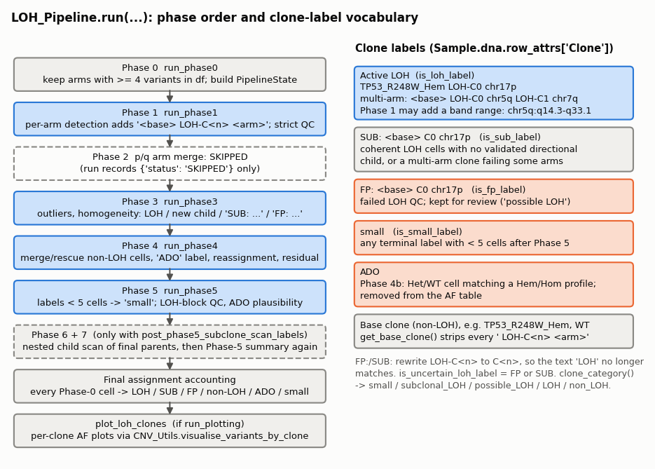
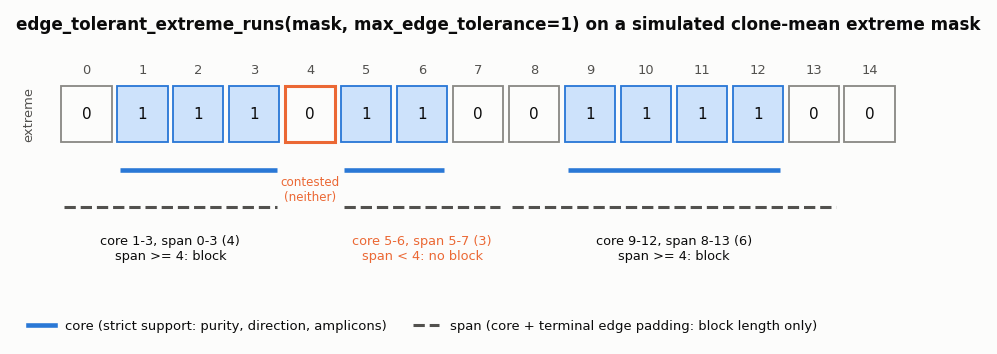
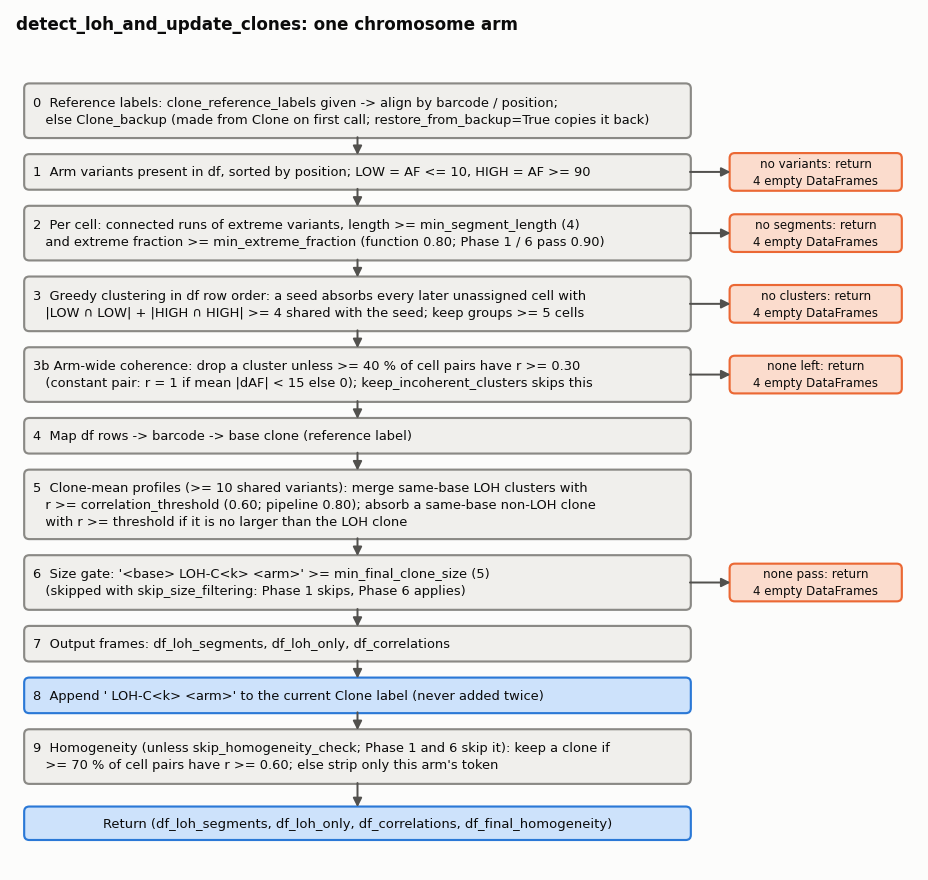
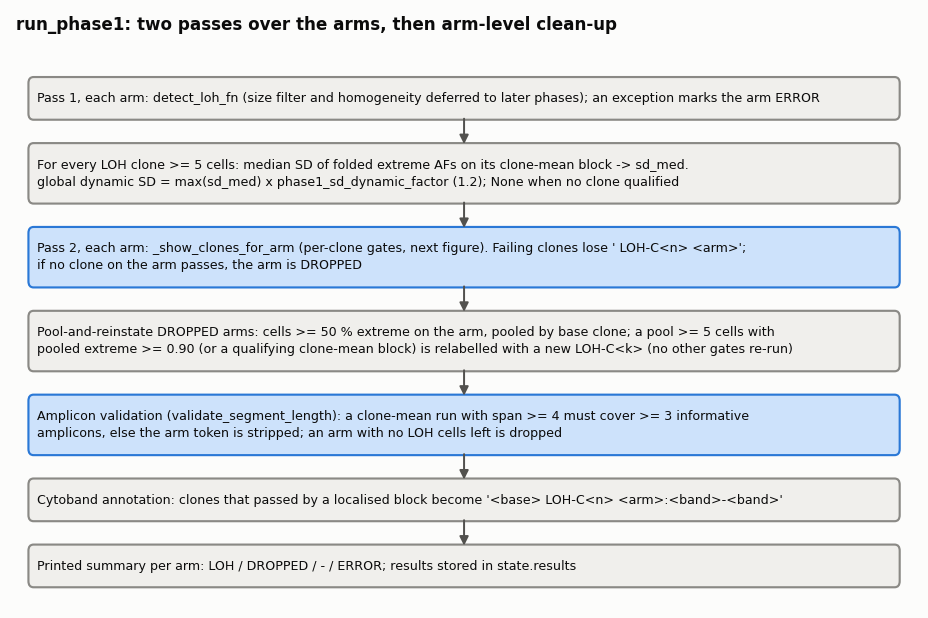
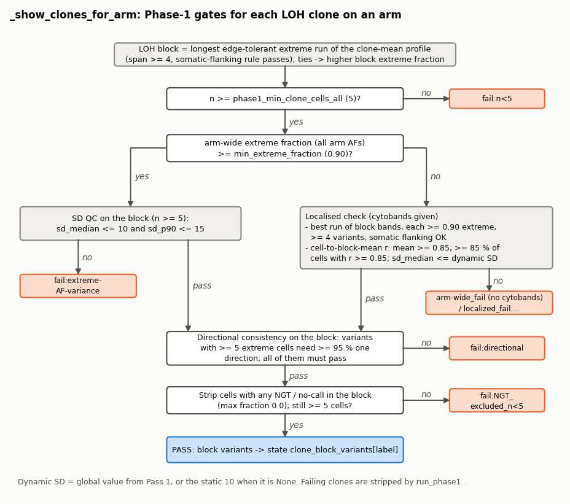
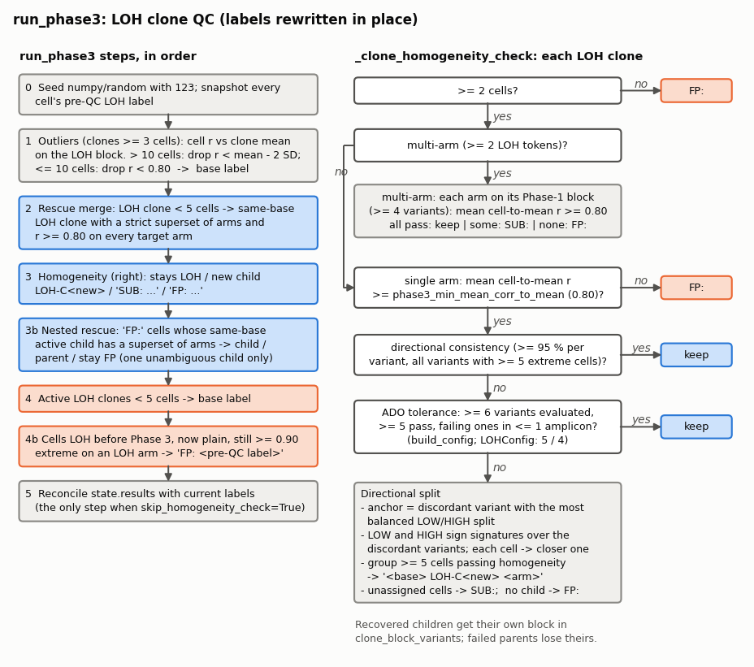
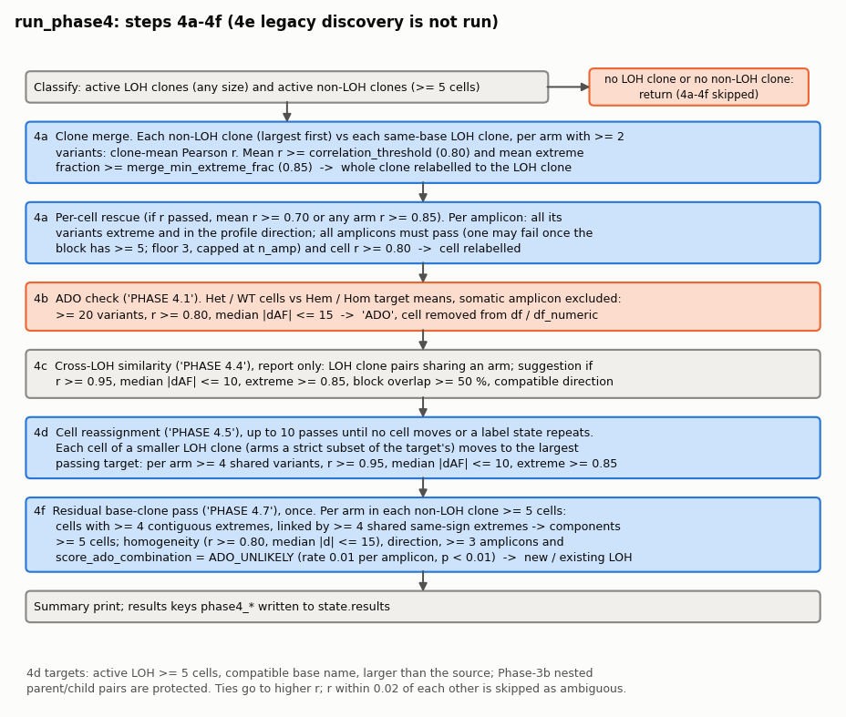
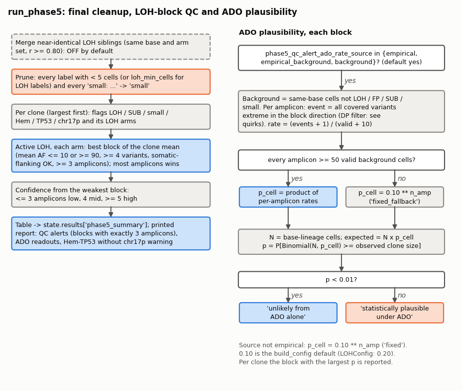
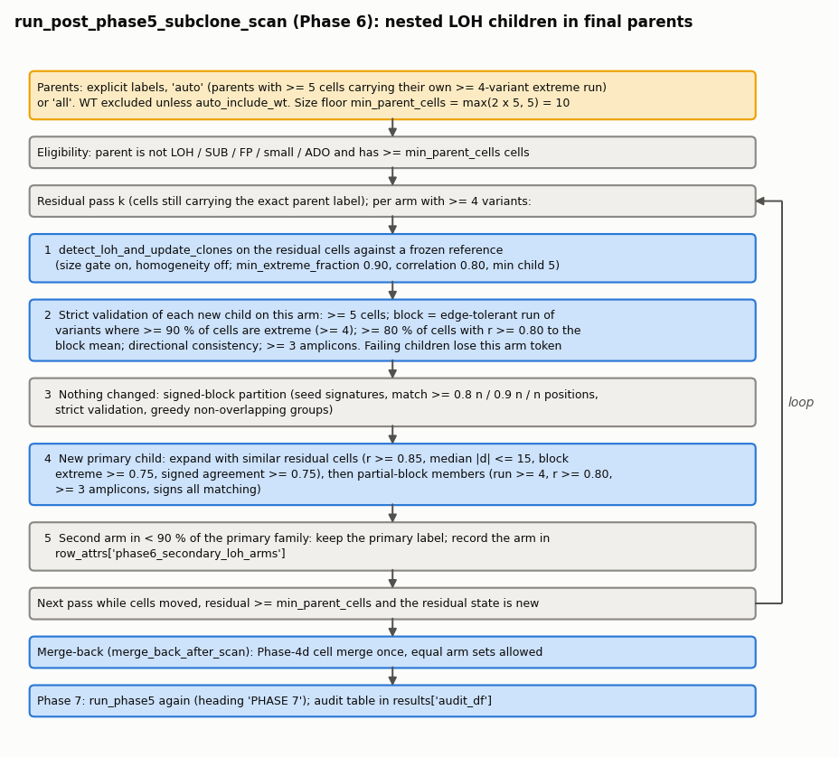

# LOH_Pipeline

Finds copy-neutral loss of heterozygosity (LOH) in single-cell DNA (Tapestri / mosaic `Sample`) data and writes it into
the clone labels. Starting from genotype clones in `Sample.dna.row_attrs["Clone"]` and a cell x variant allele-frequency
(AF, percent) table, it scans each chromosome arm for cells whose germline heterozygous variants have become extreme
(AF <= 10 or >= 90) over a contiguous block. Those cells become LOH sub-clones such as
`TP53_R248W_Hem LOH-C0 chr17p`. A series of QC phases then removes, splits, merges or flags these calls. The pipeline
is run once per sample in the `03_Sample_Analysis_*.ipynb` notebooks, after genotype clones are assigned and before the
labels are used downstream.



## Modules

| Module | Purpose | Main functions |
|---|---|---|
| `loh_wrapper` | Notebook entry point: configuration and the full run | `build_config`, `run` |
| `loh_config` | Configuration dataclass, shared state, label grammar and small helpers | `LOHConfig`, `PipelineState`, label predicates, `edge_tolerant_extreme_runs`, `check_directional_consistency` |
| `detect_loh` | Per-arm LOH detection engine | `detect_loh_and_update_clones` |
| `phase0_setup` | Arm pre-check and `PipelineState` construction | `run_phase0`, `precheck_variant_availability` |
| `phase1` | Per-arm detection plus strict Phase-1 clone QC | `run_phase1` |
| `phase3` | LOH clone QC: outliers, homogeneity, directional split, nested rescue | `run_phase3` |
| `phase4` | Non-LOH to LOH merge and rescue, ADO cells, cell reassignment, residual pass | `run_phase4` |
| `phase5` | Final cleanup (`small`), LOH-block QC, ADO plausibility, summary table | `run_phase5` |
| `phase6_subclone_scan` | Optional scan of final parent clones for nested LOH children | `run_post_phase5_subclone_scan` |
| `ado_probability` | Binomial / Poisson-binomial ADO tail probabilities | `score_ado_combination` |
| `plot_loh_clones` | Per-clone AF plots of the final labels | `plot_loh_clones` |

`LOHConfig`, `PipelineState`, `build_config`, `run`, `run_phase0`, `run_phase1`, `run_phase3`, `run_phase4`,
`run_phase5`, `run_post_phase5_subclone_scan`, `score_ado_combination`, `detect_loh_and_update_clones` and
`plot_loh_clones` are exported from `LOH_Pipeline/__init__.py`. There is no `phase2` module: Phase 2 (p/q arm merging)
was removed and `run` only records a `{"status": "SKIPPED"}` stub for it.

## Typical use

As in `03_Sample_Analysis_*.ipynb`: build a config with the standard defaults, then run every phase, including the
automatic Phase-6 scan, and plot.

```python
import LOH_Pipeline

cfg = LOH_Pipeline.build_config(
    cytobands=cytobands,
    informative_variants=informative_variants,
    output_dir=OUTPUT_DIR,
    plot_dropped_clusters=True,
    verbose=True,
    phase1_show_failed_clones=False,
)

out = LOH_Pipeline.run(
    Sample=Sample,
    df=df_AF,                              # cells x variants AF (%), variant columns contain ':'
    grouped_by_chr_arm=grouped_by_chr_arm,  # {"chr17p": [variant, ...], ...}
    chr_arms=None,                         # all arms in grouped_by_chr_arm
    cfg=cfg,
    run_plotting=True,
    informative_variants=informative_variants,
    cytobands=cytobands,
    output_dir=OUTPUT_DIR,
    output_prefix="All_clones_AF",
    include_non_loh=True,
    visualise_fn=CNV_Utils.visualise_variants_by_clone,
    post_phase5_subclone_scan_labels="auto",
    post_phase5_subclone_scan_min_parent_cells=5,
)

out["summary_df"]                 # one row per final clone (Phase 5 / Phase 7)
out["final_assignment_summary"]   # every initial cell by category
out["df_plot_all"]["label"]       # final label per plotted cell (index = barcode)
```

Afterwards the notebooks keep the plotted cells, drop `ADO`, `FP` and `small` labels, and write the remaining labels
back into `Sample.dna.row_attrs["Clone"]`. The label constants can be imported with
`from LOH_Pipeline.loh_config import LOH_TAG`.

To refine one named final clone instead of all of them, pass a list:
`post_phase5_subclone_scan_labels=["TP53_R248W_Hem"]`. Audit rows are then in `out["phase6_results"]["audit_df"]`.

## Label conventions

All phases communicate only through the string labels in `Sample.dna.row_attrs["Clone"]` (plus a few `state` caches),
so the label grammar matters:

| Label | Example | Meaning | Predicate |
|---|---|---|---|
| Base clone | `TP53_R248W_Hem`, `WT` | genotype clone without LOH | `clone_category(...) == "non_LOH"` |
| Active LOH | `TP53_R248W_Hem LOH-C0 chr17p` | LOH sub-clone; one ` LOH-C<n> <arm>` pair per arm | `is_loh_label` |
| Active LOH, localised | `... LOH-C0 chr5q:q14.3-q33.1` | Phase 1 added the cytoband range of a block that covers only part of the arm | `is_loh_label` |
| `SUB: ...` | `SUB: TP53_R248W_Hem C0 chr17p` | coherent LOH cells not assigned to a validated directional child, or a multi-arm clone where only some arms pass | `is_sub_label` |
| `FP: ...` | `FP: TP53_R248W_Hem C0 chr17p` | failed LOH QC, kept for review ("possible LOH") | `is_fp_label` |
| `small` | `small` | any terminal label below `min_final_clone_size` (5) after Phase 5 | `is_small_label` |
| `ADO` | `ADO` | Phase 4b: a Het/WT cell whose profile matches a Hem/Hom clone apart from the somatic amplicon; dropped from the AF table | `== ADO_LABEL` |

`FP:` and `SUB:` labels rewrite `LOH-C<n>` to `C<n>` (`make_fp_label`, `make_sub_label`) so that later
`"LOH" in label` tests never match them. `is_uncertain_loh_label` is true for FP or SUB. `clone_category` returns
`small`, `subclonal_LOH`, `possible_LOH`, `LOH` or `non_LOH`, checked in that order. `get_base_clone` strips every
` LOH-C<n> <arm>` pair; `fp_base_name` also strips the `FP:`/`SUB:`/`small:` prefixes and the `C<n> <token>` pairs.

Two shared building blocks recur in every phase:

- **Extreme AF**: `AF <= low_allele_threshold` (10, "LOW") or `AF >= high_allele_threshold` (90, "HIGH").
- **LOH block**: a contiguous run of extreme variants in position order, found with `edge_tolerant_extreme_runs`
  (below). The run's *core* (strictly extreme variants) is used for purity, direction and amplicon counts; its *span*
  (core plus up to `block_edge_tolerance` = 1 padded edge variant) is used only for the minimum length (4).

---

## loh_wrapper

### build_config(**kwargs) -> LOHConfig

Takes about 200 keyword thresholds, grouped by phase (Phase 1 detection, display, localised and SD QC; Phase 3 QC,
directional consistency, multi-arm and nested rescue; Phase 4 merge, rescue, ADO, cross-LOH and cell merge; amplicon
validation; somatic flanking; ADO-probability model; Phase 5 alerts; plotting; verbosity). It forwards each one to the
`LOHConfig` field of the same name. `LOHConfig` fields it does not expose (for example all `phase4_final_residual_*`
and `phase6_residual_*` fields) keep their dataclass defaults. Four `build_config` defaults differ from `LOHConfig`:

| Parameter | `build_config` | `LOHConfig` |
|---|---|---|
| `phase3_direction_ado_min_block_variants` | 6 | 5 |
| `phase3_direction_ado_min_good_variants` | 5 | 4 |
| `phase4_arm_expansion_min_cells` (unused) | 8 | 5 |
| `phase5_qc_alert_ado_rate_per_amplicon` | 0.10 | 0.20 |

All thresholds quoted in this README are the `build_config` defaults.

### run(*, Sample, df, grouped_by_chr_arm, cfg, df_dp=None, chr_arms=None, run_plotting=True, ..., post_phase5_subclone_scan_labels=None, ...) -> dict

The main entry point. Runs the phases in order on one `PipelineState` and rewrites `Sample.dna.row_attrs["Clone"]`
in place:

1. `run_phase0` builds the state (raises `RuntimeError` if it returns None). The initial cell ids are saved here,
   before Phase 4b removes ADO cells, and are the denominator of the final accounting.
2. `run_phase1`, then the Phase-2 stub `{"status": "SKIPPED", "reason": "p_q_arm_merging_disabled"}`.
3. `run_phase3`, `run_phase4`, `run_phase5`.
4. Only if `post_phase5_subclone_scan_labels` is given (a list, `"auto"` or `"all"`): `run_post_phase5_subclone_scan`
   (Phase 6, with `post_phase5_subclone_scan_chr_arms`, `_min_parent_cells`, `_merge_back` (True),
   `_auto_exclude_labels`, `_auto_include_wt` (False)), then `run_phase5` again with heading "PHASE 7".
5. `_final_assignment_summary` over the initial cells.
6. If `run_plotting`, `plot_loh_clones` with the plotting arguments (`informative_variants`, `cytobands`, `output_dir`,
   `output_prefix="All_clones_AF"`, `include_non_loh=True`, `include_possible_loh=True`, `plot_separate_clones=True`,
   `split_by_cytobands=False`, `save_figures=True`, `save_pdf=None`, `visualise_fn=None`).

Pass `df_dp` (depth table) to make the Phase-5 empirical ADO estimate coverage-aware; otherwise the DP attribute of
the Sample is tried. `print_progress=True` prints a short status block after each phase.

Returns `{"state", "phase1_results", "phase2_results", "phase3_results", "phase4_results", "phase6_results" ({} if
Phase 6 did not run), "phase7_summary_df", "ado_probability_qc" (always an empty DataFrame), "summary_df",
"final_assignment_summary", "df_plot_all"}`. `phase3_results` and `phase4_results` are the same `state.results` dict.

Private helpers:

| Name | Purpose |
|---|---|
| `_final_assignment_summary(state, initial_cell_ids)` | Maps every initial cell to its current label via the barcode and counts cells per category (LOH, subclonal_LOH, possible_LOH, non_LOH, ADO, small, unassigned) and label, with percentages; prints a sectioned report and warns if totals do not match |
| `_print_state(label, state, ...)` | Per-phase progress block: active LOH cells and labels, SUB/FP clone counts |

---

## loh_config

### LOHConfig (dataclass)

Every tunable parameter, grouped by phase, with comments in the source. Key detection defaults:
`low_allele_threshold=10`, `high_allele_threshold=90`, `min_contiguous_variants_initial=4`,
`min_extreme_fraction=0.90`, `min_shared_variants=4`, `min_cluster_size=5`, `min_final_clone_size=5`,
`correlation_threshold=0.80`, `min_homogeneity_fraction=0.80`, `block_edge_tolerance=1`,
`min_contiguous_variants_final=4`, `min_different_amplicons=3`. `cytobands` (DataFrame) enables localised calls and
band annotation; `informative_variants` (germline SNP list) drives the somatic-flanking rule and informative amplicon
counts. Some fields are kept only so old configs still load (see Known quirks).

### PipelineState(Sample, df, grouped_by_chr_arm, chr_arms, config, df_dp=None)

The mutable object passed between phases. On construction it finds the variant columns (names containing `:`),
builds `df_numeric` (numeric AF), `df_dp_numeric` (from `df_dp` or `Sample.dna.get_attribute("DP")`, aligned by index
or barcode; all-NaN if unavailable), `cell_to_barcode`, `barcode_to_sample_idx` and `cytobands_df` (= `config.cytobands`),
then calls `refresh()`.

- `refresh()` rebuilds `barcode_to_clone` and `clone_to_cells` from the current `Clone` labels. Call it after any
  label change.
- `set_clone_labels(new_labels)` writes a full label array and refreshes.
- `current_clones` (property) is the label Series; `sample_idx_for_barcode`, `loh_clone_labels`, `loh_cell_count`
  are lookups.
- Phases add `results`, `clone_block_variants` (label -> LOH block variants), `loh_cytoband_ranges`,
  `phase1_ngt_exclusions`, `nested_loh_lineages` and others as they run.

### Label helpers

`is_small_label`, `is_fp_label`, `is_sub_label`, `is_uncertain_loh_label`, `is_loh_label`, `make_fp_label`,
`make_sub_label`, `clone_category`, `fp_base_name`, `get_base_clone`, `extract_chr_arms` (all `chrN[pq]` tokens in a
label), `is_wt_clone(label, cfg)` (label starts with `WT`), `is_hem_like(label)` (a delimited `hem` token), as described
under Label conventions. Constants: `LOH_TAG="LOH"`, `HET_TAG="Het"`, `ADO_LABEL="ADO"`, `SMALL_LABEL="small"`,
`FP_TAG="FP:"`, `SUB_TAG="SUB:"`.

### edge_tolerant_extreme_runs(extreme_mask, max_edge_tolerance=0) -> list[dict]

Finds contiguous runs of 1s (cores) in a boolean vector and pads each core with up to `max_edge_tolerance`
non-extreme variants at its outer edges. An internal gap is never bridged, and a gap variant that two cores could both
claim goes to neither. Returns one dict per core with `core_indices`, `span_indices` and `n_edge_padded`. The pipeline
passes `block_edge_tolerance` (1).



### check_directional_consistency(af_block, low_thr, high_thr, min_per_var_agreement=0.85, min_block_pass_frac=0.80, min_extreme_cells_per_var=3) -> dict

For each variant (column) of a cells x variants block, counts LOW and HIGH cells (mid-range values ignored). Variants
with at least `min_extreme_cells_per_var` extreme cells are evaluated; one passes when the majority direction holds
>= `min_per_var_agreement` of them (ties never pass). The block passes when the passing fraction of evaluated
variants is >= `min_block_pass_frac`. Also returns the dominant direction (LOW / HIGH / MIXED / NA) and the counts.
The pipeline calls it with the config values: 0.95 agreement, 1.00 block pass fraction, >= 5 extreme cells.

### Other helpers

| Name | Purpose |
|---|---|
| `vprint(msg, cfg)` | Print and flush only when `cfg.verbose` |
| `sort_chromosome_arms(chr_list)` | Natural order chr1p < chr1q < ... < chr22q < chrX < chrY; unparsable last |
| `arm_variants(arm, state)` | Variants of an arm present in `state.df_numeric` |
| `pearson_safe(x, y, min_n=5)` | Pearson r over pairwise-finite values; None for < `min_n` pairs or zero variance |
| `mean_profile(df_numeric, cells, variants)` | Nan-mean AF profile; None if empty or all-NaN |
| `fmt_float(x, nd=3)` | Fixed-decimal string, `"NA"` for None/NaN/Inf |
| `build_cytoband_maps(variants_sorted, cytobands_df, target_chr)` | Variant index -> cytoband and cytoband -> variant indices for one arm; `(None, None)` when nothing maps |

---

## detect_loh

### detect_loh_and_update_clones(Sample, df, grouped_by_chr_arm, target_chr, low_allele_threshold=10, high_allele_threshold=90, min_segment_length=4, min_extreme_fraction=0.80, min_shared_variants=4, min_cluster_size=5, min_final_clone_size=5, correlation_threshold=0.60, restore_from_backup=None, skip_homogeneity_check=False, min_homogeneity_fraction=0.70, skip_size_filtering=False, cytobands_df=None, keep_incoherent_clusters=False, verbose=True, clone_reference_labels=None)

The per-arm detector. Phase 1 calls it once per arm, and Phase 6 calls it on residual parent cells. It finds cells
with contiguous extreme-AF runs on `target_chr`, groups them by shared direction-consistent extreme variants, merges
and expands the groups by profile correlation, and appends `" LOH-C<k> <arm>"` to those cells' current `Clone` labels.
Annotations therefore accumulate across arms; an annotation that is already present is not added again. Base clones
come from `Clone_backup` (created from `Clone` on the first call) or from `clone_reference_labels` (dict or Series by
barcode, or a positional list; `ValueError` if it cannot be aligned).

The function's own defaults are looser than the pipeline's: Phase 1 passes `min_extreme_fraction=0.90`,
`correlation_threshold=0.80` and `min_homogeneity_fraction=0.80` from the config, and skips both the size filter and
the homogeneity check (Phase 6 applies the size filter).

Returns `(df_loh_segments, df_loh_only, df_correlations, df_final_homogeneity)`: one row per (cell, segment); the `df`
rows of LOH cells plus `loh_cluster`, `assigned_by_correlation`, `total_loh_*` and, after the homogeneity check,
`final_*` columns; LOH vs non-LOH clone correlations; per-clone homogeneity statistics. Early exits return four empty
DataFrames.



1. Arm variants present in `df`, sorted by position; LOW, HIGH and extreme masks. Cytobands are only logged.
2. Per cell, connected runs of extreme variants with length >= `min_segment_length` and extreme fraction >=
   `min_extreme_fraction` (`_find_loh_segments_1d`).
3. Greedy clustering in `df` row order: each unassigned seed absorbs every later unassigned cell that shares >= 4
   direction-consistent extreme variants (`|LOW ∩ LOW| + |HIGH ∩ HIGH|`) with the seed; groups below
   `min_cluster_size` (5) are discarded.
4. Arm-wide coherence: a cluster is dropped unless >= 40 % of its cell pairs have r >= 0.30 over the whole arm (pairs
   need >= 3 shared values; for a constant profile, r = 1 if mean |dAF| < 15, else 0).
5. Correlation step on clone-mean profiles over the arm (>= 10 shared finite variants): same-base LOH clusters with
   r >= `correlation_threshold` are merged into the smaller cluster id; a same-base non-LOH clone with r >= threshold
   is absorbed only if it is no larger than the LOH cluster.
6. Size gate (unless `skip_size_filtering`): `<base> LOH-C<k> <arm>` clones need >= `min_final_clone_size` cells.
7. Build output frames and append the label annotation.
8. Homogeneity (unless `skip_homogeneity_check`): a final clone is kept when >= `min_homogeneity_fraction` of its cell
   pairs have r >= `correlation_threshold`; failing clones lose only this arm's token.

Private helpers:

| Name | Purpose |
|---|---|
| `_resolve_reference_clones` | Choose / align the base-clone reference (step 0) |
| `_find_loh_segments_1d` | Extreme runs of one cell (`scipy.ndimage.label`) |
| `_directional_variant_sets`, `_greedy_directional_clusters`, `_build_cluster_info`, `_empty_cluster_record` | Step 3 clustering and per-cluster shared LOW/HIGH variants |
| `_pairwise_coherence_rs`, `_drop_incoherent_clusters` | Step 3b coherence filter |
| `_map_cells_to_barcodes` | df row -> barcode (index, `barcode` column, or position) |
| `_clone_mean_profiles`, `_find_cluster_merges`, `_apply_cluster_merges`, `_expand_to_non_loh_clones`, `_correlation_merge_and_expand` | Step 5 |
| `_filter_by_final_clone_size` | Step 6 |
| `_build_output_frames`, `_append_loh_annotations`, `_count_loh_cells` | Steps 7-8 |
| `_homogeneity_check`, `_score_final_clones`, `_cells_with_final_label`, `_strip_removed_clones`, `_homogeneity_record` | Step 9 |
| `_empty_result`, `_make_vprint`, `_print_configuration`, `_extract_pos`, `_get_base_clone`, `_loh_clone_label` | Small utilities |

---

## phase0_setup

### run_phase0(Sample, df, grouped_by_chr_arm, chr_arms, cfg, df_dp=None) -> PipelineState | None

Uses all arms of `grouped_by_chr_arm` when `chr_arms` is None and sorts them naturally, runs
`precheck_variant_availability`, and builds a `PipelineState` over the available arms. Returns None when no arm is
available or `df` has no variant columns.

### precheck_variant_availability(grouped_by_chr_arm, df, chr_arms, cfg) -> (available, skipped)

Counts each arm's variants that are columns of `df` and skips arms with fewer than `min_contiguous_variants_initial`
(4), logging the reason.

---

## phase1

### run_phase1(state, detect_loh_fn) -> dict

Runs `detect_loh_fn` (normally `detect_loh_and_update_clones`) on every arm, then applies strict Phase-1 QC to the new
`<base> LOH-C<n> <arm>` labels. Returns `{arm: (df_segments, df_loh, df_corr, df_homog)}` for the arms that still carry
LOH; the same dict becomes `state.results`. Side effects: labels rewritten, `state.clone_block_variants` (block of each
passing clone), `state.phase1_ngt_exclusions`, `state.loh_cytoband_ranges`, printed per-arm tables.



1. **Pass 1** detects LOH on every arm (errors mark the arm `ERROR`). For each LOH clone with >= 5 cells it takes the
   longest edge-tolerant extreme run of the clone-mean profile (span >= 4) and the median SD of the cells' folded
   extreme AFs (`min(AF, 100 - AF)`) on it. The global dynamic SD threshold is `max(sd_med) x 1.2`.
2. **Pass 2** runs `_show_clones_for_arm` per arm (gates below). Failing clones lose the arm token; if no clone on the
   arm passes, the arm is `DROPPED`.
3. **Pool and reinstate** (`_pool_and_reinstate_dropped_arms`): for each dropped arm, cells with >= 50 % extreme AFs on
   the arm are pooled by base clone. A pool with >= 5 cells and pooled extreme fraction >= 0.90 (or a clone-mean block
   of span >= 4 that is >= 0.90 extreme) is relabelled with a new `LOH-C<k> <arm>`. This rescues real arm LOH that
   co-occurring tokens on other arms had fragmented into many tiny clones.
4. **Amplicon validation** (`validate_segment_length`, on): each clone needs a clone-mean run of span >=
   `min_contiguous_variants_final` (4) whose extreme variants cover >= `min_different_amplicons` (3) informative
   amplicons; otherwise the arm token is stripped.
5. **Cytoband annotation**: a clone that passed through a localised block has ` <arm>` rewritten to
   ` <arm>:<start band>-<end band>`.



Per-clone gates in `_show_clones_for_arm`, in order: clone size >= `phase1_min_clone_cells_all` (5); then either
arm-wide extreme fraction >= `min_extreme_fraction` (0.90) plus the SD QC (block `sd_median <= 10`, `sd_p90 <= 15`),
or, when cytobands are available, the localised check (best run of block bands that are each >= 0.90 extreme, >= 4
variants, somatic flanking OK; cell-to-block-mean r with mean >= 0.85 and >= 85 % of cells at r >= 0.85; `sd_median`
<= the dynamic SD, or 10 when none); then directional consistency on the block; then cells with any NGT/no-call in the
block are removed from the clone (`phase1_ngt_max_fraction_in_block = 0.0`) and the clone must keep >= 5 cells.

**Somatic-flanking rule** (`_block_somatic_flanking_ok`): when `informative_variants` is set, a block that contains
non-informative (somatic) variants needs >= 3 informative variants and informative variants on both sides of the
somatic span.

Private helpers:

| Name | Purpose |
|---|---|
| `_show_clones_for_arm` | Per-clone Phase-1 gates (figure above) |
| `_pool_and_reinstate_dropped_arms` | Step 3 |
| `_amplicon_validation_for_arm`, `_amplicon_validate_clone` | Step 4 |
| `_annotate_loh_clones_with_cytobands` | Step 5 |
| `_extreme_block_dispersion_stats` | Median and p90 of per-variant SDs of folded extreme AFs |
| `_exclude_ngt_cells_from_clone_block`, `_get_ngt_matrix`, `_ngt_no_call_mask` | NGT/no-call exclusion |
| `_block_somatic_flanking_ok`, `_informative_variant_set`, `_informative_amplicons_in_block` | Informative/somatic handling |
| `_strip_arm_from_failing_clones`, `_strip_specific_loh_token_from_label` | Remove arm tokens |
| `_sync_results_labels` | Refresh `df_loh` labels and drop empty arms from `results` |
| `_print_phase1_summary` | Per-arm status table |
| `_build_variant_to_amplicon`, `_variant_pos` | Variant -> amplicon map; position parser |

---

## phase3

### run_phase3(state, cfg=None) -> dict

QC of the active LOH clones left by Phase 1. Rewrites labels in place, updates `state.clone_block_variants`, prints a
summary of active LOH, SUB and FP clones, and returns `state.results`. With `skip_homogeneity_check=True` only the
final reconciliation runs.



1. Seed `numpy.random` and `random` with 123; snapshot each cell's pre-QC LOH label.
2. **Outlier removal** (`_per_cell_outlier_removal`): in each LOH clone with >= 3 cells, each cell's Pearson r to the
   clone mean over the LOH block. Clones with > 10 cells drop cells with r < mean - 2 SD; smaller clones drop
   r < 0.80. Dropped cells return to the base label.
3. **Rescue merges** (`_rescue_merges`): an LOH clone with < 5 cells joins the same-base LOH clone that has a strict
   superset of its arms and r >= `post_merge_correlation_threshold` (0.80) on every target arm (best mean r wins).
4. **Homogeneity** (`_clone_homogeneity_check`): single-arm clones need mean cell-to-mean r >= 0.80 and directional
   consistency. A directional failure can be tolerated as single-amplicon ADO (>= 6 variants evaluated, >= 5 passing,
   failing variants in <= 1 amplicon). Otherwise the clone goes to the **directional split**
   (`_split_directional_failure`): the most balanced discordant variant is the anchor, LOW/HIGH sign signatures are
   built over the discordant variants, each cell joins the closer signature, and groups of >= 5 cells that pass
   homogeneity become new `LOH-C<n>` children; unassigned cells become `SUB:`, and with no child the clone becomes
   `FP:`. Multi-arm clones are checked arm by arm on their Phase-1 blocks (correlation only): all arms pass -> kept,
   some -> `SUB:`, none -> `FP:`.
5. **Nested parent-child rescue** (`_apply_nested_parent_child_rescues`, on by default): an `FP:` population whose
   same-base active child (>= 5 cells) has a strict superset of arms, with exactly one child-only arm, is checked
   against that child. If the FP centroid matches the child's shared-arm profile (>= 4 called variants, median |dAF|
   <= 15, r >= 0.80, extreme-direction match >= 0.75), each FP cell is assigned to the child (child-only arm: r >= 0.85,
   median |dAF| <= 15, match >= 0.80), to the parent label, or stays FP. Ambiguous cases stay FP; an audit table goes to
   `state.results["phase3_nested_loh_rescue"]`.
6. Active LOH clones with < 5 cells go back to the base label.
7. Cells that were LOH before Phase 3, now carry a plain label, and are still >= 0.90 extreme on any LOH arm become
   `FP: <pre-QC label>`.
8. `_reconcile_results` prunes `state.results` to the cells that still carry each arm.

Private helpers:

| Name | Purpose |
|---|---|
| `_per_cell_outlier_removal`, `_rescue_merges`, `_clone_homogeneity_check`, `_apply_nested_parent_child_rescues`, `_discard_small_loh_clones`, `_remove_reverted_loh_outliers`, `_reconcile_results` | Steps 2-8 |
| `_homogeneity_metrics` | Per-cell r to the mean, mean r, directional check, ADO tolerance; returns a `reason` |
| `_phase3_direction_pass_with_ado_tolerance` | Single-ADO-amplicon tolerance for directional failures |
| `_split_directional_failure` | Directional split into children / SUB / FP |
| `_multi_arm_homogeneity_metrics`, `_multi_arm_phase1_block_for_arm`, `_multi_arm_loh_tokens`, `_longest_contiguous_variant_run` | Per-arm checks for multi-arm clones |
| `_automatic_nested_candidates`, `_nested_child_block_for_arm`, `_nested_profile_metrics`, `_nested_profile_passes`, `_nested_arm_variants`, `_fp_parent_label_info`, `_active_loh_label_info` | Nested rescue |
| `_loh_clone_map`, `_loh_arm_variants`, `_loh_block_variants`, `_variant_to_amplicon_map`, `_next_loh_clone_number`, `_directional_summary` | Lookups and log text |

---

## phase4

### run_phase4(state, cfg=None) -> dict

Reconciles LOH clones with same-base non-LOH clones, flags ADO cells, and reassigns cells. Mutates labels,
`state.df` / `state.df_numeric` (ADO cells removed), `state.clone_block_variants` and `state.results`, and returns
`state.results`. It returns immediately, without running any step, when there is no active LOH clone or no non-LOH
clone with >= 5 cells.



- **4a clone merge.** For each non-LOH clone (largest first) and each same-base LOH clone: per LOH arm with >= 2
  variants, the Pearson r of the two clone-mean profiles. Mean r >= `correlation_threshold` (0.80) and mean extreme
  fraction >= `merge_min_extreme_frac` (0.85) relabels the whole clone.
- **4a per-cell rescue.** Otherwise, if r passed, mean r >= 0.70 or any arm r >= 0.85, each cell is scored amplicon by
  amplicon on the LOH block (`_score_cell_against_loh_profile_ado_tolerant`): an amplicon passes when all its
  informative variants are extreme in the profile's direction; all amplicons must pass (one may fail once the block has
  >= 5 amplicons; at least 3 required, capped at the number available) and r over the passing variants must be >= 0.80.
- **4b ADO check** (`_het_ado_check`, printed "PHASE 4.1"). Het and WT cells are compared with the mean profile of
  same-key Hem/Hom clones (WT: Hem/Hom LOH clones) over all variants except the amplicons carrying the target's somatic
  mutation. >= 20 variants, r >= 0.80 and median |dAF| <= 15 -> label `ADO`, cell removed from the AF tables.
- **4c cross-LOH similarity** ("PHASE 4.4", report only): pairs of LOH clones (>= 5 cells) sharing an arm; a merge is
  suggested at r >= 0.95, median |dAF| <= 10, extreme >= 0.85, block overlap >= 50 % and compatible direction.
  Table in `phase4_cross_loh_similarity`.
- **4d cell reassignment** ("PHASE 4.5", `_iterative_cell_level_reassignment`): up to 10 passes of
  `_merge_small_loh_clones_after_annotation`, stopping when no cell moves or a label state repeats. Each cell of a
  source LOH clone moves to the largest active LOH target (>= 5 cells, larger, source arms a strict subset of target
  arms) that it passes on every arm (>= 4 shared variants, block overlap >= 50 %, r >= 0.95, median |dAF| <= 10,
  extreme >= 0.85, compatible direction). Equal-size ties go to the higher r; r within 0.02 is skipped as ambiguous.
  Phase-3 nested parent/child pairs are protected. Non-LOH and FP sources are off by default. Audit tables:
  `phase4_small_loh_merge`, `phase4_cell_assignment_iterations`, `phase4_cell_assignment_convergence`.
- **4e** (legacy residual discovery) is disabled and not called.
- **4f residual base-clone pass** ("PHASE 4.7", `_final_refine_remaining_base_clones`), once. In each non-LOH clone
  with >= 5 cells, per arm: cells with >= 4 contiguous extremes are linked when they share >= 4 same-sign extreme
  variants; connected components with >= 5 cells, a run of >= 4 columns that is >= 0.90 extreme, and homogeneity
  (mean r >= 0.80, median |d| <= 15). Cells are grouped by their component memberships across arms. A group is
  accepted only with >= 5 cells, per-arm homogeneity and directional signature, >= 3 amplicons and
  `score_ado_combination` = `ADO_UNLIKELY` (rate 0.01 per amplicon unless `amplicon_ado_rates` is given; p < 0.01). It
  joins the one existing same-base LOH clone with the same arm set, or gets a new `LOH-C<n>` label. Audit in
  `phase4_final_residual_refinement`.

`_merge_small_loh_clones_after_annotation` is also used by Phase 6 for its merge-back step.

Private helpers:

| Name | Purpose |
|---|---|
| `_het_ado_check` | 4b |
| `_cross_loh_clone_similarity_check` | 4c |
| `_iterative_cell_level_reassignment`, `_merge_small_loh_clones_after_annotation` | 4d |
| `_final_refine_remaining_base_clones`, `_final_residual_arm_components`, `_final_residual_direction_signature`, `_residual_component_homogeneous`, `_existing_exact_arm_target`, `_final_residual_lineage_size`, `_next_residual_loh_number`, `_contiguous_runs` | 4f |
| `_score_cell_against_loh_profile_ado_tolerant`, `_percell_rescue_score`, `_allowed_rescue_ado_amplicons`, `_informative_variant_set_for_rescue`, `_rescue_variants_for_clone_arm` | 4a per-cell rescue |
| `_loh_block_variants_for_label` | LOH block of a label: stored block, then substring key match, then cytoband range |
| `_get_base_name`, `_zygosity_normalized_base_name`, `_has_zygosity_tag`, `_base_names_compatible` | Base names; Het -> Hem/Hom matching |
| `_direction`, `_directions_compatible`, `_profile_extreme_fraction`, `_safe_similarity_corr` | Profile comparisons (constant profiles count as r = 1 when |d| is small) |
| `_build_variant_to_amplicon`, `_variant_pos`, `_is_active_loh`, `_is_active_non_loh` | Lookups |

---

## phase5

### run_phase5(state, cfg=None, *, loh_min_cells=None, heading="PHASE 5: LOH CLONE SUMMARY") -> DataFrame

Final cleanup and summary. Returns one row per non-empty clone (largest first, 28 columns: flags, LOH arms, best LOH
block per arm, confidence tier, ADO plausibility fields) and stores it in `state.results["phase5_summary"]`. Phase 6
calls it again as "PHASE 7"; `loh_min_cells` lowers the prune floor for LOH labels only.



1. Optionally merge near-identical LOH siblings (same base and arm set, clone-mean r >= 0.80; union-find, relabelled
   to the largest member). Off by default (`phase5_merge_similar_loh_clones=False`).
2. Prune (`phase5_prune_all_small_clones=True`): every label with fewer than `min_final_clone_size` (5) cells, and
   every legacy `small: ...` label, becomes `small`.
3. For each active LOH clone and arm, `_best_loh_block_support_for_clone_arm` recomputes the strongest block: a run of
   clone-mean AF <= 10 or >= 90 with >= 4 variants, passing the somatic-flanking rule, covering >= 3 informative
   amplicons; most amplicons wins, then most variants.
4. Confidence from the weakest block: <= 3 amplicons `low`, 4 `mid`, >= 5 `high`. Blocks with exactly
   `phase5_qc_alert_amplicons` (3) amplicons raise a QC alert.
5. ADO plausibility for every block (`_ado_plausibility_for_boundary_amp_alert`, right half of the figure): the
   per-cell chance p_cell that the block's amplicons all drop out is the product of empirical background rates
   (same-base non-LOH cells; event = all covered variants extreme in the block direction; Beta-smoothed
   `(events + 1) / (valid + 10)`; usable when every amplicon has >= 50 valid cells), else `0.10 ** n_amplicons`.
   With N = base-lineage cells, `P[Binomial(N, p_cell) >= observed]` < 0.01 reads "unlikely from ADO alone". The block
   with the largest p is reported per clone.
6. Printed report: partition counts, LOH / SUB / small / non-LOH tables, QC alerts, ADO readouts, and a warning for
   Hem TP53 clones without chr17p LOH.

`state.ado_probability` is set to an empty DataFrame (the old ADO-combination QC was removed).

Private helpers:

| Name | Purpose |
|---|---|
| `_merge_similar_loh_clones_before_phase5`, `_prune_small_terminal_clones_before_phase5` | Steps 1-2 |
| `_best_loh_block_support_for_clone_arm`, `_final_clone_loh_block_qc`, `_format_variant_block_span`, `_contiguous_true_runs` | Steps 3-4 |
| `_ado_plausibility_for_boundary_amp_alert`, `_estimate_empirical_ado_rates_for_block`, `_background_cells_for_empirical_ado`, `_base_lineage_size_for_clone`, `_binom_sf_geq` | Step 5 |
| `_loh_confidence_from_min_amplicons` | <= 3 low, 4 mid, >= 5 high |
| `_is_active_loh`, `_is_active_non_loh`, `_is_subclonal_loh`, `_yes_flags` | Predicates and table formatting |

---

## phase6_subclone_scan

### run_post_phase5_subclone_scan(*, state, clone_labels, chr_arms=None, min_parent_cells=None, rerun_phase5_summary=True, merge_back_after_scan=True, auto_exclude_labels=None, auto_include_wt=False, verbose=True) -> dict

Rescans selected final non-LOH parent clones for nested LOH children that were masked inside a large parent. Usually
called from `run` (Phase 6). Existing LOH, SUB, FP, small and ADO labels are never reopened. Modifies `Clone` and the
`phase6_*` row attributes in place. Returns `audit_df` (one row per parent, pass and arm), `parent_results`,
`summary_df`, `merge_back_df` and the resolved settings, also stored in
`state.results["phase6_post_phase5_subclone_scan"]`.



1. **Parents**: an explicit list; `"auto"` = eligible parents in which at least 5 cells carry their own extreme run of
   >= 4 variants on a scan arm; `"all"` = every eligible parent. The exact `WT` label is excluded in automatic modes
   unless `auto_include_wt=True`. Size floor `min_parent_cells` defaults to `max(2 x min_cluster_size,
   min_final_clone_size)` = 10 (the notebooks pass 5).
2. **Residual passes** (at most `ceil(n_cells / 5)`): each pass takes the cells still carrying the exact parent label
   and, per arm with >= 4 variants:
   - runs `detect_loh_and_update_clones` against a frozen reference (size filter on, homogeneity off, child size 5);
   - strict-validates each new child (`_strict_arm_metrics_for_cells`): >= 5 cells; block = edge-tolerant run of
     variants where >= 90 % of cells are extreme (span >= 4); >= 80 % of cells with r >= 0.80 to the block mean;
     directional consistency; >= 3 amplicons. Failing children lose this arm token;
   - if nothing changed, tries the signed-block partition (`_signed_block_partition_children`) for mixed
     LOW/HIGH clusters;
   - expands each new primary child with similar residual cells (r >= 0.85, median |d| <= 15, block extreme >= 0.75,
     signed agreement >= 0.75) and then with partial-block members (signed run >= 4, r >= 0.80, >= 3 amplicons, all
     signs matching);
   - a second arm carried by < 90 % of the primary family is not split off: those cells keep the primary label and the
     arm is recorded in `row_attrs["phase6_secondary_loh_arms"]`.
   Passes continue while cells move, the residual has >= `min_parent_cells` cells and its state is new.
3. **Merge-back** (`merge_back_after_scan`): one Phase-4d cell merge with equal arm sets allowed, so a smaller child
   can rejoin a larger same-arm sibling when all the 4d gates pass.
4. **Phase 7**: `run_phase5` again (inside `run` this is done by the wrapper with the heading "PHASE 7").

Row attributes written: `phase6_primary_loh_child`, `phase6_primary_loh_arm`, `phase6_primary_loh_member_role`
(`strict_core`, `expanded_similarity`, `expanded_partial_block`) and `phase6_secondary_loh_arms`.

Private helpers:

| Name | Purpose |
|---|---|
| `_auto_select_scan_parents`, `_parent_has_possible_loh_block`, `_eligible_parent_label`, `_normalise_clone_labels` | Parent selection |
| `_freeze_residual_reference` | Frozen labels for the detector (residual cells -> parent) |
| `_strict_arm_metrics_for_cells`, `_strict_validate_new_arm_children`, `_strict_passing_child_labels`, `_n_strict_passing`, `_strict_fail_reasons`, `_has_strict_pass_column` | Strict child validation |
| `_signed_block_partition_children`, `_next_phase6_child_number` | Signed partition fallback |
| `_expand_primary_child_with_similar_members`, `_expand_primary_child_with_partial_block_members`, `_safe_profile_similarity` | Primary-family expansion |
| `_collapse_secondary_arm_subset_to_primary_family`, `_record_phase6_secondary_arm_evidence`, `_set_phase6_primary_metadata` | Secondary arms and metadata |
| `_sample_row_attr_array`, `_write_sample_row_attr`, `_append_semicolon_token`, `_remove_arm_token`, `_skipped_parent_audit_row` | Row-attribute and label edits |
| `_sample_idx_for_cell`, `_cells_with_label`, `_min_child_size`, `_to_float_array`, `_clone_label_series`, `_variant_position`, `_variant_to_amplicon`, `_contiguous_runs_from_mask`, `_contiguous_true_runs` | Utilities |

---

## ado_probability

Not part of the default Phase-5 QC any more; `score_ado_combination` is used by Phase 4f.

### score_ado_combination(*, block_amplicons, amplicon_ado_rates, original_clone_size, observed_subclone_size, required_amplicons=None, rate_col="smooth_ado_any_rate", amplicon_col="amplicon_id", default_amplicon_ado_rate=0.01, pvalue_threshold=0.05) -> dict

Asks whether an LOH block of `observed_subclone_size` cells in a lineage of `original_clone_size` could be chance
allelic dropout. The single-cell probability is the product of the block amplicons' ADO rates (missing rates use the
default) when all amplicons must drop out, otherwise the Poisson-binomial tail for `required_amplicons`. Then
`P(X >= observed)` with `X ~ Binomial(n0, p)` gives `ADO_COMPATIBLE` (p >= threshold), `ADO_UNLIKELY` or
`ADO_NOT_SCORED`. Returns the probabilities, expected cells, enrichment and the amplicons lacking rates.

Other functions: `normalise_amplicon_ado_rates` (dict / Series / DataFrame -> `{amplicon: probability}`, percentages
converted, clipped to [0, 1]), `poisson_binomial_tail_at_least(probs, k)` (exact DP), `binomial_tail_at_least(n, k, p)`
(SciPy or exact sum). Private: `_variant_pos`.

---

## plot_loh_clones

### plot_loh_clones(state, *, cfg=None, informative_variants=None, cytobands=None, output_dir=None, output_prefix="LOH_clones_AF", include_non_loh=False, include_possible_loh=True, plot_separate_clones=True, split_by_cytobands=False, save_figures=True, save_pdf=None, visualise_fn=None, verbose=None)

Builds a plotting DataFrame from `state.df` with a `label` column from `state.clone_to_cells`: active LOH clones, plus
SUB and FP clones (`include_possible_loh`), plus non-LOH clones with >= 5 cells if `include_non_loh`. `small` is never
plotted. Clones are ordered LOH, SUB, FP, non-LOH (each by size) and passed to `visualise_fn` (default
`CNV_Utils.visualise_variants_by_clone`) with the informative variants present in the data. With `save_figures`, every
open matplotlib figure is also saved as PDF (`save_pdf` defaults to `cfg.save_pdf`). Returns the plotted DataFrame
(this is `out["df_plot_all"]`), or None if nothing qualifies. Raises `ValueError` without informative variants or
`output_dir`. Private: `_labels_in_category`.

---

## Known quirks

Behaviour that looks unintended; documented, not fixed.

- `phase1.py:_ngt_no_call_mask` - `phase1_ngt_treat_nan_as_ngt=False` has no effect with the default no-call values ("NAN"/"NONE" are in the set).
- `phase1.py:_variant_pos` - range-style IDs (`chr1:100-200:A/T`) are not parsed (sorted last), unlike the phase4/phase6 parsers.
- `phase1.py:_strip_arm_from_failing_clones` - a failing `chr5p` turns `X LOH-C0 chr5p+chr5q` into `X+chr5q`.
- `phase1.py:_pool_and_reinstate_dropped_arms` - pools any cell >= 50 % extreme (not only former LOH cells) without re-checking similarity, SD, direction or NGT; the new `LOH-C<k>` index can collide with another arm's.
- `phase1.py:run_phase1` - Pass-1 SD values come from blocks without the somatic-flanking check that Pass 2 applies.
- `phase1.py:_amplicon_validate_clone` - with no informative amplicons it falls back to all amplicons, so somatic variants can count as support.
- `phase1.py` - several `getattr` fallbacks and docstrings quote 12 / 18 (SD QC) and 0.80 (localised r); the config values actually used are 10 / 15 and 0.85.
- `phase3.py:run_phase3` - reseeds the global `numpy` and `random` generators (seed 123) on every call.
- `phase3.py:_remove_reverted_loh_outliers` - reads `state.df` by barcode while the rest of Phase 3 uses `df_numeric` by cell id; a cell is flagged if extreme on any LOH arm.
- `phase3.py` - if `state.clone_block_variants` is missing, the blocks of recovered split children are discarded.
- `phase3.py:_per_cell_outlier_removal` - the stripped count includes outliers whose label did not change.
- `loh_config.py:fmt_float` - numpy float32 NaN renders as "nan" instead of "NA".
- `loh_config.py:build_config` - four defaults differ from `LOHConfig` (table under `build_config`).
- `loh_config.py:LOHConfig` - `ado_probability_qc_enabled`, `ado_probability_required_amplicons`, `ado_probability_require_rates`, `phase4_arm_rescue_*`, `phase4_arm_expansion_*`, `phase4_residual_base_loh_*`, `ado_min_extreme_frac`, `phase4_final_residual_refinement_max_iterations` / `_min_small_cells` are never read; `ado_probability_pvalue_threshold` / `_default_amplicon_rate` are only fallbacks that 4f never reaches.
- `loh_config.py:PipelineState` - raises `IndexError` on an empty `df`.
- `ado_probability.py:normalise_amplicon_ado_rates` - converts a percentage `default_rate` but `score_ado_combination` uses the raw `default_amplicon_ado_rate` (5 is clamped to 1.0).
- `phase4.py:_loh_block_variants_for_label` - falls back to substring matching of labels, which can pick a different clone whose name contains this one.
- `phase4.py:run_phase4` - the early return (no LOH or no non-LOH clone >= 5) also skips 4b, 4c, 4d and 4f, and their results keys stay unset.
- `phase4.py:run_phase4` - `list(set(...))` makes cell order hash-dependent; labels are written into the raw row-attribute array (fixed-width `<U` arrays would truncate).
- `phase4.py:run_phase4` - `np.nanmean` over a boolean mask counts NaN AFs as non-extreme; `phase4_percell_min_extreme` is read but unused.
- `phase4.py:_het_ado_check` - the printed `best_match=` is the first passing target, not the best; active LOH clones whose label contains `_Het` are also ADO candidates.
- `phase4.py:_final_refine_remaining_base_clones` - `clone_to_cells` is not refreshed between accepted groups, so two groups with the same arms in one base each get a new `LOH-C` label.
- `loh_wrapper.py:run` - `ado_probability_qc` in the result is always an empty DataFrame.
- `detect_loh.py:detect_loh_and_update_clones` - function defaults are looser than `LOHConfig` (`min_extreme_fraction` 0.80 vs 0.90, `correlation_threshold` 0.60 vs 0.80, `min_homogeneity_fraction` 0.70 vs 0.80).
- `detect_loh.py:_greedy_directional_clusters` - one greedy pass compared only to the seed, so results depend on row order; cells in undersized groups are never reconsidered.
- `detect_loh.py:_expand_to_non_loh_clones` - requires the non-LOH clone to be no bigger than the LOH clone, which almost never holds; absorbed cells get `total_loh_* = 0`.
- `detect_loh.py:_map_cells_to_barcodes` - whether the index holds barcodes is decided from the first clustered cell only.
- `detect_loh.py:_homogeneity_check` - groups cells by their full accumulated label, so one cluster is split by other arms' annotations; clones with < 2 indexable cells or no valid correlations are removed without a stats row; constant profiles give NaN correlations.
- `detect_loh.py:detect_loh_and_update_clones` - `restore_from_backup=False` and `None` behave identically.
- `plot_loh_clones.py:plot_loh_clones` - PDF export saves every open matplotlib figure, including ones not created by this call.
- `phase5.py:_estimate_empirical_ado_rates_for_block` - checks `block["variants"]` but blocks carry `variant_ids`, so DP filtering is never applied and the explanation always says "AF-only".
- `phase5.py:_prune_small_terminal_clones_before_phase5` - hard-codes `small` and ignores `phase5_small_loh_target_label`.
- `phase5.py` - report text hard-codes "3" ("3-amplicon QC boundary", "low=3 amps") regardless of `phase5_qc_alert_amplicons`.
- `phase6_subclone_scan.py:run_post_phase5_subclone_scan` - when auto mode finds no parents it calls plain `run_phase5(state)` (heading "PHASE 5") and does not store the result.
- `phase6_subclone_scan.py:_expand_primary_child_with_similar_members` - the child is never re-validated after each addition.
- `phase6_subclone_scan.py:_strict_arm_metrics_for_cells` - the constant-profile fallback uses a hard-coded 10.0 delta.
- `phase6_subclone_scan.py:run_post_phase5_subclone_scan` - "Newly labelled LOH-child cells" sums per arm, so a cell relabelled on several arms is counted more than once.

## Tests

From the pipelines folder:

```bash
~/miniconda3/envs/mosaic/bin/python -m pytest -c tests/pytest.ini tests/test_loh*
```

`VALIDATION.md` lists the earlier synthetic checks of the residual-validation and `small`-label rules.

## Regenerating figures

From the pipelines folder:

```bash
~/miniconda3/envs/mosaic/bin/python docs/make_LOH_Pipeline_figures.py
```

The script writes the PNGs into `LOH_Pipeline/docs/`. `edge_tolerant_runs.png` is drawn by calling
`edge_tolerant_extreme_runs` on a simulated mask; the others are schematics whose thresholds are the `build_config`
defaults.
