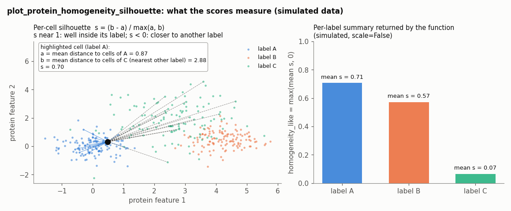
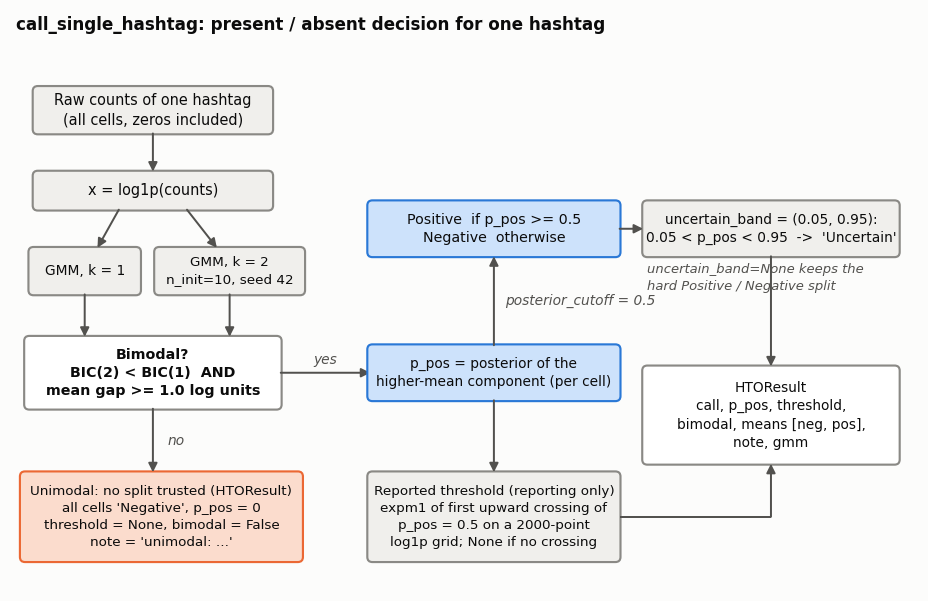
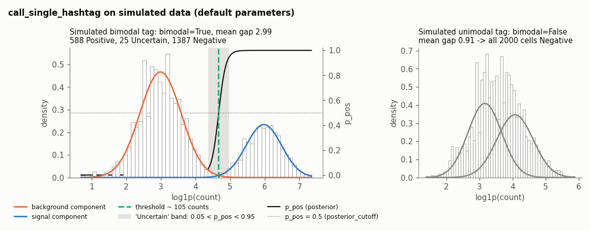

# PRO_Utils

Helpers for the protein (antibody-derived tag, ADT) assay of Tapestri / mosaic `Sample` objects. The package copies
cell-type labels from an annotation table onto `Sample.protein`, plots the protein UMAP with a fixed cell-type palette,
scores how well protein features separate the labels (per-label silhouette), and makes a present/absent QC call for
individual hashtag (HTO) antibodies. It is used in the per-sample analysis notebooks (`03_Sample_Analysis_*.ipynb`),
after protein clustering and cell-type annotation.

## Modules

| Module | Purpose | Main functions |
|---|---|---|
| `update_labels` | Copy labels from a DataFrame onto `Sample.protein.row_attrs` by barcode | `update_protein_labels_from_dataframe` |
| `colors` | Canonical cell-type colour map | `CELLTYPE_COLOR_MAP`, `get_celltype_color` |
| `plot_umap` | Plotly protein UMAP coloured by cell type | `plot_protein_umap` |
| `homogeneity_silhouette` | Per-label silhouette QC of protein features | `plot_protein_homogeneity_silhouette` |
| `hto_calling` | Per-hashtag present/absent calling with a 2-component Gaussian mixture | `call_hto_present_absent`, `call_single_hashtag`, `plot_hashtag_distribution`, `HTOResult` |

All of the above are exported from `PRO_Utils/__init__.py`.

## Typical use

Hashtag QC (single tag, hard Positive/Negative split):

```python
import PRO_Utils

adata_hto, hto_summary, hto_results = PRO_Utils.call_hto_present_absent(
    Sample.protein, ["Hashtag-1"], uncertain_band=None
)
hto_summary
```

Silhouette QC of the annotated protein clusters:

```python
df_pro = Sample.protein.get_attribute('Normalized_reads', constraint='row+col')
cols = list(df_pro.columns.values)
df_pro.loc[:, 'label'] = Sample.protein.row_attrs['Final_annotation']
df_pro = df_pro.loc[:, ['label'] + cols]

per_label_stats, global_h = PRO_Utils.plot_protein_homogeneity_silhouette(df_pro, label_col="label", scale=True)
```

Sync labels and plot the UMAP:

```python
PRO_Utils.update_protein_labels_from_dataframe(
    Sample=Sample, anno_df=pro_df_anno, label_col='label', target_attr='label', verbose=True
)

fig = PRO_Utils.plot_protein_umap(
    Sample=Sample, celltype_column='label',
    outdir=f"{wd}/results/per_sample/{EXPERIMENT}/{PATIENT_ID}/protein/annotation",
    output_filename="Protein_UMAP_celltypes.png",
    point_size=8, width=600, height=600,
)
```

## update_labels

<details>
<summary><b><code>update_protein_labels_from_dataframe</code></b> — Writes labels from <code>anno_df</code> into <code>Sample.protein.row_attrs[target_attr]</code> (via <code>add_row_attr</code>, in place; returns</summary>

`update_protein_labels_from_dataframe(Sample, anno_df, barcode_col=None, label_col='label', target_attr='label', verbose=True)`

Source: [update_labels.py:17](update_labels.py#L17 "update_protein_labels_from_dataframe")

Writes labels from `anno_df` into `Sample.protein.row_attrs[target_attr]` (via `add_row_attr`, in place; returns
`None`). Cells are matched by barcode: the index of `anno_df` when `barcode_col` is `None`, otherwise that column.

- Matched cells get the label from `anno_df[label_col]`. If a barcode appears more than once in `anno_df`, the last
  occurrence wins (the mapping is built with `dict(zip(...))`).
- Unmatched cells keep their current `target_attr` value when that row attribute already exists; otherwise they get
  `'Unknown'`.
- With `verbose=True` it prints the number of cells and labels in the table, matched / not-matched counts and
  percentages, and the resulting label distribution sorted by cell count.
- Raises `ValueError` if `barcode_col` (when given) or `label_col` is not a column of `anno_df`.

</details>

## colors

<details>
<summary><b><code>CELLTYPE_COLOR_MAP / DEFAULT_COLOR</code></b> — <code>CELLTYPE_COLOR_MAP</code> maps 15 canonical cell-type names to hex colours: <code>Erythroid</code>, <code>Pro-Myeloid</code>, <code>HSC_MPP</code>,</summary>

`CELLTYPE_COLOR_MAP, DEFAULT_COLOR`

Source: [colors.py:12](colors.py#L12 "CELLTYPE_COLOR_MAP") · [colors.py:31](colors.py#L31 "DEFAULT_COLOR")

`CELLTYPE_COLOR_MAP` maps 15 canonical cell-type names to hex colours: `Erythroid`, `Pro-Myeloid`, `HSC_MPP`,
`Progenitor`, `CD14_monocyte`, `B`, `NK`, `Mast`, `CD16_monocyte`, `Other_T`, `CD8_T`, `CD4_T`, `Plasma`, `pDC`, `cDC`.
`DEFAULT_COLOR = '#808080'` (grey) is returned for unknown names; note that `cDC` also uses `#808080`, so it is not
visually distinguishable from unknown labels.

</details>

<details>
<summary><b><code>get_celltype_color</code></b> — Returns the hex colour for a cell-type name.</summary>

`get_celltype_color(celltype_name)`

Source: [colors.py:34](colors.py#L34 "get_celltype_color")

Returns the hex colour for a cell-type name. It tries an exact key match first; otherwise it normalises both the query
and every key (lower-case, spaces and hyphens replaced by underscores) and returns the first key that matches, in
mapping order (so `'cd14 monocyte'` and `'pro_myeloid'` resolve). Falls back to `DEFAULT_COLOR`. The argument must be
a string (it calls `.lower()`).

</details>

## plot_umap

<details>
<summary><b><code>plot_protein_umap</code></b> — Reads UMAP coordinates with <code>Sample.protein.get_attribute(umap_attribute, constraint=&#x27;row&#x27;)</code> and labels from</summary>

`plot_protein_umap(Sample, celltype_column='label', outdir=None, output_filename='Protein_UMAP.png', umap_attribute='umap', point_size=5, width=800, height=1000, show_plot=True, verbose=True)`

Source: [plot_umap.py:22](plot_umap.py#L22 "plot_protein_umap")

Reads UMAP coordinates with `Sample.protein.get_attribute(umap_attribute, constraint='row')` and labels from
`Sample.protein.row_attrs[celltype_column]`, then builds a plotly figure with one `go.Scatter` trace per unique label
(in `np.unique` order), coloured by `get_celltype_color`. Axes are hidden, the aspect ratio is fixed 1:1, the
background is white and the legend is horizontal, centred under the plot (200 px bottom margin).

- If `outdir` is given (created if needed), writes `output_filename` as PNG and the same name with `.png` replaced by
  `.pdf`, both at `scale=2` (needs `kaleido`).
- Calls `fig.show()` when `show_plot=True`; with `verbose=True` prints the label → colour mapping with cell counts.
- Returns the `go.Figure`, or `None` (printing the error when verbose) if the coordinates or labels cannot be read.

</details>

## homogeneity_silhouette

<details>
<summary><b><code>plot_protein_homogeneity_silhouette</code></b> — Measures how cleanly the protein features separate the labels, cell by cell, and summarises it per label.</summary>

`plot_protein_homogeneity_silhouette(df_PRO, *, label_col='label', scale=True, figsize=(7, 4), drop_duplicate_columns_after_str_cast=True, save_csv=False, csv_path=None, show_plot=True, verbose=True)`

Source: [homogeneity_silhouette.py:22](homogeneity_silhouette.py#L22 "plot_protein_homogeneity_silhouette")

Measures how cleanly the protein features separate the labels, cell by cell, and summarises it per label.



1. Every column of `df_PRO` except `label_col` is a feature. Feature names are cast to `str`; with
   `drop_duplicate_columns_after_str_cast=True` only the first of any duplicated name is kept. Values are coerced with
   `pd.to_numeric(errors='coerce')` and NaNs set to 0. Labels are cast to `str`.
2. With `scale=True` (default) features are z-scored with `StandardScaler`.
3. `sklearn.metrics.silhouette_samples` (Euclidean) gives each cell `s = (b - a) / max(a, b)`, where `a` is its mean
   distance to cells of its own label and `b` the mean distance to cells of the nearest other label. `s` close to 1
   means the cell sits well inside its label; `s < 0` means it is closer, on average, to another label.
4. Per label: `mean`, `median`, `std`, `count` of `s`, sorted by `mean` descending, plus
   `homogeneity_like = max(mean, 0)`.
5. Draws two matplotlib figures of size `figsize`: a bar chart of `homogeneity_like` per label (y from 0 to 1), and a
   box plot (no fliers) with a strip plot of per-cell silhouettes and a red dashed line at 0. `plt.show()` is called
   after each when `show_plot=True`.
6. With `save_csv=True`, writes `label, mean, std, count` to `csv_path` (its directory is created; `csv_path` is
   required).

Returns `(per_label, global_homogeneity)`. `global_homogeneity` is `homogeneity_score(y, y)`, which is always 1.0; it
is kept only so existing notebook code that unpacks two values keeps working. Raises `KeyError` if `label_col` is
missing and `ValueError` for fewer than 2 unique labels or `save_csv=True` without `csv_path`. Silhouette is
O(n²) in the number of cells, so very large assays are slow.

</details>

## hto_calling

Each hashtag is scored independently as present/absent. This is a QC call, not demultiplexing: no cross-tag
information is used, so doublets cannot be identified.

<details>
<summary><b><code>call_single_hashtag</code></b> — Calls one hashtag.</summary>

`call_single_hashtag(counts, posterior_cutoff=0.5, uncertain_band=(0.05, 0.95), min_mean_separation=1.0, n_init=10, random_state=42)`

Source: [hto_calling.py:101](hto_calling.py#L101 "call_single_hashtag")

Calls one hashtag. `counts` is a `pd.Series` of raw counts indexed by barcode; its `.name` becomes the tag name.
Returns an `HTOResult`.



1. `x = log1p(counts)` for all cells (zeros included; they are the cleanest negatives).
2. Fit a 1-component and a 2-component Gaussian mixture to `x` (the 2-component fit uses `n_init=10` restarts and
   `random_state=42`).
3. The tag is **bimodal** only if `BIC(2) < BIC(1)` **and** the two component means (log units) are at least
   `min_mean_separation = 1.0` apart.
4. Not bimodal: every cell is `'Negative'`, `p_pos` is all zeros, `threshold=None`, `bimodal=False`, and `note`
   explains that no split was found.
5. Bimodal: `p_pos` is each cell's posterior probability of the higher-mean component. Cells with
   `p_pos >= posterior_cutoff` (0.5) are `'Positive'`, the rest `'Negative'`.
6. With `uncertain_band=(0.05, 0.95)`, cells with `0.05 < p_pos < 0.95` (strict) are then relabelled `'Uncertain'`.
   Pass `uncertain_band=None` for a hard two-way split (as the notebooks do).
7. `threshold` is for reporting only: on a 2000-point grid over the observed `log1p` range, the first point where the
   posterior goes from below to at/above the cutoff, converted back with `expm1`; `None` if there is no upward crossing.
   Calls always use each cell's own posterior, which can differ from a single count cut when the two components have
   unequal variances.

The real function on simulated data (left: a clear two-population tag; right: a tag whose fitted means are 0.91 log
units apart, below the 1.0 minimum, so nothing is thresholded):



</details>

<details>
<summary><b><code>call_hto_present_absent</code></b> — Runs <code>call_single_hashtag</code> on each tag in <code>hashtags</code> (extra keyword arguments are forwarded, e.g.</summary>

`call_hto_present_absent(assay, hashtags, plot=True, verbose=True, **call_kwargs)`

Source: [hto_calling.py:194](hto_calling.py#L194 "call_hto_present_absent")

Runs `call_single_hashtag` on each tag in `hashtags` (extra keyword arguments are forwarded, e.g.
`uncertain_band=None`). Counts come from `assay.get_attribute('read_counts', constraint='row+col')`; if that raises,
from `assay.to_df()` or an AnnData-style `X` / `obs_names` / `var_names`. Raises `KeyError` listing missing tags and the
available columns.

Returns `(adata, summary, results)`:

- `adata`: `AnnData` of the selected tags' raw counts (`X` as float32). `.obs` holds the raw count per tag
  (`obs[tag]`), `obs[f"{tag}_p_pos"]`, the categorical call `obs[f"{tag}_call"]` (categories Negative / Uncertain /
  Positive) and `obs["n_positive"]`, the number of tags called Positive in that cell (not a demultiplexing
  assignment).
- `summary`: one row per hashtag (index `hashtag`) with `bimodal`, `n_positive`, `pct_positive`, `n_uncertain`,
  `threshold_count` (rounded to 0.1, or `None`), `mean_neg_log`, `mean_pos_log`, `note`.
- `results`: `dict` of tag → `HTOResult`.

With `verbose=True` prints one line per tag (bimodal flag, positive count and %, uncertain count, threshold, note);
with `plot=True` draws `plot_hashtag_distribution` for each tag (no `plt.show()` is called).

</details>

<details>
<summary><b><code>plot_hashtag_distribution</code></b> — Histogram (100 bins, density) of <code>log1p(counts)</code> with the fitted mixture density, each weighted component (dotted) and</summary>

`plot_hashtag_distribution(counts, result, ax=None)`

Source: [hto_calling.py:299](hto_calling.py#L299 "plot_hashtag_distribution")

Histogram (100 bins, density) of `log1p(counts)` with the fitted mixture density, each weighted component (dotted) and
a dashed vertical line at `log1p(threshold)` when a threshold exists. Unimodal tags get `[UNIMODAL — not thresholded]`
in the title. Creates an 8 × 5 inch figure when `ax` is `None`; returns the axes.

</details>

<details>
<summary><b><code>HTOResult</code></b> — Dataclass for one tag: <code>hashtag</code>, <code>call</code> (object array of <code>&#x27;Positive&#x27;</code> / <code>&#x27;Negative&#x27;</code> / <code>&#x27;Uncertain&#x27;</code>), <code>p_pos</code>,</summary>

`HTOResult`

Source: [hto_calling.py:45](hto_calling.py#L45 "HTOResult")

Dataclass for one tag: `hashtag`, `call` (object array of `'Positive'` / `'Negative'` / `'Uncertain'`), `p_pos`,
`threshold` (raw count or `None`), `bimodal`, `means` (sorted log-space component means `[negative, positive]`),
`note`, and `gmm` (the fitted 2-component `GaussianMixture`, hidden from the repr).

</details>

<details>
<summary><b>Private helpers</b> (1 entries)</summary>

| Name | Purpose |
|---|---|
| `_extract_hto_counts(assay, hashtags)` | Return raw counts for the tags as a cells × tags DataFrame copy, with the fallbacks described above; `KeyError` on missing tags. |

</details>

## Known quirks

Documented behaviour that looks unintended; not changed by the refactor.

- `update_labels.py:update_protein_labels_from_dataframe` — an assay with zero cells raises `ZeroDivisionError`, even
  with `verbose=False` (the matched/not-matched percentages are always computed).
- `update_labels.py:update_protein_labels_from_dataframe` — numeric labels raise `ValueError` in the verbose label
  summary (`{label:20s}` formatting).
- `update_labels.py:update_protein_labels_from_dataframe` — looking up the existing label of each unmatched cell scans
  all barcodes, so it is O(n²) and slow on large assays with many unmatched cells.
- `colors.py:get_celltype_color` — non-string labels (e.g. numpy integers) raise `AttributeError` instead of falling
  back to grey; `plot_protein_umap` inherits this.
- `homogeneity_silhouette.py:plot_protein_homogeneity_silhouette` — the "fewer than 2 rows" check is unreachable (the
  "fewer than 2 unique labels" check fires first); a bare-filename `csv_path` fails because `os.makedirs('')` raises.
- `hto_calling.py:call_hto_present_absent` — the verbose line prints the threshold only when it is truthy, so a
  threshold of exactly 0.0 is not shown.

## Tests

From the pipelines folder:

```bash
~/miniconda3/envs/mosaic/bin/python -m pytest -c tests/pytest.ini tests/test_pro*
```

(`test_pro_colors.py`, `test_pro_hto_calling.py`, `test_pro_plotting.py`, `test_pro_update_labels.py`; fakes for the
`Sample` object are in `tests/_cnv_pro_fakes.py`.)

## Regenerating figures

From the pipelines folder:

```bash
~/miniconda3/envs/mosaic/bin/python docs/make_PRO_Utils_figures.py
```

This rewrites `PRO_Utils/docs/hto_decision_flow.png`, `hto_simulated_fit.png` and `silhouette_schematic.png`. The two
data figures run the package's real `call_single_hashtag` and `plot_protein_homogeneity_silhouette` on simulated data.
